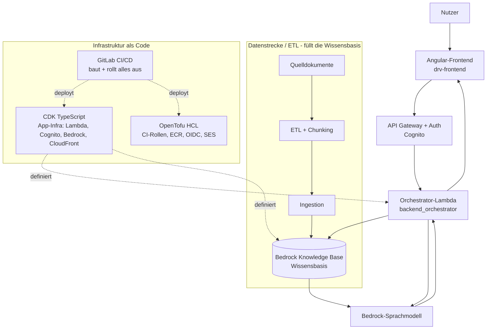

# Onboarding: Einstieg bei Team Red / Renate

**Start:** Montag · **Zeitrahmen dieses Plans:** bis Ende August (Abschluss der Ausbildung)
**Fokus:** erfolgreicher Ausbildungsabschluss, aufgebaut auf echtem Hands-on an unserem System.

Dieses Dokument richtet sich an dich als neues Teammitglied. Es beschreibt, was in den ersten Wochen zu verstehen und abzuliefern ist, welche Technologien wir einsetzen und wo du sie lernen kannst.

**Zur Einordnung:** Wir gehen davon aus, dass du aus der Ausbildung kommst und hier zum ersten Mal an einem echten Produktivsystem arbeitest. Genau dafür ist dieser Plan da. Du wirst in kurzer Zeit sehr viel lernen. Unsere Erwartungen und Ansprüche sind hoch - das ist bewusst so. Wir trauen dir zu, dich eigenständig und ambitioniert durch die Grundlagen zu arbeiten, und dieser Plan gibt dir alles dafür an die Hand.

Der Plan ist in zwei Dateien geteilt:
- **01 (dieses Dokument):** Wochenplan, Lernpfad, Technologie-Steckbriefe mit Tutorials, Arbeitspakete, Definition of Done.
- **02:** Arbeitsmodell, Zugänge, Deployment-Regeln, Leitplanken (siehe `02-arbeitsmodell-und-leitplanken.md`).

---

## 0. Leitplanken (gelten ab Tag 1)

- **Dev-Account ab Tag 1, keine Admin-Rechte.** Alles wird selbst erkundet, nichts wird manuell in Prod/QA angefasst.
- **Nur Feature- und Review-Branches.** Kein direkter Push auf `master`. Jede Änderung geht über einen Merge Request.
- **Deployments ausschließlich über GitLab CI/CD.** Kein manuelles `make cdk-deploy` von Hand.
- **Erst selbst versuchen, dann fragen.** Als Faustregel: etwa 15 Minuten selbst ansetzen, bevor du nachfragst - aber auch nicht tagelang festbeißen.
- **Alles Neue in einem eigenen Branch ausprobieren.** Experimente danach aufräumen.
- **Eigenständig durcharbeiten, ohne KI-Assistenten.** In dieser Phase geht es darum, die Grundlagen wirklich selbst zu verstehen - was passiert, warum es passiert, und was ein Ergebnis bedeutet. Wer alles blind von einem Werkzeug erledigen lässt, baut dieses Verständnis nicht auf.

---

## 1. Zielbild in einem Satz

Renate ist ein **RAG-Chatbot** (Retrieval Augmented Generation): Nutzerfrage rein, passende Textstellen aus einer Wissensbasis werden gesucht, ein Sprachmodell (AWS Bedrock) baut daraus eine belegte Antwort. Alles läuft serverless in AWS, die Infrastruktur ist Code, ausgerollt wird nur über Pipelines.

### Wie die Teile zusammenhängen

**Wichtig:** Zwei IaC-Werkzeuge leben nebeneinander.
- **CDK (TypeScript)** baut die **App** (Lambda, DynamoDB, Buckets, API, Cognito, Knowledge Base) - nah am Anwendungscode.
- **OpenTofu (HCL)** baut die **Plattform/CI-Schicht** (GitLab-OIDC, ECR, Deploy-Rollen, SES-Mail).
- Welcher Code wo hingehört, steht im Monorepo unter `docs/` - das ist die verbindliche Quelle.

---

## 2. Lernpfad mit Technologie-Steckbriefen

Jeder Block: **was es ist**, **warum wir es nutzen**, **ein Hands-on-Tutorial**. Reihenfolge = empfohlene Lernreihenfolge. Nicht alles muss tief sitzen - das Ziel in den ersten Wochen ist, jeden Begriff sicher einordnen zu können.

### 2.1 Git und GitLab (zuerst, nicht überspringen)
**Was:** Versionsverwaltung. Git speichert Codestände, GitLab ist der Server dafür plus Pipelines, Reviews, Wiki.
**Warum bei uns:** Alles liegt auf `gitlab.kilab-platform.de`. Jede Änderung = Branch + Merge Request. Ohne das geht nichts.
**Tutorials (in dieser Reihenfolge):**
- [GitLab: Make your first Git commit](https://docs.gitlab.com/tutorials/make_first_git_commit/) - vom ersten Commit bis zum ersten MR, Schritt für Schritt.
- [GitLab: Get started with Git](https://docs.gitlab.com/topics/git/get_started/) - Branches, commit, push, pull erklärt.
- [GitLab Tutorials-Übersicht](https://docs.gitlab.com/tutorials/) - weiterführend.

### 2.2 Python (unser Backend)
**Was:** Programmiersprache. Die Lambda-Handler sind Python 3.12.
**Warum bei uns:** `backend/` (Orchestrator, Auth, ETL) ist komplett Python. Paket-Tool ist `uv`, Tests mit `pytest`, Linting mit `ruff`.
**Tutorial:**
- [Das offizielle Python-Tutorial](https://docs.python.org/3/tutorial/) - Grundlagen bis Module und Fehlerbehandlung.
- Zusatz für uns: `uv` kurz anschauen (`pyproject.toml`, `uv sync`) - steht im `backend/README.md`.

### 2.3 Docker und Container
**Was:** Eine Anwendung samt Umgebung in ein wiederholbares "Paket" (Image) stecken.
**Warum bei uns:** Orchestrator und ETL werden als Container-Lambdas ausgeliefert (Dockerfiles in `backend/src/backend_orchestrator/` und `backend/src/etl/`).
**Tutorial:**
- [Docker: Get started](https://docs.docker.com/get-started/) - von "was ist ein Container" bis Image bauen.

### 2.4 AWS-Grundlagen
**Was:** Die Cloud-Plattform, auf der alles läuft.
**Warum bei uns:** Renate ist komplett serverless in AWS (Lambda, S3, DynamoDB, Cognito, Bedrock, CloudFront). Account-Zugang kommt über SSO.
**Tutorials:**
- [AWS Cloud Practitioner Essentials (kostenlos, Skill Builder)](https://explore.skillbuilder.aws/learn/course/external/view/elearning/134/aws-cloud-practitioner-essentials) - Kernservices, Preise, Architektur für Einsteiger.
- [AWS Getting Started Resource Center](https://aws.amazon.com/getting-started/) - kuratierte Hands-on-Guides.

### 2.5 Infrastructure as Code (IaC) - Konzept
**Was:** Infrastruktur (Server, Datenbanken, Rollen) als versionierten Code statt Klick im Web.
**Warum bei uns:** Nichts wird von Hand in der AWS-Konsole gebaut. Alles ist Code, alles geht durch Review und Pipeline.
**Tutorial:**
- [AWS: Was ist IaC?](https://aws.amazon.com/what-is/iac/) - herstellerneutrale Einordnung.

### 2.6 OpenTofu (unsere Plattform-/CI-Infra)
**Was:** Open-Source-Werkzeug für IaC in HCL (der freie Terraform-Fork). Wir nutzen **OpenTofu 1.11**, nicht HashiCorp-Terraform.
**Warum bei uns:** Die `terraform/`-Verzeichnisse und die Repos `renate/bootstrap` und `renate/tofu-modules` sind OpenTofu. Damit bauen wir CI-Rollen, ECR, OIDC, SES.
**Tutorials:**
- [OpenTofu: Getting started](https://opentofu.org/docs/intro/) - Installation, erste Schritte.
- [Terraform Get Started - AWS (HashiCorp)](https://developer.hashicorp.com/terraform/tutorials/aws-get-started) - die Syntax ist identisch; gutes Hands-on zum `plan`/`apply`-Zyklus. Nur `terraform` durch `tofu` ersetzen.

### 2.7 AWS CDK mit TypeScript (unsere App-Infra)
**Was:** Infrastruktur in einer echten Programmiersprache (hier TypeScript) beschreiben, CDK erzeugt daraus CloudFormation.
**Warum bei uns:** `cdk/` definiert die App-Infrastruktur (Lambda, Cognito, CloudFront, Bedrock Knowledge Base). Tests mit Jest.
**Tutorials:**
- [AWS CDK Workshop (TypeScript)](https://cdkworkshop.com/) - baut eine echte App von null bis Deploy.
- [AWS CDK Getting Started (Developer Guide)](https://docs.aws.amazon.com/cdk/v2/guide/getting-started.html) - Setup und Kernkonzepte.

### 2.8 GitLab CI/CD (wie bei uns ausgerollt wird)
**Was:** Pipelines, die bei jedem Push automatisch testen, bauen und deployen.
**Warum bei uns:** Der einzige reguläre Deploy-Weg. AWS-Login in Pipelines läuft über OIDC (keine statischen Schlüssel). `tofu apply` in Prod ist manuell gated.
**Tutorials:**
- [GitLab: Create your first pipeline](https://docs.gitlab.com/tutorials/create_first_pipeline/) - erste `.gitlab-ci.yml`.
- [GitLab CI/CD Doku-Einstieg](https://docs.gitlab.com/ci/) - Pipelines, Jobs, Stages.

### 2.9 RAG und Amazon Bedrock (das Herz von Renate)
**Was:** RAG = Antworten mit gesuchten Belegstellen statt reinem Modellwissen. Bedrock = AWS-Dienst, der die Sprachmodelle und die Knowledge Base bereitstellt.
**Warum bei uns:** Das ist Renates Kern. Hier geht es am Ende am tiefsten rein - aber erst, wenn Git/Python/AWS sitzen.
**Tutorials:**
- [AWS: Was ist RAG?](https://aws.amazon.com/what-is/retrieval-augmented-generation/) - einsteigerfreundlich.
- [IBM Research: RAG überblick](https://research.ibm.com/blog/retrieval-augmented-generation-RAG) - etwas tiefer.
- [Amazon Bedrock: Getting Started (Doku)](https://docs.aws.amazon.com/bedrock/latest/userguide/getting-started.html)
- [Amazon Bedrock Workshop (Hands-on)](https://catalog.us-east-1.prod.workshops.aws/workshops/a4bdb007-5600-4368-81c5-ff5b4154f518/en-US) - Labs zu Text, Embeddings, Agenten.

---

## 3. Wochenplan (erste 4 Wochen)

### Woche 1 - Ankommen, Werkzeug, Systemverständnis
**Abzuliefern:** Rechner läuft, GitLab-Zugang steht, die Architektur kann in eigenen Worten erklärt werden.
- Zugänge: Laptop, SSO/authentik, GitLab-Login über den "sign in with"-Knopf (nicht das normale Passwortfeld - das SSO-Passwort gehört dort nicht hin), AWS-Dev-Zugang.
- Lokales Setup: Repo `renate/digibro-monorepo` klonen, `make install`, `make test` einmal grün bekommen. (Voraussetzung: Python 3.12 + `uv`.)
- Lernpfad 2.1 (Git/GitLab) + 2.2 (Python) durcharbeiten.
- `docs/` lesen: `README.md`, `CONTRIBUTING.md`, `arc42-architektur.md`, `aws-architecture-overview.md`. Das `docs/`-Verzeichnis ist die verbindliche Quelle.
- **Mini-Aufgabe:** Ein Architekturdiagramm der Datenstrecke selbst skizzieren (Quelle -> ETL -> Chunks -> Ingestion -> KB -> Antwort) und mit dem Mentor abgleichen.

### Woche 2 - Erster Merge Request, CI/CD verstehen
**Abzuliefern:** Ein erster echter (kleiner) MR ist durch die Pipeline gegangen.
- Lernpfad 2.3 (Docker-Überblick) + 2.8 (GitLab CI/CD).
- Eine echte Pipeline im Monorepo anschauen: Stages lesen (`validate -> tofu-plan -> tofu-apply -> build -> deploy`), eine vergangene Pipeline durchklicken.
- Branch-/Commit-Konventionen lernen: Branch `<type>/<kurzbeschreibung>`, Conventional Commits (`feat(scope): ...`), pre-commit-Hook läuft - **kein `--no-verify`**.
- **Erstes Arbeitspaket (siehe Abschnitt 4), Kategorie A.** Ziel ist nicht Umfang, sondern den ganzen Weg einmal zu gehen: Branch, Änderung, Commit, MR, Review-Deployment, Review-Kommentare einarbeiten.

### Woche 3 - AWS und IaC anfassen
**Abzuliefern:** Verständnis, wo welche Infrastruktur herkommt; sicheres lesendes Umsehen im Dev-Account.
- Lernpfad 2.4 (AWS) + 2.5 (IaC-Konzept) + 2.6 (OpenTofu) + 2.7 (CDK).
- Im Dev-Account lesend umsehen: welche Lambdas, Buckets, die Knowledge Base - und im Code (`cdk/lib/`, `terraform/live/dev/`) finden, wo genau sie definiert sind.
- **Provisionierungs-Übung:** Für 3 Ressourcen (z.B. eine Lambda, ein Bucket, eine CI-Rolle) herausfinden: CDK oder OpenTofu? Welche Datei? Als kurze Tabelle dokumentieren.
- **Zweites Arbeitspaket, Kategorie A oder B.**

### Woche 4 - RAG/Bedrock und eigenständigere Aufgabe
**Abzuliefern:** Grobes Verständnis des RAG-Kerns; eine etwas größere kleine Aufgabe eigenständig durchgezogen.
- Lernpfad 2.9 (RAG + Bedrock), inkl. einem Lab aus dem Bedrock-Workshop.
- Eine echte Frage durch Renate verfolgen: Frage -> welche Chunks kommen zurück -> wie baut der Orchestrator die Antwort.
- **Drittes Arbeitspaket, Kategorie B.** Scope, Umsetzung und MR werden jetzt weitgehend selbst getragen, mit Review durch den Mentor.

---

## 4. Arbeitspakete - Kategorien (für die ersten Wochen)

Keine festen Tickets, sondern ein Raster, aus dem der Mentor passende echte Kleinigkeiten zieht. Steigerung A -> C.

| Kat. | Was | Zweck | Beispiele |
|------|-----|-------|-----------|
| **A** | Doku / Text / Config, kein Laufzeit-Risiko | Den MR-Weg lernen | Tippfehler/veralteten Link in `docs/` fixen, README-Beispiel ergänzen, einen fehlenden docstring |
| **B** | Kleine Code- oder Teständerung mit sichtbarem Effekt | Code lesen + ändern + testen | Einen Testfall ergänzen, eine kleine Validierung im ETL, ein Log-Detail verbessern, ein `ruff`-Finding beheben |
| **C** | Kleines, abgegrenztes Feature/Fix mit Review-Deployment | Eigenständigkeit | Ein kleines Orchestrator-Detail, eine CI-Script-Verbesserung, eine kleine Frontend-Korrektur |

**Regel für die Auswahl:** reversibel, eng geschnitten, mit klarem "fertig wenn". Jedes Paket bekommt vorab eine Mini-Abmachung: Branch / Scope / nicht im Scope / fertig wenn.

---

## 5. Definition of Done (für einen MR)

Ein MR gilt als fertig, wenn:
1. Eigener Feature-Branch, Conventional-Commit-Nachricht, pre-commit-Hook grün (ohne `--no-verify`).
2. Tests laufen lokal und in der Pipeline grün (`make test` bzw. die passenden Lanes).
3. Bei Laufzeitänderung: im Review-Deployment verifiziert, nicht nur lokal.
4. MR-Beschreibung erklärt **was** und **warum** - kurz, aber nachvollziehbar.
5. Review-Kommentare eingearbeitet, keine offenen Diskussionen.

---

## 6. Erwarteter Stand nach 4 Wochen

- Renate lässt sich high-level erklären: RAG, die Datenstrecke, App vs. Plattform-Infra.
- Mehrere kleine MRs sind selbstständig durch die Pipeline gegangen.
- Sicheres lesendes Zurechtfinden im Dev-Account; klar, wo Ressourcen im Code definiert sind.
- Die Leitplanken sind bekannt und werden eingehalten (Branches, CI-only-Deploy, kein `--no-verify`).
- Ein grober Plan steht, in welche Richtung die Vertiefung in den nächsten Monaten geht.

---

## 7. Bogen bis Ende August (Ausbildungsabschluss)

Vorrangiges Ziel ist der erfolgreiche Ausbildungsabschluss. Darauf baut dieser Bogen auf. Die Ansprüche sind bewusst hoch gesetzt - gerade weil hier zum ersten Mal an einem echten Produktivsystem gearbeitet wird, ist in dieser Zeit sehr viel Lernfortschritt möglich.

- **Monat 1-2:** Grundlagen sitzen (Git, Python, AWS-/IaC-Einordnung). Kleine MRs der Kategorie A/B laufen selbstständig, Review-Feedback wird kürzer.
- **Monat 3-4:** Fremder Code wird sicher gelesen. Ein kleiner Zuständigkeitsbereich wird übernommen (z.B. ein ETL-Detail oder ein Satz Tests).
- **Monat 5 bis Ende August:** Mitarbeit an echten Aufgaben, der RAG-Kern wird so weit verstanden, dass Qualitätsprobleme eigenständig eingegrenzt werden können.

**Ambitioniertes Ziel (Feuertaufe):** ein kleiner, klar abgegrenzter Fix oder ein kleines Feature (Kategorie C) wird eigenständig umgesetzt und bis durch das Review-Deployment gebracht - ohne enge Begleitung. Das ist bewusst hoch angesetzt; es zeigt, dass der ganze Weg vom Verstehen bis zum verifizierten Deploy selbstständig beherrscht wird.
