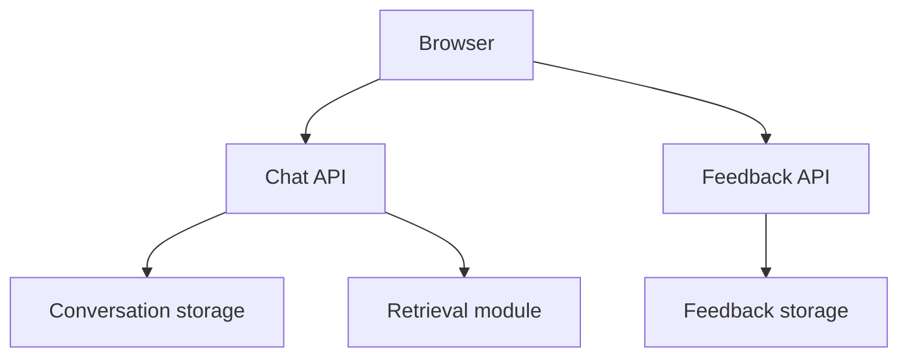

# Application components, monoliths, and microservices

[Chapter index](README.md) · [Library index](../README.md) · [Previous lesson](../01-foundations/04-aws-accounts-and-locations.md) · [Next lesson](../02-architecture/02-mainframes-and-applications.md)

This is an **architecture-style** lesson: it explains how application responsibilities are organised and deployed.

> **In one sentence:** Frontend and backend describe responsibilities; monolith and microservices describe how application responsibilities are packaged and deployed.

## Learning objectives

Separate a code module from a deployed service and recognise the trade-offs of splitting an application.

## Why it matters

A repository with many folders is not automatically a microservice system. Understanding deployment boundaries helps you predict the impact of a change.

## Mental model

The **frontend** provides the user interface. An **API** defines an interaction boundary. The **backend** performs business operations and coordinates data access. A **database** stores and retrieves structured application data.

A **monolith** packages substantial application functionality into one deployment unit. A **modular monolith** keeps clear internal modules while still deploying them together. **Microservices** split capabilities into separately deployable services communicating over explicit interfaces.

These descriptions do not determine the hardware. A monolith can run in a container; microservices can run on VMs. Several Lambda functions can also form a tightly coupled system if every change requires deploying them together.

## Worked example and walkthrough

Our Helpdesk backend has three modules:

```text
backend/
  conversations.py
  search.py
  feedback.py
```

In a modular monolith, one deployment contains all three. A request can call Python functions directly between modules.

If feedback becomes a separate service:

1. The chat backend or frontend calls its API.
2. The feedback service validates and stores feedback.
3. That service can be released independently.
4. The team must handle network failures, API compatibility, and access between services.



This illustrates separate feedback deployment, not a rule that every module deserves a service. A split is useful when independent change, scaling, or ownership justifies the extra coordination.

## Common mistakes

Microservices are not automatically more mature. A small team may understand and operate a modular monolith more easily.

A shared database can introduce coupling even when services deploy separately. Multiple repositories do not guarantee independence, and one monorepo can contain several independent services.

## Practice

“Changing feedback requires redeploying the whole backend.” What does this suggest? Expected: feedback is part of the same deployment unit, or the system is operationally coupled. Folder count alone cannot settle it.

## Self-check

- [ ] I can identify a deployment boundary in a diagram.
- [ ] I can explain one benefit and one cost of splitting a service.

## Related notes and sources

- [[Terms]] and [[Glossary]] for short definitions.
- [Chapter index](README.md)
- [Library index](../README.md)
- [AWS: monolithic and microservice architecture](https://aws.amazon.com/compare/the-difference-between-monolithic-and-microservices-architecture/)

Documentation consulted 2026-11-25. Examples are educational drafts; service features and tool behaviour can change.
