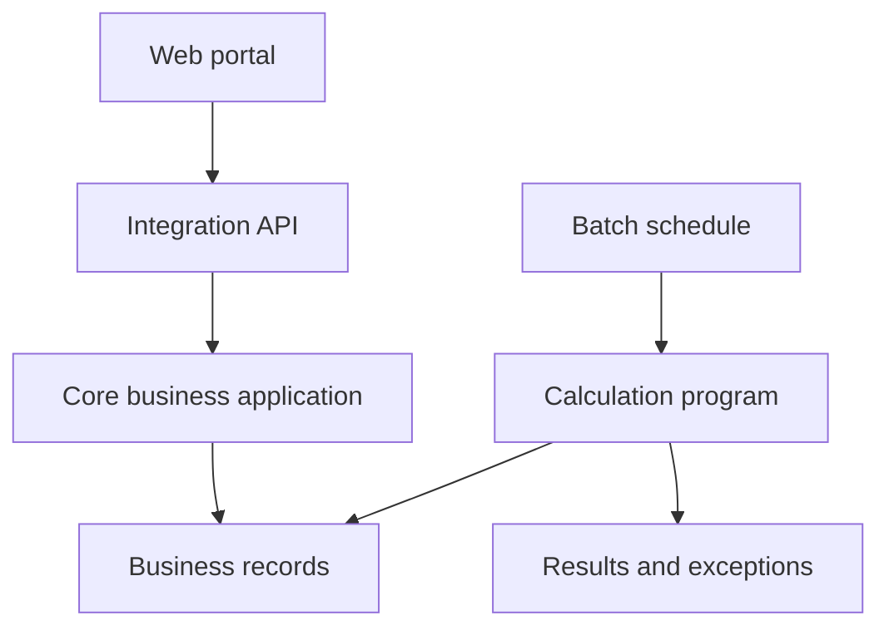

# Mainframes: what runs there, and why they still fit

[Chapter index](README.md) · [Library index](../README.md) · [Previous lesson](../02-architecture/01-components-monolith-microservices.md) · [Next lesson](../03-networking/01-vpc-subnets-routes-gateways.md)

This is a **platform** lesson: it explains a computing environment that can host many different applications.

> **In one sentence:** A mainframe is a computing platform for running important workloads, often including large volumes of transactions and batch processing.

## Learning objectives

Explain the difference between a mainframe and an application, and describe how a web application can interact with mainframe systems.

## Why it matters

In a large organisation, a new web interface may rely on established business systems. Understanding this makes “the frontend is modern, but the core runs on a mainframe” a meaningful statement.

## Mental model

Think of the mainframe as a specialised computing environment, not one enormous program. It supplies processing, memory, storage connections, and operating-system services. Multiple applications can run there.

For example, IBM Z is a mainframe platform family; z/OS is an operating system used on it. Applications implement business rules. A transaction monitor such as CICS helps manage large numbers of short business operations. A database holds the records those applications use.

You do not need to learn these products now. The layers matter:

| Layer | What it answers |
| --- | --- |
| Computing platform | Where does the work execute? |
| Operating system | How are resources and programs managed? |
| Transaction or batch infrastructure | How is work submitted and coordinated? |
| Business application | What business rules are applied? |
| Data | What information is read or changed? |

Reliability, throughput, established data, and decades of tested business rules can make these systems valuable. “Old” code can carry substantial organisational knowledge. That does not make every old design good, but rewriting it requires understanding its behaviour.

## Worked example and walkthrough

Imagine a fictional benefits organisation with a web portal and a core record system.

**Interactive transaction:**

1. A user opens the portal and requests their current contact address.
2. The portal backend authenticates the request.
3. Through an approved integration API, it requests that record from a core application.
4. The core application reads the relevant data.
5. The result returns to the portal.

This is **online transaction processing**: a request gets a timely business result. “Online” here does not require a public Internet website.

**Batch processing:**

1. A scheduled job selects all records due for a monthly calculation.
2. Programs validate inputs and apply business rules.
3. The system writes results and produces a report.
4. Operators inspect failures and handle records needing attention.

Batch work processes a collection without a person clicking each item. It may run overnight, but “batch” does not mean “only at night”.

The core application, batch program, and records could be hosted in a mainframe environment. The portal could run elsewhere. This is a fictional integration example, not a description of a particular employer.

## How this relates to the other lessons

**Mainframe** describes a platform. **Monolith** describes application structure. **Microservices** describe service boundaries. **Serverless** describes a provider-managed execution approach.

A mainframe can host multiple applications and expose APIs. A monolith can run in AWS. Moving code to a cloud provider does not automatically split it into microservices or preserve all its existing guarantees.

A chatbot could call a carefully designed API to request permitted information from a core system. The language model should not receive unrestricted database access merely because it can formulate a request.

## Common mistakes

A mainframe is not just “a central database”, “an obsolete PC”, or “another word for monolith”. COBOL is a programming language often associated with such systems, not the hardware itself.

A failed batch rerun can repeat changes unless the job has restart and duplicate-handling rules. Operational procedures matter alongside source code.

## Practice

Classify these phrases: “monthly calculation”, “IBM Z”, “one deployable backend”, “browser portal”.

Expected: workload; computing platform; application structure; user interface. None alone tells you where every other part runs.

## Self-check

- [ ] I can describe an application running on a mainframe.
- [ ] I can distinguish interactive transactions from batch work.
- [ ] I can explain why a modern web frontend may retain a mainframe backend.

## Related notes and sources

- [[Terms]] and [[Glossary]] for short definitions.
- [Chapter index](README.md)
- [Library index](../README.md)
- [IBM: What is a mainframe?](https://www.ibm.com/think/topics/mainframe)
- [IBM: batch and online transaction workloads](https://www.ibm.com/docs/en/zos-basic-skills?topic=today-mainframe-workloads-batch-online-transaction-processing)
- [IBM: mainframe transaction systems](https://www.ibm.com/docs/en/zos-basic-skills?topic=zos-transaction-systems-mainframe)

Documentation consulted 2026-11-25. Examples are educational drafts; service features and tool behaviour can change.
