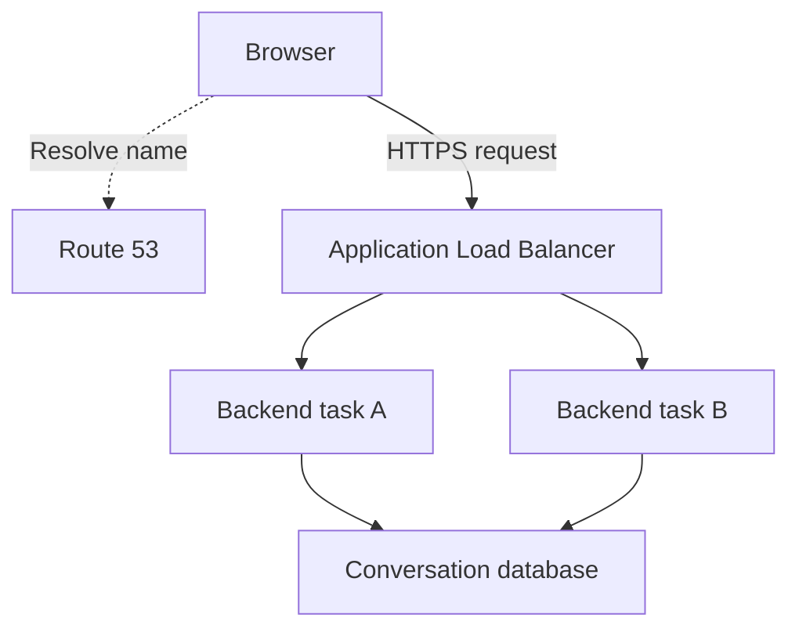

# DNS, HTTPS, Route 53, and load balancing

[Chapter index](README.md) · [Library index](../README.md) · [Previous lesson](../03-networking/02-inbound-outbound-and-filters.md) · [Next lesson](../04-storage-and-delivery/01-s3-hosting-and-dynamodb.md)

This is a **concept** lesson: it connects ideas and responsibilities rather than teaching one command.

> **In one sentence:** DNS helps find an endpoint; HTTPS carries protected requests; a load balancer distributes requests across eligible targets.

## Learning objectives

Recognise each component’s role and locate common connection failures.

## Why it matters

A user sees one address, but several independently configured services may sit behind it.

## Mental model

**DNS** maps names to information needed to reach services. **Route 53** is an AWS DNS service. It does not normally carry each HTTP request after name resolution.

**HTTP** defines requests and responses. **HTTPS** uses TLS to protect that exchange and authenticate the server using certificates. It does not itself prove that the caller may read a particular conversation.

**Elastic Load Balancing (ELB)** is a family of managed load-balancing services. An **Application Load Balancer (ALB)** can route HTTP requests using information such as hostnames and URL paths.

## Worked example and walkthrough

Imagine a container-based version of Helpdesk:

1. The browser resolves the application name.
2. It establishes a TLS connection to the exposed endpoint.
3. The load balancer selects an eligible target.
4. A backend task handles the request.
5. The response returns through the load balancer.

Health checks help determine whether targets should receive traffic. A basic “process is alive” check does not prove every dependency works.

For a Lambda-based API, API Gateway is another possible front door. You do not need to put an ALB in front of every Lambda. CloudFront can also sit in front of an application for content delivery.

## Common mistakes

DNS is not a reverse proxy forwarding every request. Changing DNS also does not immediately change every client’s cached answer.

TLS can terminate at the load balancer. Whether the next connection to the backend is encrypted is a separate configuration choice.

Load balancing cannot make incompatible application versions compatible or fix incorrect shared-data assumptions.

## Practice

The hostname resolves, but the certificate does not match it. Which layer needs investigation? Expected: TLS/certificate and endpoint configuration, not primarily database queries.

## Self-check

- [ ] I can explain DNS versus request forwarding.
- [ ] I can explain why multiple backend instances need consistent shared data.

## Related notes and sources

- [[Terms]] and [[Glossary]] for short definitions.
- [Chapter index](README.md)
- [Library index](../README.md)
- [Route 53](https://docs.aws.amazon.com/Route53/latest/DeveloperGuide/Welcome.html)
- [Elastic Load Balancing](https://docs.aws.amazon.com/elasticloadbalancing/latest/userguide/what-is-load-balancing.html)

Documentation consulted 2026-11-25. Examples are educational drafts; service features and tool behaviour can change.
