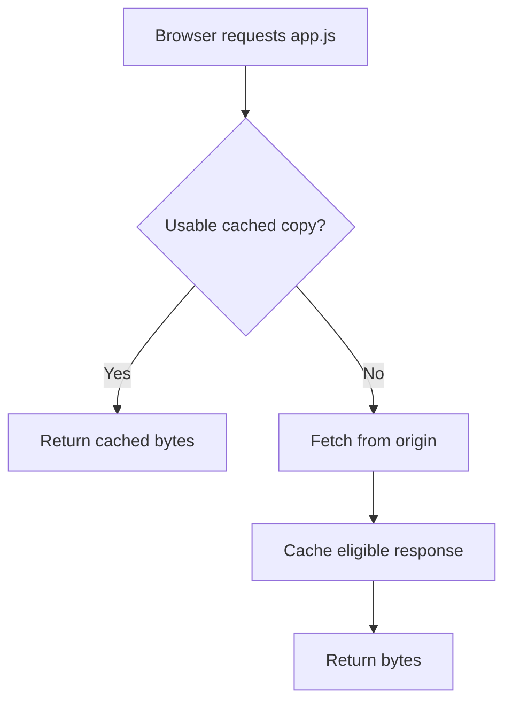

# Cache, CDN, CloudFront, and edge locations

[Chapter index](README.md) · [Library index](../README.md) · [Previous lesson](../04-storage-and-delivery/01-s3-hosting-and-dynamodb.md) · [Next lesson](../05-compute/01-lambda-execution.md)

This is a **concept** lesson: it connects ideas and responsibilities rather than teaching one command.

> **In one sentence:** A cache keeps a reusable copy of a result so a later request can avoid repeating the original work.

## Learning objectives

Explain hits, misses, expiry, and invalidation, and place a CDN in the website-delivery path.

## Why it matters

Caching improves speed and reduces repeated work, but it also explains why users sometimes see old content after deployment.

## Mental model

A **cache hit** finds a usable saved result. A **cache miss** means the requested result is unavailable or unusable, so it must be fetched or computed.

A **TTL**, or time to live, sets a freshness/lifetime rule in a particular system. **Invalidation** makes an existing cached entry unusable before it would otherwise expire.

Caching is a general technique: a CPU caches data, a program caches calculations, and a browser caches downloaded files. A **CDN** distributes content delivery geographically. **CloudFront** is AWS’s CDN, with edge infrastructure that can cache eligible responses from an **origin**, the source service.

## Worked example and walkthrough

For our frontend, the origin might be S3. The first request at a particular cache location may need an origin fetch. A later request can reuse the cached object.

Now deployment uploads changed code under the same name, `app.js`. An edge or browser may still have the previous response. A common strategy is to give built assets versioned names, such as `app.a1b2.js`, and update the HTML that references them. The HTML itself still needs suitable caching rules.

CloudFront can also forward requests that should not be cached. It is not limited to serving files from S3.

## Common mistakes

A cache is not the authoritative source of truth. Changing the origin does not guarantee every cached copy is instantly replaced.

Caching personalized responses under a shared key can expose another user’s data. Decide which requests may share a response, and configure cache keys and caching behaviour accordingly.

Do not confuse a cache TTL with a database TTL deletion mechanism; service semantics differ.

## Practice

A new logo is visible directly from the origin but not through the website. What would you inspect? Expected: URL/version, browser cache, CDN cache policy, and any invalidation—not only the upload job.

## Self-check

- [ ] I can describe a cache hit and miss.
- [ ] I can explain what an edge location changes about delivery.
- [ ] I can name one correctness risk of caching.

## Related notes and sources

- [[Terms]] and [[Glossary]] for short definitions.
- [Chapter index](README.md)
- [Library index](../README.md)
- [CloudFront overview](https://docs.aws.amazon.com/AmazonCloudFront/latest/DeveloperGuide/Introduction.html)
- [CloudFront expiration](https://docs.aws.amazon.com/AmazonCloudFront/latest/DeveloperGuide/Expiration.html)
- [Updating CloudFront files](https://docs.aws.amazon.com/AmazonCloudFront/latest/DeveloperGuide/UpdatingExistingObjects.html)

Documentation consulted 2026-11-25. Examples are educational drafts; service features and tool behaviour can change.
