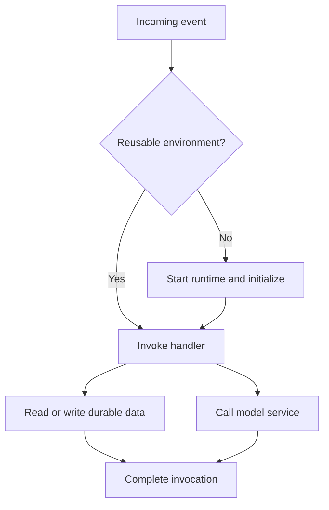

# Lambda: how your code runs without managing a server

[Chapter index](README.md) · [Library index](../README.md) · [Previous lesson](../04-storage-and-delivery/02-cache-cdn-cloudfront.md) · [Next lesson](../05-compute/02-ecs-fargate-and-choices.md)

This is a **service** lesson: it explains managed AWS capabilities and how an application uses them.

> **In one sentence:** You deploy a function and its configuration; Lambda supplies an execution environment and invokes your handler when an event arrives.

## Learning objectives

Trace a standard request-driven function from deployment to execution, and explain cold starts, reuse, concurrency, and durable state.

## Why it matters

A chatbot backend may run in Lambda, but that does not mean the language model runs inside the same function. Knowing which part runs where makes debugging much easier.

## Mental model

Think of two separate moments.

**Deployment:** your team uploads a code package or supported container image, identifies the handler, and configures permissions, memory, timeout, environment variables, and triggers.

**Invocation:** an event causes Lambda to run the handler in an AWS-managed execution environment. The environment contains a runtime, such as Python, that executes your instructions on real computing hardware.

AWS manages the underlying servers. Your team does not normally log into a persistent VM to start the function process. You still own the function’s logic, dependencies, configuration, access, and operational behaviour.

This lesson describes the standard event-driven Lambda handler model. Features and execution options evolve; consult the linked documentation for current limits rather than memorising one number for every Lambda workload.

## Worked example

Illustrative Python 3 handler, not deployed or executed as part of these lessons:

```python
def handler(event, context):
    question = event.get("question", "").strip()

    if not question:
        return {"error": "empty_question"}

    return {"answer": f"You asked: {question}"}
```

For the direct test event `{"question": "Hello"}`, the expected result is `{"answer": "You asked: Hello"}`.

The **handler** is the function Lambda calls. The **event** contains input; **context** contains execution information. API Gateway integrations often wrap HTTP input and require a particular response format, so this direct-event example is not a complete HTTP API handler.

## Step-by-step walkthrough

1. An API endpoint, queue, schedule, or another supported source produces an event.
2. Lambda chooses or prepares an execution environment.
3. When preparation is needed, the runtime starts and module-level initialization runs. This contributes to a **cold start**.
4. Lambda calls the handler with the event.
5. The handler may read history from DynamoDB and call Bedrock.
6. The handler returns or fails; the integration determines what the caller receives.
7. The environment may be kept for reuse or later discarded.



The storage and model calls represent possible handler work, not a guarantee that they happen in parallel.

## Where is the chatbot?

The Lambda function can run the **orchestration**: validate the message, retrieve history and documents, call a model endpoint, and store the result. The model service performs inference separately. Your function coordinates the work.

A global Python list is not a reliable conversation database. One warm environment might retain it temporarily, while another environment has a different list. Store durable conversation data externally.

When requests overlap, Lambda can provide additional capacity within configured and service limits. Do not assume unlimited scaling or that dependencies can handle the same load.

## Common mistakes and failures

- Warm-environment reuse is an optimisation, not a persistence guarantee.
- A function timeout does not undo a database write already completed.
- Some event sources retry or deliver more than once. Make repeated operations safe, for example by checking a stable message identifier.
- A runtime that is ready does not guarantee the database or model endpoint is reachable.
- The function’s execution role controls its AWS actions; the caller’s authentication is a separate concern.

## Practice

Request A stores conversation history only in a global variable. Request B runs in another environment. What happens? Expected: B cannot reliably see A’s history. Use shared durable storage.

Then imagine a write succeeds but the response is lost. What should a retry check? Expected: whether that operation/message was already completed.

## Self-check

- [ ] I can explain what executes the Python code.
- [ ] I can distinguish deployment from invocation.
- [ ] I can explain cold versus warm execution.
- [ ] I can explain why history belongs outside local process memory.

## Related notes and sources

- [[Terms]] and [[Glossary]] for short definitions.
- [Chapter index](README.md)
- [Library index](../README.md)
- [Lambda overview](https://docs.aws.amazon.com/lambda/latest/dg/welcome.html)
- [Execution environment lifecycle](https://docs.aws.amazon.com/lambda/latest/dg/lambda-runtime-environment.html)
- [Python handler](https://docs.aws.amazon.com/lambda/latest/dg/python-handler.html)
- [Lambda best practices](https://docs.aws.amazon.com/lambda/latest/dg/best-practices.html)

Documentation consulted 2026-11-25. Examples are educational drafts; service features and tool behaviour can change.
