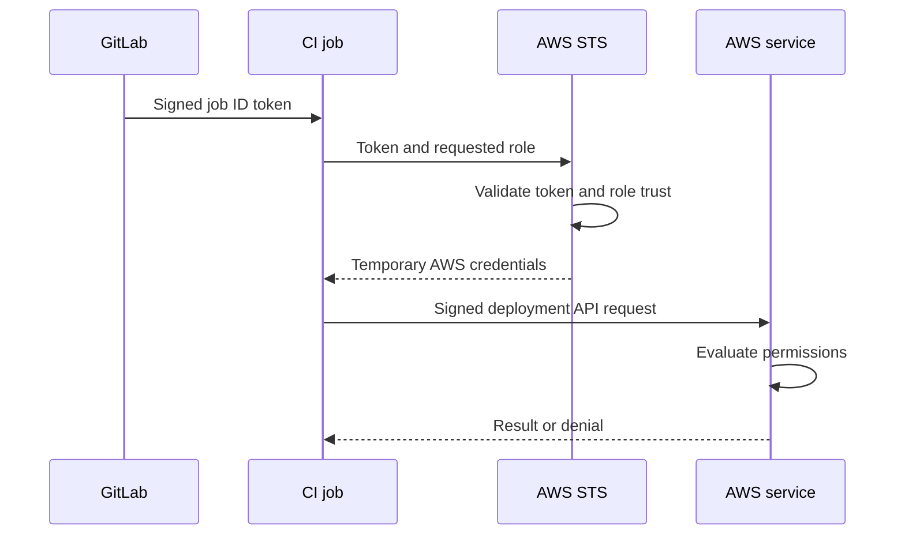

# OIDC: how a CI job proves its identity to AWS

[Chapter index](README.md) · [Library index](../README.md) · [Previous lesson](../06-identity/02-organizations-and-policy-layers.md) · [Next lesson](../07-ai-and-retrieval/01-bedrock-and-orchestration.md)

This is a **protocol** lesson: it explains an identity exchange and how CI uses it.

> **In one sentence:** GitLab issues a signed statement about a job, and AWS can exchange that statement for temporary credentials when the job matches a trusted identity.

## Learning objectives

Explain the audience URL, distinguish an ID token from AWS credentials, and trace identity separately from permissions.

## Why it matters

A runner executes commands. It does not automatically have the right to deploy. OIDC lets a deployment job establish an identity without keeping a permanent AWS access key in the repository.

## Mental model

There are four participants:

| Participant | Responsibility |
| --- | --- |
| GitLab | Issue a signed ID token describing the job |
| Runner/job | Present the token and execute deployment commands |
| AWS Security Token Service (STS) | Validate the request and issue temporary role credentials |
| AWS service | Evaluate the resulting API request and permissions |

**OIDC** is an identity protocol. In this CI use, the identity describes a workload, not an interactive browser user. The ID token is a signed JWT containing claims. Examples include its issuer, intended audience, subject, and expiry.

Signing allows the recipient to check that the issuer produced the token and its contents were not changed. It is not the same as encrypting the contents.

## Why does YAML contain a link instead of a token?

Illustrative GitLab job fragment:

```yaml
deploy-example:
  id_tokens:
    GITLAB_OIDC_TOKEN:
      aud: sts.amazonaws.com
  script:
    - ./deploy.sh
```

This fragment assumes the referenced script and job environment exist. It is not a complete deployment.

- `id_tokens` asks GitLab to issue an ID token for this job.
- `GITLAB_OIDC_TOKEN` names the environment variable that receives the generated token.
- `aud` specifies the intended audience.
- The actual token is generated when the job runs; it is not written into this YAML.

An audience can be a URI-like string, including a URL. **It is an identifier that is compared with expected configuration, not a hyperlink the shell follows to download a token.**

Some integrations use the GitLab instance URL as the audience. That only works if the AWS OIDC provider and relevant checks expect the same value. The issuer URL and audience are different concepts even when a configuration uses the same string for both. Do not change a team’s audience independently of its AWS trust configuration.

## Step-by-step walkthrough

1. An administrator configures AWS to recognise the GitLab OIDC issuer and its public verification keys.
2. An IAM role’s trust policy limits which matching identities may assume it—for example, a particular project and release branch.
3. GitLab creates a signed ID token for the running job.
4. The job asks STS to assume that role using the token.
5. AWS verifies the signature, issuer, audience, lifetime, and applicable trust conditions.
6. If accepted, STS returns temporary AWS credentials for the role.
7. The deployment tools use those credentials to call AWS APIs.
8. AWS evaluates each action against the role and other applicable policy layers.



Temporary credentials include an access key identifier, secret access key, and session token. The OIDC ID token and these AWS credentials are different objects.

## Worked example: trace a deployment failure

A fictional role trusts the subject:

```text
project_path:example/helpdesk:ref_type:branch:ref:main
```

This illustrates a common GitLab subject format; actual claims and supported trust keys depend on the GitLab deployment and configuration.

A feature-branch job can receive a valid GitLab ID token but fail to assume that role because its subject does not match. A main-branch job can successfully assume the role but still fail to update Lambda because the role lacks the required action.

These are two different problems: **trust denied** versus **service permission denied**.

## Where to look in a project

Read the job’s `id_tokens`, the authentication setup in `before_script` or scripts, the role identifier selected for the environment, and the AWS role trust/permissions definitions. OIDC configuration does not automatically guarantee that only reviewed code can deploy; pipeline and branch protections must support that intention.

For self-managed GitLab, AWS also needs access to the issuer’s discovery/key information through a supported configuration.

## Common mistakes

Do not print tokens or credentials to debug them. Do not assume a human’s GitLab role becomes the job’s AWS permissions. A broadly trusted project/branch pattern can grant more deployment access than intended.

## Practice

A token is correctly signed but has the wrong audience. Should AWS accept it? Expected: no. Now suppose the audience matches but S3 access is denied after role assumption. Inspect permissions and resource policies rather than rewriting the token request.

## Self-check

- [ ] I can explain why `aud` is not the token.
- [ ] I can trace the exchange from GitLab identity to AWS credentials.
- [ ] I can distinguish trust-policy failures from action-permission failures.

## Related notes and sources

- [[Terms]] and [[Glossary]] for short definitions.
- [Chapter index](README.md)
- [Library index](../README.md)
- [GitLab ID tokens](https://docs.gitlab.com/ci/secrets/id_token_authentication/)
- [GitLab OIDC with AWS](https://docs.gitlab.com/ci/cloud_services/aws/)
- [AWS OIDC federation](https://docs.aws.amazon.com/IAM/latest/UserGuide/id_roles_providers_oidc.html)
- [STS AssumeRoleWithWebIdentity](https://docs.aws.amazon.com/STS/latest/APIReference/API_AssumeRoleWithWebIdentity.html)

Documentation consulted 2026-11-25. Examples are educational drafts; service features and tool behaviour can change.
