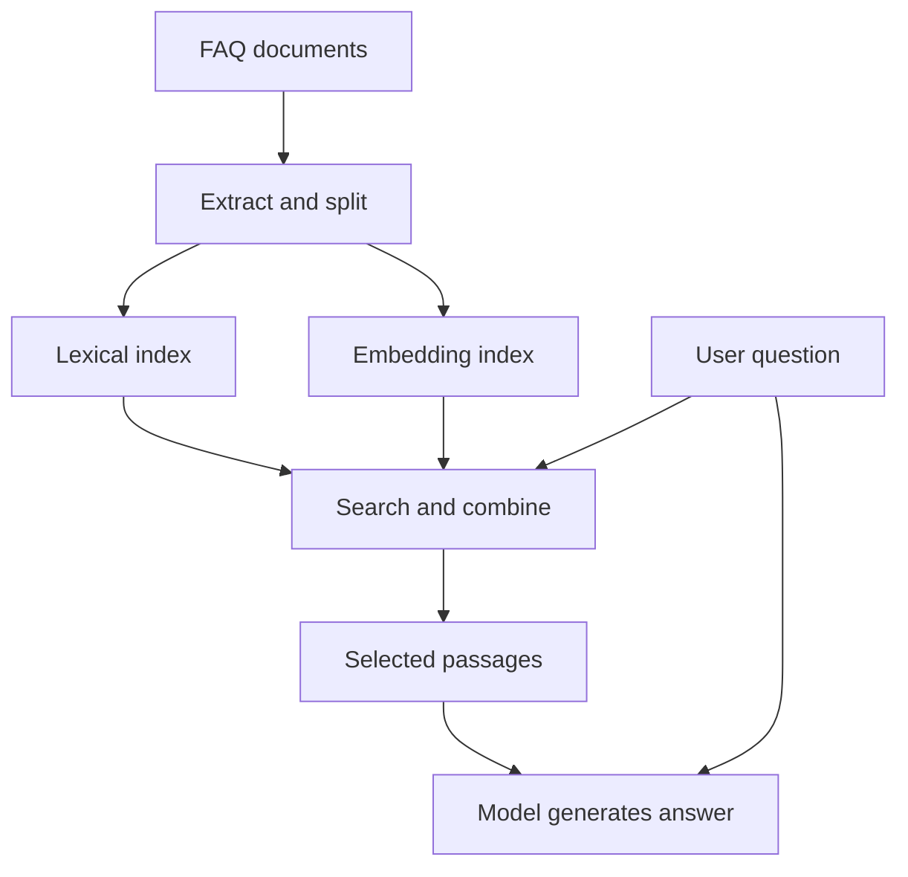

# Document ingestion, BM25, vectors, and RAG

[Chapter index](README.md) · [Library index](../README.md) · [Previous lesson](../07-ai-and-retrieval/01-bedrock-and-orchestration.md) · [Next lesson](../08-infrastructure-as-code/01-desired-state-and-providers.md)

This is a **concept** lesson: it connects ideas and responsibilities rather than teaching one command.

> **In one sentence:** Retrieval selects useful source material before a model generates an answer, and different search methods capture different kinds of relevance.

## Learning objectives

Separate preparation from question-time search and explain BM25 versus vector retrieval without needing the formulas.

## Why it matters

A knowledge update can require its own build and acceptance checks even when application code has not changed.

## Mental model

There are two flows:

- **Ingestion:** read source documents, clean/extract text, split it into useful passages, and prepare searchable data.
- **Retrieval:** use a question to select relevant passages from that prepared collection.

**BM25** is a text-ranking algorithm, not an AWS service. It considers matching terms, their frequency, their rarity across the collection, and document length. Repeating a word contributes with diminishing returns; the algorithm does not simply count all occurrences equally.

**Vector retrieval** compares numerical representations called embeddings. It can find related wording even when exact words differ. Similarity is not a guarantee of factual relevance.

**Hybrid retrieval** combines evidence from lexical and vector approaches. **RAG** adds retrieved material to the model’s input before generation.

## Worked example and walkthrough

Suppose our FAQ has these passages:

- A: “Password reset: use the account recovery page.”
- B: “Changing the colour theme.”
- C: “If you cannot sign in, recover access through the recovery form.”

For the query “password reset”, lexical matching gives A direct evidence. For “I forgot how to get into my account”, embeddings may help identify semantically related passages such as A or C. This is a conceptual expectation, not a measured ranking; results depend on tokenization, model, index, and configuration.

A source citation should identify the supporting material. Merely displaying a source link does not prove the answer follows from it.

## Common mistakes

Uploading a new document does not guarantee the active index includes it. Inspect ingestion completion, selected data version, and retrieval results.

Small chunks can lose context; huge chunks can dilute relevant information. There is no universal chunk size that fits every document.

Retrieval permissions matter too: the search process should not expose documents the requesting user cannot access.

## Practice

A newly uploaded FAQ cannot be found. List two checks before changing the prompt. Expected: whether ingestion/indexing completed and whether the application searches the intended index/version.

## Self-check

- [ ] I can distinguish ingestion, retrieval, and generation.
- [ ] I can explain why BM25 and vector search may complement each other.

## Related notes and sources

- [[Terms]] and [[Glossary]] for short definitions.
- [Chapter index](README.md)
- [Library index](../README.md)
- [Elasticsearch BM25 settings](https://www.elastic.co/docs/reference/elasticsearch/index-settings/similarity)
- [Bedrock Knowledge Bases](https://docs.aws.amazon.com/bedrock/latest/userguide/knowledge-base.html)

Documentation consulted 2026-11-25. Examples are educational drafts; service features and tool behaviour can change.
