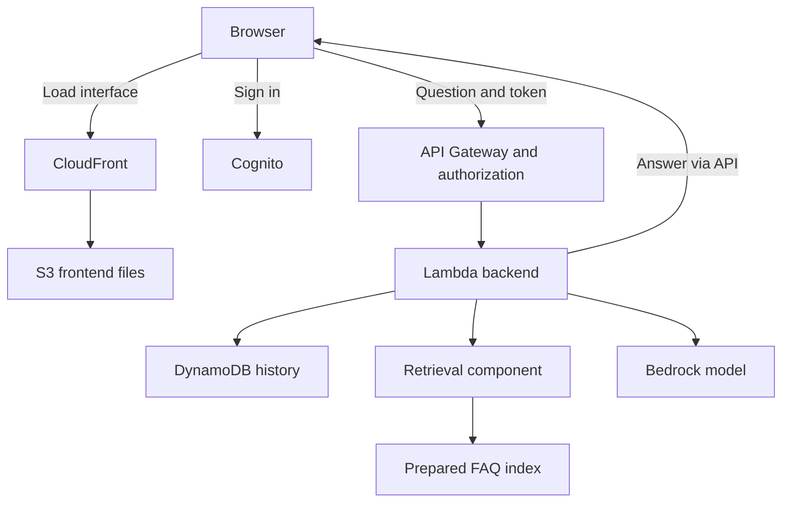
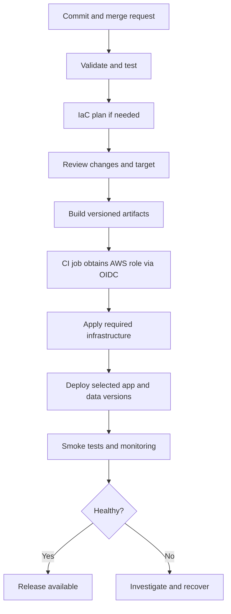

# The complete picture: a user request and a developer change

[Chapter index](README.md) · [Library index](../README.md) · [Previous lesson](../08-infrastructure-as-code/04-iac-in-team-ci-cd.md)

This is a **concept** lesson: it connects ideas and responsibilities rather than teaching one command.

> **In one sentence:** Runtime architecture explains how the application serves a user; delivery architecture explains how reviewed changes reach that running application.

## Learning objectives

Tell both stories without mixing deployment tools into the user’s request path, and locate a problem by its place in the system.

## Why it matters

You do not need to memorise every AWS service. You need a map that tells you what question to ask when a name appears in code or a discussion.

## Mental model

This is a fictional learning architecture. It combines concepts from the previous chapters; it is not a claim about an employer’s production deployment.

The frontend is built into static assets. CloudFront delivers them from S3. Cognito supports sign-in. API Gateway accepts backend requests. Lambda coordinates history, retrieval, and Bedrock calls. DynamoDB stores conversation records.

### Journey 1: someone asks a question

The retrieval component/index is deliberately generic: BM25 or vector search requires an implementation, but neither algorithm name specifies a unique AWS service.

## Worked request walkthrough

1. The browser obtains the interface files and runs the JavaScript.
2. Sign-in supplies appropriate tokens for the configured application.
3. A message request includes the information the API contract requires.
4. The API/backend validates identity and access.
5. Backend logic checks the message, reads relevant history, and retrieves source passages.
6. It sends the question and selected context to the model.
7. It stores the accepted result and returns an answer.

The diagram omits network and monitoring detail to keep the main responsibilities visible. Real error paths, retries, streaming, and asynchronous processing require additional design.

### Journey 2: someone changes the application

This is one possible dependency order. Some jobs obtain limited AWS identity earlier to read state or create a plan. IaC and build order also vary with the resources being changed.

## Where to look in a repository

| Question | Likely evidence |
| --- | --- |
| What does the browser send? | Frontend API client and API schema |
| How is the message handled? | Backend handler and service layer |
| Where is history stored? | Storage adapter/repository and table definition |
| How is knowledge found? | Ingestion and retrieval code/configuration |
| Which resources exist? | OpenTofu/Terraform files or CDK stacks |
| Who may deploy? | CI authentication setup and IAM trust/permissions |
| Which jobs run? | Root CI YAML, includes, rules, and dependencies |
| Did the release work? | Deployment logs, smoke tests, metrics, traces |

These are investigation starting points. File and folder names differ between projects.

## Common mistakes

OpenTofu does not normally execute for every chat message. A CI runner is not the backend serving users. The deployment ID token is not the user’s sign-in token.

Seeing every box does not prove you understand every arrow. Ask what data crosses it, which identity authorizes it, and what happens if it fails.

## Practice

Trace these failures to a likely first investigation:

1. Old JavaScript appears after deployment.
2. The CI job cannot assume an AWS role.
3. A new FAQ cannot be retrieved.
4. A plan unexpectedly replaces a database.

Expected starting points: cache/versioned assets; OIDC issuer/audience/subject and role trust; ingestion and active index/version; resource attributes, lifecycle, state, and target environment.

## Self-check

- [ ] I can draw the user journey without including CI as a runtime dependency.
- [ ] I can draw the developer journey without confusing it with model inference.
- [ ] I can identify the data, identity, and failure mode of one connection.

## Related notes and sources

- [[Terms]] and [[Glossary]] for short definitions.
- [Chapter index](README.md)
- [Library index](../README.md)
- [AWS serverless web application guidance](https://docs.aws.amazon.com/whitepapers/latest/serverless-multi-tier-architectures-api-gateway-lambda/welcome.html)
- [GitLab pipelines](https://docs.gitlab.com/ci/pipelines/)

Documentation consulted 2026-11-25. Examples are educational drafts; service features and tool behaviour can change.
