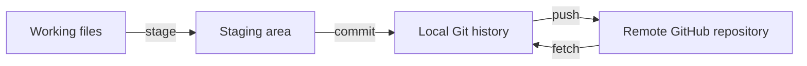

# Resolve Merge Conflicts

> **In one sentence:** A conflict occurs when Git cannot automatically reconcile changes on two histories.

## Learning objectives

- Explain the role of this concept in version control or GitHub collaboration.
- Use or interpret the example below and understand what changes locally versus remotely.
- Identify a common mistake before making it in a real repository.

## Why it matters

A conflict occurs when Git cannot automatically reconcile changes on two histories. It helps make changes traceable and collaboration safer. The goal is to understand both the command and the state transition it causes, not just memorize syntax.

## Mental model



For this lesson, identify which of these places the operation affects. Some GitHub-specific actions such as PR reviews happen on the hosting platform, while `git status`, `git add` and `git commit` work locally.

## Example

```bash
git status
git diff --check
git add resolved.md
```

**Walkthrough:** A conflict occurs when Git cannot automatically reconcile changes on two histories. When running the example, check the current directory, branch and `git status` first. Record the output and determine whether a local commit, remote branch or GitHub collaboration object changed.

## Where it fits in real work

Read both versions, keep the intended result and run relevant checks.

## Common mistakes and trade-offs

**Watch for:** Conflict markers are editable working-file text and must be resolved before committing.

When experimenting, use a disposable practice repository rather than your important notes or a company repository. Never include secrets or internal documents in demonstration commits.

## Exercise

**Task:** Create two competing edits on separate branches and resolve them.

**Check:** Describe the state of your working tree, staging area, local history and remote afterward; note which commands require internet access.

## Self-check

- [ ] I can explain what this operation changes.
- [ ] I can interpret its output or configuration.
- [ ] I completed the exercise on a practice repository.
- [ ] I can distinguish Git's local work from GitHub-hosted work.

## Related notes and sources

- [Chapter index](README.md)
- Previous: [[05_push]]
- [Git documentation](https://git-scm.com/docs)
- [GitHub documentation](https://docs.github.com/)
