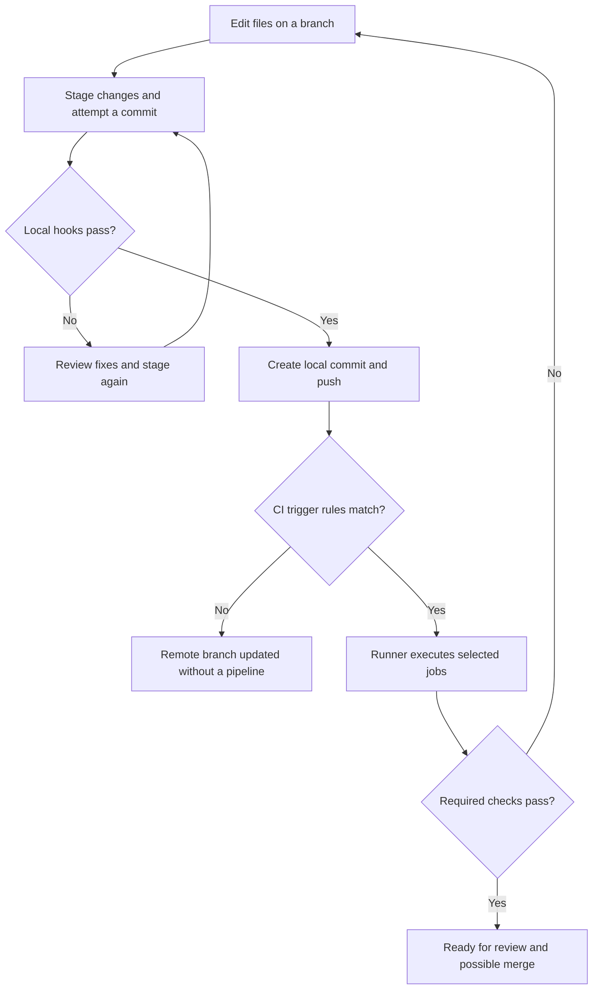

# Branches, Commits, Hooks, and Pipeline Stages

> **In one sentence:** You organize changes in Git, check them locally with hooks, and let a hosting platform schedule shared checks on runners.

## Classification and learning objectives

This is a **concept** lesson connecting several tools and workflow steps. It is not a description of a particular team's infrastructure.

After studying it, you should be able to:
- Distinguish branch names, commit messages, and Git tags.
- Explain local hooks versus CI jobs.
- Find a pipeline's entry point and follow included configuration.
- Distinguish the hosting platform, runner, image, and running container.
- Read a small pipeline and predict which commands execute.

## Why it matters

A successful local commit does not mean that tests passed on the server. A successful build does not mean that a new version is deployed. Knowing which step you are looking at helps you understand failures and ask precise questions.

## Mental model



The diagram assumes hooks have been installed. Passing checks does not automatically approve or merge changes.

## 1. Branch names, commit messages, and tags

| Item | Purpose | Example |
| --- | --- | --- |
| Branch | A moving reference to a line of work | `feat/text-export` |
| Commit | A recorded snapshot with metadata and parents | A commit adding export tests |
| Commit message | Explain the change represented by a commit | `test(export): cover empty input` |
| Git tag | Name a particular commit, usually a release | `v1.2.0` |

A branch can contain implementation, test, and documentation commits. You do not need a separate branch for each commit type. Branch prefixes such as `feat/` and `fix/` are team conventions, not Git requirements.

Conventional Commits uses a type, optional scope, and description:

```text
feat(export): add text export
fix(parser): handle empty input
docs: explain installation
```

Here, `export` is the scope. A breaking change can be marked with `!` or a `BREAKING CHANGE:` footer. Release tools can interpret these messages, but Git does not automatically calculate versions.

A tag normally stays attached to one commit while a branch advances. Tag-triggered pipelines are useful for releases. Other projects exclude them because an existing branch pipeline already creates releases; running again for the generated tag could duplicate work. Neither policy is universal.

## 2. Local hooks versus CI jobs

| | Local pre-commit hook | CI job |
| --- | --- | --- |
| Runs on | Your development machine | A configured runner |
| Trigger | Attempting a commit | Pipeline and job rules |
| Typical tasks | Formatting, linting, simple file checks | Tests, builds, checks, deployments |
| Failure | Stops that commit attempt | Fails the job; pipeline impact depends on configuration |

Git hooks are scripts invoked at Git events. The **pre-commit tool** manages configurable hooks; it is not Git itself.

For a project that already declares pre-commit as a uv dependency and supplies its configuration:

```bash
uv run pre-commit install --hook-type pre-commit --hook-type commit-msg
uv run pre-commit run --all-files
```

The first command installs both hook entry points locally. The second manually runs file checks across tracked files; it does not validate a prospective commit message.

A `commit-msg` hook checks the message. Listing it in configuration does not by itself install it. Hook installation is local to each clone.

If a formatter changes files, review the diff, stage the intended fixes, and retry the commit. CI repeats important checks because local hooks might be absent.

## 3. YAML and the pipeline entry point

`.yml` and `.yaml` denote the same format. YAML represents structured data; it does not execute shell commands itself. Use spaces for indentation.

| Platform/tool | Usual configuration location |
| --- | --- |
| GitLab CI/CD | Root `.gitlab-ci.yml`, unless project settings select another path |
| GitHub Actions | Workflow files under `.github/workflows/` |
| pre-commit tool | `.pre-commit-config.yaml` |

GitLab does not treat every YAML file as pipeline configuration. The entry point can reference additional files with `include`.

```yaml
include:
  - local: .gitlab/ci/validate.yml
```

Here, `local` means the same repository, not your laptop. Included configuration is combined; include order is not execution order. GitHub Actions has different syntax—do not paste a GitLab job into an Actions workflow unchanged.

## 4. Platform, runner, image, and container

| Component | Responsibility |
| --- | --- |
| GitLab / GitHub | Interpret configuration and coordinate work |
| Runner | Execute assigned jobs and report logs/results |
| Container image | Packaged filesystem and metadata supplying a job environment |
| Container | A running instance created from an image |

A runner is configured separately. An `image:` setting does not create a new runner. Container-capable executors can start job containers; other executor types behave differently.

For example, `python:3.12` is an image reference with tag `3.12`. A container-image tag labels an image; a Git tag labels a commit. Neither kind of tag should be confused with runner-selection tags.

## 5. Worked example: a small GitLab pipeline

**Illustrative, not executed here.** It requires a GitLab practice project, a compatible runner with network access, a Python project with pytest in its locked dependencies, a committed `uv.lock`, and a `tests/` directory. The uv installation below is deliberately simple; a maintained project should pin its tool versions or use an appropriate prepared image.

```yaml
workflow:
  rules:
    - if: $CI_COMMIT_TAG
      when: never
    - if: $CI_PIPELINE_SOURCE == "merge_request_event"
    - if: $CI_COMMIT_BRANCH == $CI_DEFAULT_BRANCH

stages:
  - validate
  - build

.python-setup:
  image: python:3.12
  before_script:
    - python -m pip install uv
    - uv sync --frozen

tests:
  extends: .python-setup
  stage: validate
  script:
    - uv lock --locked
    - uv run python -m pytest tests

package-source:
  image: alpine:3.20
  stage: build
  script:
    - mkdir -p dist
    - tar --exclude=.git --exclude=.venv --exclude=dist -czf dist/source.tar.gz .
  artifacts:
    paths:
      - dist/source.tar.gz
```

### Step-by-step walkthrough

1. GitLab reads the configuration for the event. The first matching workflow rule applies. In this example, tags are excluded, MR events and default-branch events are allowed, and unmatched events are excluded.
2. `tests` belongs to `validate`. It inherits preparation from `.python-setup`; the leading dot marks a hidden job used as a template.
3. Its container supplies Python. Preparation installs uv and project dependencies.
4. Tests run. A failing command normally fails this job.
5. Once validation succeeds, `package-source` creates a compressed source archive. This is a simple packaging example, not a container build.
6. GitLab stores the declared artifact so it can be downloaded. No deployment occurs in this example.

An MR pipeline can run while a proposal is still being reviewed; it does not wait until the merge happens.

### Commands in the example

| Command/part | Meaning |
| --- | --- |
| `uv sync --frozen` | Use the existing lock file without refreshing it or checking its consistency |
| `uv lock --locked` | Fail if dependency declarations require a lock-file update |
| `uv run python -m pytest tests` | Run pytest through Python and discover tests in `tests/` |
| `mkdir -p dist` | Create the output directory if needed |
| `tar -czf ...` | Create a gzip-compressed archive at the specified filename |
| `--exclude=...` | Leave matching paths out of the archive |

Each job has its own execution environment. Do not assume files installed or generated in one job automatically appear in another.

## 6. Stages, jobs, and scripts

A **stage** groups jobs, such as validation jobs. A **job** is one assigned unit of work. Its **script** is the sequence of commands the runner executes.

A common conceptual path is validation, building, deployment, and post-deployment checks. Stage names and ordering are project choices. Jobs in the same stage can run in parallel; `needs` can express dependencies that allow earlier starts. Job rules can exclude work, and manual gates can require an operator action.

A build produces something deployable. Deployment makes a selected version active in a target environment. Dev, QA, and production are environments, not automatically branch names or pipeline stages.

### Reading a job

| Field | Question it answers |
| --- | --- |
| `rules` | Should this job participate? |
| `stage` | Which group does it belong to? |
| `extends` | Which template settings does it reuse? |
| `image` | Which container environment supplies its tools? |
| `before_script` | What preparation runs first? |
| `script` | What commands perform the work? |
| `needs` | Which jobs must finish first? |
| `artifacts` | Which outputs should be retained/passed on? |
| `cache` | Which reusable files may speed up later runs? |

Artifacts are deliberate outputs, such as reports or packages. Caches primarily improve speed and must not be treated as guaranteed delivery of build results.

## 7. Tests, linting, types, and coverage

| Check | Main question |
| --- | --- |
| pytest tests | Does the executed behavior match assertions? |
| Ruff linting | Does the code violate configured rules? |
| Static type checking | Are annotated types used consistently? |
| Dependency checking | Do imports match declared dependencies? |
| Coverage measurement | Which code was executed by the tests? |

A test can execute a line without checking its result correctly. High coverage does not prove correctness.

With pytest-cov installed, an illustrative command is:

```bash
uv run python -m pytest tests --cov=sample_app --cov-report=xml
```

Replace `sample_app` with the actual importable package. The options measure coverage and produce an XML report; CI still needs artifact/report configuration if that file should be retained or displayed.

Exit code `0` normally means success. Nonzero normally signals failure; some tools assign special meanings to individual codes.

## Common mistakes and edge cases

- A green commit hook does not guarantee a green CI job: environments and selected checks can differ.
- The existence of a YAML file does not prove it is included or its jobs selected.
- A branch called `feat/example` does not force its commits to use `feat:`.
- An image version does not necessarily equal the Python version inside it.
- `uv sync --frozen` alone does not establish lock-file consistency.
- A template's list values are not automatically concatenated by `extends`; inspect inherited settings when overriding commands.
- Bash syntax depends on the runner's shell. PowerShell commands are not interchangeable with Bash commands.
- Successful checks only establish what those checks actually examine.

## Practice

Use a disposable repository; these examples have not been run for you.

1. Create a branch with `git switch -c docs/ci-notes`. Write a short note, stage it, and commit with `docs: explain local hooks`. Inspect `git status` and `git log -1 --oneline`.
2. Explain why a test commit could also belong on a feature branch.
3. Predict the example pipeline for three events: a feature-branch push without an MR, an MR event, and a tag push.
4. On paper, make one test fail. Which job fails, and does the later build job run?
5. Identify the archive artifact and explain why creating it does not deploy an application.

Expected reasoning for 3–5: no pipeline / pipeline / no pipeline; the tests job fails and the normal later build is skipped; the archive is stored output, with no command updating a running environment.

## Self-check

- [ ] I can distinguish a branch, commit, and tag.
- [ ] I can explain hook versus CI job.
- [ ] I can find the CI entry point for GitLab and GitHub.
- [ ] I can distinguish runner, image, and container.
- [ ] I can trace preparation, tests, and artifacts in the example.
- [ ] I understand why a successful build is not a deployment.

## Next lesson

OpenTofu, Terraform, and AWS: desired infrastructure, planning versus applying, and how infrastructure work fits into CI/CD. This topic remains to be studied.

## Related notes and sources

- [Chapter index](README.md)
- [CI Pipeline Basics](02_ci_basics.md)
- [GitHub Actions and Workflows](01_github_actions.md)
- [Branches](../02_branches_and_remotes/01_branches.md)
- [Commits and staging](../01_fundamentals/04_git_add_commit.md)
- [[Terms]]
- [[Glossary]]

Version-sensitive configuration should be checked against the installed tools and GitLab version.

- [GitLab CI YAML reference](https://docs.gitlab.com/ci/yaml/)
- [pre-commit documentation](https://pre-commit.com/)
- [Conventional Commits 1.0.0](https://www.conventionalcommits.org/en/v1.0.0/)
- [Git hooks](https://git-scm.com/docs/githooks)
- [Git tags](https://git-scm.com/docs/git-tag)
- [GitHub Actions workflow syntax](https://docs.github.com/en/actions/reference/workflows-and-actions/workflow-syntax)
- [uv project synchronization](https://docs.astral.sh/uv/concepts/projects/sync/)
- [pytest-cov reporting](https://pytest-cov.readthedocs.io/en/latest/reporting.html)
