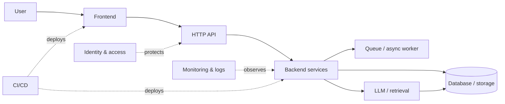
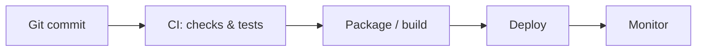
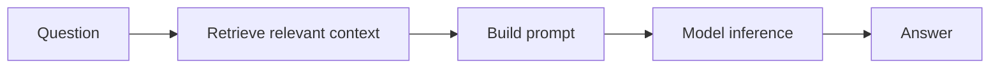

# Knowledge Spine

This is a **conceptual learning map**, not a diagram of a particular company's production architecture. It links topics by their role in an application, helping you see the big picture before learning individual tools.

## The end-to-end system

*Many production applications use only part of this pattern. Components may be managed services, containers, functions, or processes.*

## 1. Fundamentals

**Start with:** Git → Linux/terminal → networks → HTTP → APIs → JSON and YAML.

Key terms: Git, GitHub, Bash, DNS, HTTP, REST, API, JSON, YAML, SSH.

## 2. Application and backend

**Questions:** What happens after the user sends a request? Which program handles it? Where does it store state?

Key terms: frontend, backend, API endpoint, framework, service, database, object storage, asynchronous execution, message queue.

## 3. Cloud and infrastructure

**Questions:** Where does the code run? What provisions cloud resources? What is managed for me?

Key terms: AWS, Lambda, S3, DynamoDB, SQS, ECR, VPC, containers, serverless, OpenTofu, infrastructure as code.

## 4. Build, testing and delivery

**Questions:** How does a change get from local code to a reliable deployment?

Key terms: Python, uv, npm, Nix, Make, GitLab CI/CD, runners, pytest, linting, Docker/Buildah, semantic versioning, Cocogitto.

## 5. AI, retrieval and agents

**Questions:** How does the application find relevant knowledge, construct a prompt, call a model, and evaluate the answer?

Key terms: LLM, tokens, embeddings, RAG, chunking, BM25, vector search, reranking, AWS Bedrock, agent, Langfuse.

## 6. Security and operations

**Questions:** Who can access what? How do we notice and troubleshoot failures?

Key terms: IAM, least privilege, OIDC, TLS, secrets, guardrails, rate limiting, observability, CloudWatch, tracing, DLQ.

## How to use this spine

- Explore terms using [[Glossary]].
- Create detailed notes for the topics you need to understand or practice.
- Add `[[wikilinks]]` to these sections **after** the corresponding notes exist, so this stays a readable map rather than a maze of empty links.
- Record what you are unsure about under the relevant note's **Questions to revisit**.
- Avoid treating this learning architecture as a description of a specific private repository.
