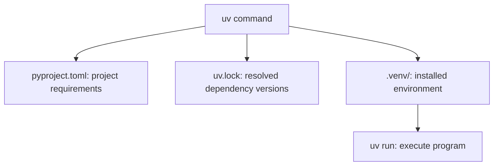
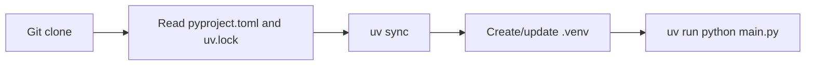

# uv Basics — Python Projects and Dependencies

> **In one sentence:** `uv` is a Python development tool that can manage Python versions, virtual environments, project dependencies, and commands.

## Learning objectives

- Distinguish Python, `pip`, `venv`, and `uv`.
- Initialize a project and add dependencies.
- Understand `pyproject.toml`, `uv.lock`, and `.venv/`.
- Run a script in a project's managed environment.
- Know when `uv sync` and `uv run` are useful.

## Why does uv exist?

A project can depend on external packages and a specific Python version. Installing random packages into the global Python environment makes projects hard to reproduce. `uv` provides one workflow for managing those requirements, creating an isolated environment, and running code.

`uv` is not Python itself and not a programming language. It overlaps with jobs usually handled by `pip` (package installation), `venv` (environment creation), and other project/dependency tools.

## Mental model



- **`pyproject.toml`** says which packages a project directly requires and defines project metadata.
- **`uv.lock`** records the resolved dependency graph and versions for reproducible installation. Normally commit it for an application.
- **`.venv/`** is the local environment containing installed packages. Normally **do not** commit it.
- **`uv run`** makes sure the project environment is available and current, then runs the command inside it.

## 1. Check or install uv

For an existing installation:

```powershell
uv --version
```

On Windows, one installation option is:

```powershell
winget install --id astral-sh.uv -e
```

Alternatively follow the [official installation instructions](https://docs.astral.sh/uv/getting-started/installation/). Restart your terminal after installing if the command is not found.

## 2. Create a fresh practice project

Run these commands in a **new practice folder**, not at the root of this knowledge-base repository:

```powershell
uv init uv-playground
cd uv-playground
uv run python --version
```

`uv init` prepares a Python project. `uv run` can create or synchronize its environment before executing Python.

A typical application project then contains:

```text
uv-playground/
├── pyproject.toml
├── uv.lock
├── .python-version
├── .venv/
└── main.py
```

Some files are created only when commands need them; versions and project settings can change the layout.

## 3. Add a dependency and use it

```powershell
uv add requests
```

This declares `requests` as a dependency in `pyproject.toml`, resolves it in `uv.lock`, and installs it into the project environment.

In `main.py`:

```python
import requests

print(requests.__version__)
```

Run:

```powershell
uv run python main.py
```

**Execution sequence:** `uv run` checks the environment, runs the requested interpreter, imports the package from the project's environment, and prints its version.

## 4. Common commands

| Command | Purpose |
| --- | --- |
| `uv init project-name` | Create a Python project |
| `uv add requests` | Add a project dependency |
| `uv remove requests` | Remove a declared dependency |
| `uv run python main.py` | Run inside the managed project environment |
| `uv sync` | Synchronize the environment with project requirements and the lockfile |
| `uv lock` | Update the dependency lockfile |
| `uv tree` | Inspect the resolved dependency tree |
| `uv python install 3.12` | Install a supported Python version |
| `uv python pin 3.12` | Record a preferred Python version for the project |
| `uvx ruff --version` | Run a tool in an ephemeral tool environment |

## 5. How is uv related to pip and venv?

| Tool | Primary role |
| --- | --- |
| `python` | Executes Python programs |
| `pip` | Installs Python packages |
| `venv` | Creates isolated Python environments |
| `uv` | Can manage Python installations, environments, dependencies, locks, and command execution |

You can use `uv` for an entire project without separately invoking `pip` or creating a virtual environment yourself. However, `pip` and `venv` remain useful to understand because many projects use them.

For standalone projects, `uv venv` can create a virtual environment without initializing a managed `uv` project. `uv pip install` offers a pip-like interface; it is **different** from declaring project dependencies with `uv add`.

## 6. Practical workflow: another developer clones your project



The other developer needs Python or an available Python installation managed through uv, but does **not** need your original `.venv/` folder.

## 7. Common mistakes

- Committing `.venv/` into Git. Ignore it in `.gitignore`.
- Assuming `uv add` and `uv pip install` are interchangeable. Only the former declares a dependency in a managed project.
- Assuming that `uv sync` always needs a manually activated environment. Usually `uv run` and `uv sync` manage the project environment directly.
- Editing `uv.lock` by hand rather than using uv to resolve dependencies.
- Running `uv init` inside an existing project without checking whether it already has `pyproject.toml`.

## Practice

1. Create a fresh `uv-playground` project.
2. Add `requests` and print its version using `uv run`.
3. Inspect the changes to `pyproject.toml` and `uv.lock`.
4. Remove `requests` and verify that the dependency declaration changes.
5. Explain why the project should commit its lockfile but not its `.venv/` environment.

## Self-check

- [ ] I can explain `uv` compared with `pip` and `venv`.
- [ ] I can create a project with `uv init`.
- [ ] I can add packages using `uv add`.
- [ ] I know what each of `pyproject.toml`, `uv.lock`, and `.venv/` contains.
- [ ] I can run a script with `uv run`.

## Related notes

- [[pip_basics|pip basics]]
- [[virtualenv|Virtual environments]]
- [[project_structure|Project structure]]
- [[Python library/01_fundamentals/README|Chapter 01 — Fundamentals]]

## Sources

- [uv installation](https://docs.astral.sh/uv/getting-started/installation/)
- [uv features and command categories](https://docs.astral.sh/uv/getting-started/features/)
- [Working on projects with uv](https://docs.astral.sh/uv/guides/projects/)
