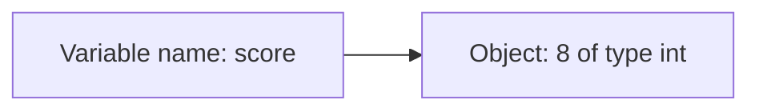

# Variables and Types

> **In one sentence:** A variable is a name bound to an object; the object has a type, and the name can later be rebound.

## Learning objectives

- Assign and reassign names using `=`.
- Recognize `str`, `int`, `float`, `bool` and `None`.
- Distinguish a value, a variable name, and the value's type.

## Why it matters

Almost every Python program needs to store information between operations. Variables let us label and reuse values without copying the same literal everywhere.

## Mental model

Python names **refer to objects**. The object has a type; the variable name itself is not permanently restricted to that type.



## Worked example

```python
name = "Ada"     # str
age = 27        # int
height = 1.68   # float
active = True   # bool

print(type(age))  # <class 'int'>
age = age + 1
print(age)        # 28
```

**Walkthrough:** `age = 27` binds the name to an integer; `age + 1` computes a new integer, then assignment rebinds `age`. `type(age)` inspects the current object's type.

## Rules and pitfalls

| Expression | Meaning |
| --- | --- |
| `x = 5` | Assign a value to a name |
| `x == 5` | Compare for equality |
| `type(x)` | Inspect the object's type |
| `x = "5"` | Rebind `x` to a string; it is not the number 5 |

- Type hints such as `age: int = 27` communicate intent but normally do not enforce a runtime type.
- Avoid shadowing built-ins with names such as `list`, `str` or `sum`.
- Use descriptive `snake_case` names.

## Try it

**Predict:** What do the two `type(value)` calls show?

```python
value = 100
print(type(value))
value = "100"
print(type(value))
```

**Challenge:** Store a product name, unit price and quantity; calculate the subtotal and display its type.

**Code reference:** [01_variables_types.py](01_variables_types.py).

## Practice and self-check

- [ ] Explain the idea aloud without reading the note.
- [ ] Run the linked Python script, then predict the output after changing one input.
- [ ] Recreate the example from memory.
- [ ] Complete the challenge above and explain your solution.

## Connections and reference

- Chapter: [[01_fundamentals/README|Fundamentals chapter]]
- Next: [[02_strings]]
- [Python tutorial — official documentation](https://docs.python.org/3/tutorial/)

*Learning status: draft — complete the self-check before marking this note mastered.*
