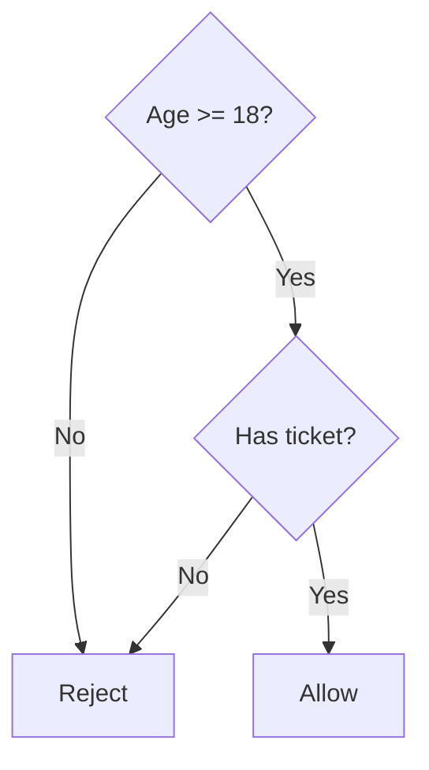

# Booleans and Logic

> **In one sentence:** Booleans represent `True` or `False` and control decisions through comparisons and logical operations.

## Learning objectives

- Evaluate comparisons (`==`, `!=`, `<`, `>=`).
- Combine conditions with `and`, `or`, `not`.
- Distinguish booleans from truthy and falsy values.

## Why it matters

Programs continuously make decisions: whether a user has access, a value is in range, or a record should be processed.

## Worked example

```python
age = 20
has_ticket = True
allowed = age >= 18 and has_ticket
print(allowed)  # True

name = ""
print(bool(name))  # False
```

**Walkthrough:** `age >= 18` evaluates to `True`, so `True and True` is `True`. Empty strings are falsy; nonempty strings are truthy.

## Logical operators

| Expression | Result |
| --- | --- |
| `True and False` | `False` |
| `True or False` | `True` |
| `not True` | `False` |



## Important distinction

`and` and `or` can return **operands**, not necessarily literal booleans:

```python
print("" or "guest")  # guest
print("admin" and 42)  # 42
```

The operators short-circuit: Python may skip evaluating the second operand when the first already determines the result.

## Pitfalls

- `=` assigns; `==` compares.
- `bool("False")` is `True` because the string is nonempty.
- `is` tests object identity, not value equality; use `==` for most value comparisons.

## Try it

**Predict:** Evaluate `not (4 > 2 and 1 == 2)`.

**Challenge:** Write a condition that allows access only if a user is active and either an admin or a verified member.

**Code reference:** [04_booleans.py](04_booleans.py).

## Practice and self-check

- [ ] Explain the idea aloud without reading the note.
- [ ] Run the linked Python script, then predict the output after changing one input.
- [ ] Recreate the example from memory.
- [ ] Complete the challenge above and explain your solution.

## Connections and reference

- Chapter: [[01_fundamentals/README|Fundamentals chapter]]
- Previous: [[03_numbers]]
- Next: [[05_input_output]]
- [Python tutorial — official documentation](https://docs.python.org/3/tutorial/)

*Learning status: draft — complete the self-check before marking this note mastered.*
