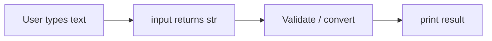

# Input and Output

> **In one sentence:** `print()` writes text to standard output, while `input()` reads a line of user input as a string.

## Learning objectives

- Display multiple values and format text with f-strings.
- Read input interactively and understand the returned type.
- Anticipate invalid user input and distinguish CLI input from API input.

## Why it matters

Even a small script needs a way to communicate with its user. This is also a first example of a program's **input → processing → output** flow.

## Mental model



## Worked example

```python
name = input("Your name: ").strip()
print(f"Hello, {name}!")

age_text = input("Your age: ")
try:
    age = int(age_text)
except ValueError:
    print("Please enter a whole number.")
else:
    print(f"Next year: {age + 1}")
```

**Walkthrough:** `input()` receives text; `strip()` removes surrounding whitespace; `int()` tries to parse a whole number; `except` handles invalid text instead of crashing. The next chapter on exceptions develops this pattern further.

## Output reference

| Expression | Effect |
| --- | --- |
| `print(x)` | Print representation of a value |
| `print(a, b)` | Print both, with a space by default |
| `print(x, end="")` | Override final newline |
| `f"{value}"` | Embed a value in a formatted string |

## Pitfalls

- `input()` always returns `str` (or raises `EOFError` when no input is available).
- `int("2.5")` raises `ValueError`.
- Don't place `input()` in code expected to run unattended in a background job or API handler.

## Try it

**Predict:** What is the type of `input("Number: ")` after entering `25`?

**Challenge:** Ask for a city and a temperature in Celsius, then display both; handle an invalid temperature gracefully.

**Code reference:** [05_input_output.py](05_input_output.py) — this script prompts for interactive input.

## Practice and self-check

- [ ] Explain the idea aloud without reading the note.
- [ ] Run the linked Python script, then predict the output after changing one input.
- [ ] Recreate the example from memory.
- [ ] Complete the challenge above and explain your solution.

## Connections and reference

- Chapter: [[01_fundamentals/README|Fundamentals chapter]]
- Previous: [[04_booleans]]
- Next: [[06_type_casting]]
- [Python tutorial — official documentation](https://docs.python.org/3/tutorial/)

*Learning status: draft — complete the self-check before marking this note mastered.*
