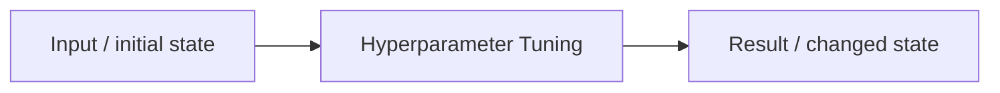

# Hyperparameter Tuning

> **Core idea:** Search model settings using validation procedures.

## Learning objectives

- Explain why the technique exists and identify where it is useful.
- Predict and verify the companion program's behavior.
- Recognize the main pitfall and solve a variation independently.

## Concept and motivation

**Hyperparameter Tuning** is part of the broader topic **Advanced Ml Path**. Search model settings using validation procedures. Think of it as a tool for expressing a particular operation clearly rather than syntax to memorize. When reading an implementation, ask: *What information goes in? What operation happens? What result or side effect comes out?*

## Mental model

Find all three stages in the companion example. For I/O and mutable data, the effect can be external or in-place rather than a new returned value. For ML examples, also identify training and evaluation data separately.

## Practical walkthrough

**Companion example:** [04_hyperparameter_tuning.py](04_hyperparameter_tuning.py) (Python script).

1. **Read:** Locate the input variables, imports and main operation; paraphrase their purpose.
2. **Predict:** Before running, write down the expected result and which expressions cause it.
3. **Execute:** Run the script in VS Code using `python 04_hyperparameter_tuning.py` from this chapter folder.
4. **Modify:** Change exactly one parameter or input and explain any difference.
5. **Extend:** Implement the challenge below in a separate scratch file; keep the reference script intact.

**What to notice:** Search model settings using validation procedures. The important part is being able to explain the mechanism rather than remembering output for one fixed input.

## Common mistakes and edge cases

**Pitfall:** Do not tune on the final test set.

Try an empty input, unexpected type, boundary value or error condition where appropriate. If the sample does not contain that case, implement it in your practice copy. Do not assume one successful example proves a general rule.

## Practice task

**Your task:** Use GridSearchCV.

Afterward answer: What did you expect? What happened? What would fail, and how would you test that possibility?

## Self-check

- [ ] I can describe the concept without looking at this page.
- [ ] I ran the linked example and predicted its result.
- [ ] I modified the example, checked an edge case and solved the task.
- [ ] I can connect this topic to a realistic Python application.

## Connections and sources

- [Chapter index](README.md)
- Previous: [[03_imbalanced_data]]
- [Python official documentation](https://docs.python.org/3/)
- [scikit-learn user guide](https://scikit-learn.org/stable/user_guide.html)
