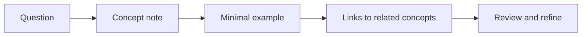

# Ki-Lab Stack Knowledge

A personal, English-language, Obsidian-compatible knowledge base for learning the technologies used in modern chatbot and production software projects.

## Conventions

- **Notes:** Markdown (`.md`) with Obsidian `[[wikilinks]]` between notes.
- **Language:** English for explanations, titles, comments, and diagrams.
- **Default programming language:** Python (`python` fenced code blocks).
- **Other languages:** TypeScript, HTML, CSS, Bash, YAML, SQL, or others only when they explain a technology accurately. Use a language identifier on each code fence.
- **Diagrams:** Mermaid (`mermaid` fenced code blocks), with short accompanying explanations.
- **Scope:** Public knowledge, general examples, and independently written learning notes. Do not copy proprietary workplace material, secrets, or internal architecture.

## Suggested knowledge areas

- `Fundamentals/` — Git, APIs, HTTP, Linux, operating systems
- `Languages/` — Python, TypeScript and other languages when needed
- `Backend-and-APIs/` — backend architecture, services, REST, Lambda
- `AI-and-LLMs/` — RAG, LangChain, AWS Bedrock, evaluation, monitoring
- `DevOps-and-Cloud/` — Docker, Nix, uv, Make, CI/CD, OpenTofu, AWS
- `Security/` — OIDC, IAM, secrets, authorization
- `Workflows/` — end-to-end concepts and connections between tools
- `Templates/` — repeatable note structures

These folders are optional organizational destinations; create them as notes accumulate. Existing notes remain untouched.

## Writing a new note

1. Copy `Templates/Technology Note.md` to the most suitable folder.
2. Replace placeholders; remove irrelevant sections rather than filling with fluff.
3. Write a one-sentence explanation before implementation details.
4. Include at least one simple example or a practical flow whenever useful.
5. Use `[[Note Name]]` for related notes and cite external sources.
6. Mark unclear or unverified content explicitly. Do not invent details.

## Learning flow

See [CONTRIBUTING.md](CONTRIBUTING.md) for detailed style rules and [AGENTS.md](AGENTS.md) for assistant/Codex instructions.
