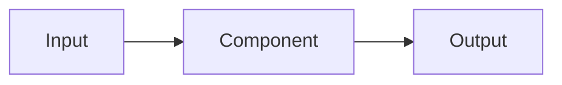

# {{title}}

## Classification

**Kind:** Choose one value from `kind` above, then briefly explain why. For example, Git is a tool/version-control system, `git remote` is a command, FastAPI is a framework, REST is an architectural style, and AWS Lambda is a cloud service. Use a more specific description if useful; categories are not always mutually exclusive.

## In one sentence

> What is it, in plain English?

## Why does it exist?

Describe the problem it solves and when it is useful.

## How it works

Explain the mechanism in a few clear steps. Define unavoidable jargon.



*Replace or delete the diagram if it does not improve understanding.*

## Minimal example

Prefer Python when the concept is language-independent. Use TypeScript, HTML, CSS, YAML, shell, or another language when that is the actual interface of the tool.

```python
# Replace with a small, runnable example.
def example(value: str) -> str:
    return value.strip()
```

## How it fits into a production system

Explain what calls it, what it calls, and where it runs (local machine, CI runner, server, cloud service, browser, etc.).

## Key concepts and commands

| Concept / command | Meaning |
| --- | --- |
| TODO | TODO |

## Common mistakes and trade-offs

- TODO

## Related notes

- [[Related Technology]]

## Sources

- [Official documentation](https://example.com) — replace with actual source

## Questions to revisit

- [ ] TODO
