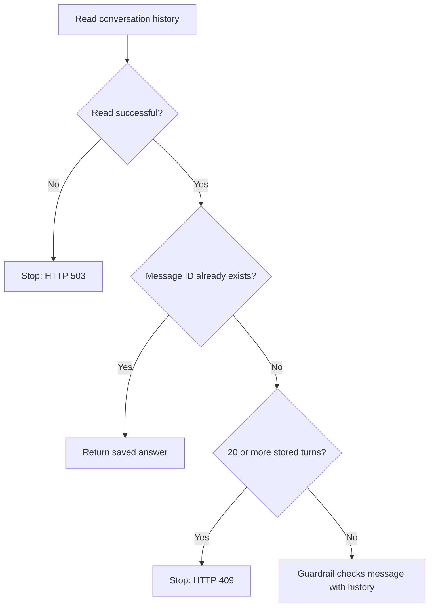

Ticket 23.11 - 11.12 (Woche 30.11 - 5.12 Berufschule = fehlt aus)
Stand 24.11 : 1c,2b erledigt  

!1124 (merged)
!1195 (merged)
!1400 (merged)

        
      Folgende  MRs werden analysiert
        - 1a) https://gitlab.kilab-platform.de/renate/digibro-monorepo/-/merge_requests/1124
        - 1b) https://gitlab.kilab-platform.de/renate/digibro-monorepo/-/merge_requests/1195
        - 1c) https://gitlab.kilab-platform.de/renate/digibro-monorepo/-/merge_requests/1400

        
      Was ändert sich? Warum? Woran sieht man, dass es geprüft wurde? Wird beantwortet

        
      Bei !1124 (merged) nachvollgezogen: Wo steht die 180 im Code, wo im Test, wo in der Doku?

        
      Zusatzlich : Themen wie AWS-Grundlagen, Docker und Container, IaC, OpenTofu erarbeitet

Ziel :

        
      - 2a) Stages validate -> tofu-plan -> tofu-apply -> build -> deploy verstehen

        
      - 2b) Branch-/Commit-Konventionen lernen: Branch <type>/<kurzbeschreibung>, Conventional Commits (feat(scope): ...), pre-commit-Hook erklären können

        
      - 2c) Lambdas, Buckets, die Knowledge Base im Code (cdk/lib/, terraform/live/dev/) finden, wo genau sie definiert sind

        
      - 2d) 3 Ressourcen (z.B. eine Lambda, ein Bucket, eine CI-Rolle) herausfinden: CDK oder OpenTofu? Welche Datei? Als kurze Tabelle dokumentieren

**1c)** https://gitlab.kilab-platform.de/renate/digibro-monorepo/-/merge_requests/1400

"schema": {"$ref": "#/components/schemas/ErrorResponse"} - verstehe nicht was es macht
In "generate_OpenApi.py"
Antwort:  

"ErrorResponse": error_response,

    error_response = {
        "type": "object",
        "properties": {
            "error": {"type": "string"},
            "message": {"type": "string"},
        },
        "required": ["error"],
    }

also : "declaring the expected structure of an error response"

**Was ändert sich?**

neue funktionen : _parse_chat_body, _process_traced, test_handle_chat_request_maps_limit_and_read_errors
neue class : class ConversationLimitReachedError in conversation.py mit _load_history_within_limit
neue class : class TestConversationLimit in test_chat_service.py

Konstante deklariert wie viele message PAIR (prompt - respond) stored max :
MAX_MESSAGES_PER_CONVERSATION = 20 #in chat_service.py

**Why ?**

stay within context window? 

**Woran sieht man?**

if len(history_items) >= MAX_MESSAGES_PER_CONVERSATION:
    # Log that the limit was reached.
    raise ConversationLimitReachedError # in  _enforce_conversation_limit

def test_21st_message_is_rejected_without_model_call(self, service_parts, stored):
        service, store, guardrail, run_agent, _ = service_parts
        store.get_history.return_value = self._history(stored)

        with pytest.raises(ConversationLimitReachedError):
            service.process_message("Frage", "s1", message_id="s1#new")

        # The guardrail is an LLM call too, so it must not run either.
        guardrail.assert_not_called()
        run_agent.assert_not_called()
        store.store_conversation.assert_not_called()

es soll eine Session mit erst mal 20 dann 21 messages "gemockt" sein, und wird ConversationLimitReachedError erwartet, sonst check failed

**1a)**

180 im code : cdk/parameter.js
im test :cdk/test/utils/conversation-ttl-config.test.ts
in Doku: docs/compliance/dsfa-consent-flow.md und docs/compliance/loeschkonzept.md

Was ändert sich?
Änderung beim chatbotParametersMap für dev,qa,preprod,prod, demo sollte weiterhin auf 30 tage bleiben, dazu frage Wo werden defaults gesetzt ? diese 30 tagen sind ja nicht explizit übergegeben bei demo parametrisierung, und bei Deklarierung der Parametern ist keine default value dabei
Warum?
DSGVO konform zu machen
Woran sieht man, dass es geprüft wurde?
CDK-Synthese für Dev bestätigt CONVERSATION_TTL_DAYS: "180" in der Chat-Lambda-Konfiguration

test.each(['dev', 'qa', 'preprod', 'prod'] as const)(
'configures %s for the DSFA retention period of 180 days',
(envName) => {
const params = getChatbotParameters(
new cdk.App(),
envName,
chatbotParametersMap,
);

expect(params.conversationTtlDays).toBe(180);
prüft das beim conversationTtlDays für 'dev', 'qa', 'preprod', 'prod' wert 180 ist

**2b)**

checks cover syntax, formatting, and common mistakes
Check	What it does
check-case-conflict	Detects names such as File.py and file.py that can conflict across operating systems
check-merge-conflict	Looks for unresolved merge markers such as <<<<<<<
check-toml, check-yaml, check-json	Checks whether those files have valid syntax
check-ast	Checks whether Python code can be parsed
check-builtin-literals	Encourages forms such as [] instead of list()
check-vcs-permalinks	Checks supported repository links use permanent commit references
forbid-new-submodules	Prevents adding Git submodules
check-executables-have-shebangs	Checks executable text files have an interpreter line such as #!/bin/bash
detect-private-key	Looks for private keys accidentally included in files
detect-aws-credentials	Looks for configured AWS credentials in files
end-of-file-fixer	Ensures a file ends with one newline
trailing-whitespace	Removes unnecessary spaces at line endings
mixed-line-ending	With --fix=lf, normalizes line endings to LF
check-added-large-files	With --maxkb=1024, rejects newly added files larger than 1024 KB

Commitizen: checking the commit message
commit-msg hook needs installation separately? uv run pre-commit install --hook-type pre-commit --hook-type commit-msg
how do i check? ls -la .git/hooks/commit-msg .git/hooks/pre-commit
ls: cannot access '.git/hooks/commit-msg': No such file or directory !!!!
-rwxr-xr-x 1 notebook notebook 639 Nov 18 14:51 .git/hooks/pre-commit

Hook	Command	Triggering files
ESLint CDK	cd cdk && npm run lint	.js files under cdk/
ESLint frontend	cd drv-frontend && npm run lint -- --fix	.ts, .js, .html under frontend src/
TypeScript frontend	cd drv-frontend && npx tsc --noEmit	.ts under frontend src/
TypeScript CDK	cd cdk && npm run build	.ts under cdk/

to runchecks before commit : 
uv run pre-commit run --all-files

Branch Convention : ?? New branch for feat():, test():, fix():
Commit Convention : ?? fix(chat): Konversationslimit 20, wiederholte message_id idempotent beantworten

**2a)**

Stages validate -> tofu-plan -> tofu-apply -> build -> deploy

Stage ist eine Gruppe von Jobs