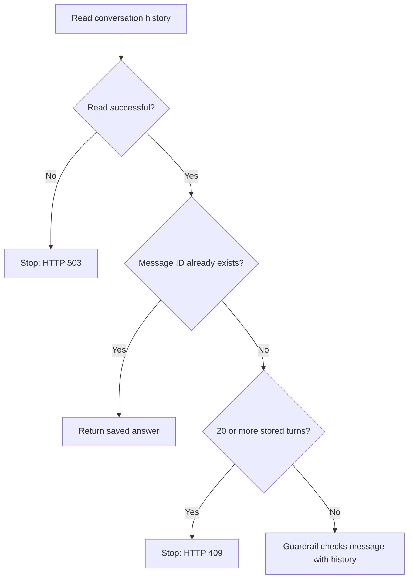
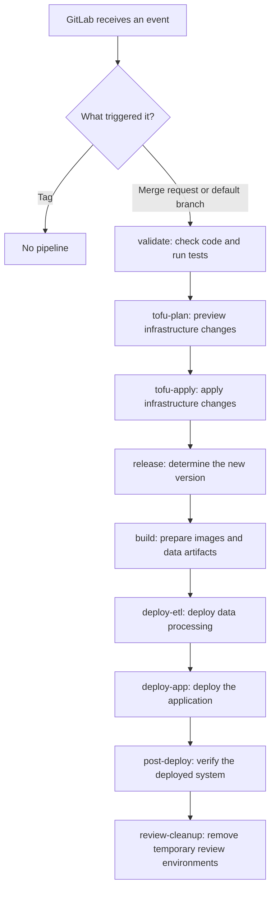

# Learning diary — 24 November 2026

Ticket 23.11 - 11.12 (Woche 30.11 - 5.12 Berufschule = fehlt aus)
Stand 24.11 : 1c,2b erledigt

- !1124 (merged)
- !1195 (merged)
- !1400 (merged)

## Merge requests

Folgende MRs werden analysiert

- 1a) https://gitlab.kilab-platform.de/renate/digibro-monorepo/-/merge_requests/1124
- 1b) https://gitlab.kilab-platform.de/renate/digibro-monorepo/-/merge_requests/1195
- 1c) https://gitlab.kilab-platform.de/renate/digibro-monorepo/-/merge_requests/1400

Was ändert sich? Warum? Woran sieht man, dass es geprüft wurde? Wird beantwortet

Bei !1124 (merged) nachvollgezogen: Wo steht die 180 im Code, wo im Test, wo in der Doku?

Zusatzlich : Themen wie AWS-Grundlagen, Docker und Container, IaC, OpenTofu erarbeitet

## Goals

- 2a) Stages validate -> tofu-plan -> tofu-apply -> build -> deploy verstehen

- 2b) Branch-/Commit-Konventionen lernen: Branch `<type>/<kurzbeschreibung>`, Conventional Commits (feat(scope): ...), pre-commit-Hook erklären können

- 2c) Lambdas, Buckets, die Knowledge Base im Code (cdk/lib/, terraform/live/dev/) finden, wo genau sie definiert sind

- 2d) 3 Ressourcen (z.B. eine Lambda, ein Bucket, eine CI-Rolle) herausfinden: CDK oder OpenTofu? Welche Datei? Als kurze Tabelle dokumentieren

## 1c) Conversation limit

https://gitlab.kilab-platform.de/renate/digibro-monorepo/-/merge_requests/1400

```json
"schema": {"$ref": "#/components/schemas/ErrorResponse"}
```

verstehe nicht was es macht

In `generate_OpenApi.py`

Antwort:

```python
"ErrorResponse": error_response,

error_response = {
    "type": "object",
    "properties": {
        "error": {"type": "string"},
        "message": {"type": "string"},
    },
    "required": ["error"],
}
```

also : "declaring the expected structure of an error response"

### Was ändert sich?

- neue funktionen : `_parse_chat_body`, `_process_traced`, `test_handle_chat_request_maps_limit_and_read_errors`
- neue class : `class ConversationLimitReachedError` in `conversation.py` mit `_load_history_within_limit`
- neue class : `class TestConversationLimit` in `test_chat_service.py`

Konstante deklariert wie viele message PAIR (prompt - respond) stored max :

```python
MAX_MESSAGES_PER_CONVERSATION = 20 #in chat_service.py
```

### Why?

stay within context window?

### Woran sieht man?

```python
if len(history_items) >= MAX_MESSAGES_PER_CONVERSATION:
    # Log that the limit was reached.
    raise ConversationLimitReachedError # in _enforce_conversation_limit
```

```python
def test_21st_message_is_rejected_without_model_call(self, service_parts, stored):
    service, store, guardrail, run_agent, _ = service_parts
    store.get_history.return_value = self._history(stored)

    with pytest.raises(ConversationLimitReachedError):
        service.process_message("Frage", "s1", message_id="s1#new")

    # The guardrail is an LLM call too, so it must not run either.
    guardrail.assert_not_called()
    run_agent.assert_not_called()
    store.store_conversation.assert_not_called()
```

es soll eine Session mit erst mal 20 dann 21 messages "gemockt" sein, und wird ConversationLimitReachedError erwartet, sonst check failed



## 1a) Conversation retention

- 180 im code : `cdk/parameter.js`
- im test : `cdk/test/utils/conversation-ttl-config.test.ts`
- in Doku: `docs/compliance/dsfa-consent-flow.md` und `docs/compliance/loeschkonzept.md`

### Was ändert sich?

Änderung beim chatbotParametersMap für dev,qa,preprod,prod, demo sollte weiterhin auf 30 tage bleiben, dazu frage Wo werden defaults gesetzt ? diese 30 tagen sind ja nicht explizit übergegeben bei demo parametrisierung, und bei Deklarierung der Parametern ist keine default value dabei

### Warum?

DSGVO konform zu machen

### Woran sieht man, dass es geprüft wurde?

CDK-Synthese für Dev bestätigt CONVERSATION_TTL_DAYS: "180" in der Chat-Lambda-Konfiguration

Code excerpt:

```typescript
test.each(['dev', 'qa', 'preprod', 'prod'] as const)(
  'configures %s for the DSFA retention period of 180 days',
  (envName) => {
    const params = getChatbotParameters(
      new cdk.App(),
      envName,
      chatbotParametersMap,
    );

    expect(params.conversationTtlDays).toBe(180);
```

prüft das beim conversationTtlDays für 'dev', 'qa', 'preprod', 'prod' wert 180 ist

## 2b) Branches, commits, and pre-commit hooks

### General file checks

checks cover syntax, formatting, and common mistakes

| Check | What it does |
| --- | --- |
| check-case-conflict | Detects names such as File.py and file.py that can conflict across operating systems |
| check-merge-conflict | Looks for unresolved merge markers such as <<<<<<< |
| check-toml, check-yaml, check-json | Checks whether those files have valid syntax |
| check-ast | Checks whether Python code can be parsed |
| check-builtin-literals | Encourages forms such as [] instead of list() |
| check-vcs-permalinks | Checks supported repository links use permanent commit references |
| forbid-new-submodules | Prevents adding Git submodules |
| check-executables-have-shebangs | Checks executable text files have an interpreter line such as #!/bin/bash |
| detect-private-key | Looks for private keys accidentally included in files |
| detect-aws-credentials | Looks for configured AWS credentials in files |
| end-of-file-fixer | Ensures a file ends with one newline |
| trailing-whitespace | Removes unnecessary spaces at line endings |
| mixed-line-ending | With --fix=lf, normalizes line endings to LF |
| check-added-large-files | With --maxkb=1024, rejects newly added files larger than 1024 KB |

### Commitizen: checking the commit message

commit-msg hook needs installation separately?

```bash
uv run pre-commit install --hook-type pre-commit --hook-type commit-msg
```

how do i check?

```bash
ls -la .git/hooks/commit-msg .git/hooks/pre-commit
```

```text
ls: cannot access '.git/hooks/commit-msg': No such file or directory !!!!
-rwxr-xr-x 1 notebook notebook 639 Nov 18 14:51 .git/hooks/pre-commit
```

| Hook | Command | Triggering files |
| --- | --- | --- |
| ESLint CDK | cd cdk && npm run lint | .js files under cdk/ |
| ESLint frontend | cd drv-frontend && npm run lint -- --fix | .ts, .js, .html under frontend src/ |
| TypeScript frontend | cd drv-frontend && npx tsc --noEmit | .ts under frontend src/ |
| TypeScript CDK | cd cdk && npm run build | .ts under cdk/ |

### Run checks before committing

```bash
uv run pre-commit run --all-files
```

### Branch convention

 ?? New branch for feat():, test():, fix(): Branch names follow `<type>/<short-description>` (e.g. `feat/streaming-chat`,
  `chore/remove-kiro-folder`)

### Commit convention

 ?? fix(chat): Konversationslimit 20, wiederholte message_id idempotent beantworten
Commit messages follow the cocogitto conventional-commit style already
  enforced by the pre-commit hook

## 2a) CI/CD pipeline

Stages validate -> tofu-plan -> tofu-apply -> build -> deploy

Stage ist eine Gruppe von Jobs

### `.gitlab/ci` structure

```text
ci/
    validate/                  Checks before building/deploying
        backend.yml            Python tests, linting, type checks
        frontend.yml           Frontend checks
        cdk.yml                Application infrastructure checks
        terraform.yml          OpenTofu infrastructure checks
        api-contract.yml       API contract checks
        docs.yml               Documentation checks
        deploy.yml             Deployment tooling checks

    infra/                     OpenTofu infrastructure jobs
        tofu-plan-mr.yml       Preview infrastructure changes
        tofu-apply.yml         Apply infrastructure changes

    cocogitto.yml              Automated versioning/release jobs
    release/
        release.yml            Another versioning job definition*

    build/
        lambda.yml             Backend container build jobs

    deploy/                    Deployment jobs
        _bases.yml             Shared job templates
        dev.yml                Dev deployment and follow-up jobs
        lambda.yml             Lambda-related jobs
        frontend.yml           Frontend deployment
        etl.yml                Data-processing deployment
        data-artifacts.yml     Knowledge-data artifact jobs
        frontend-browser-smoke.yml
                               Basic browser checks after deployment

        qa/                    QA promotion and rollback
        preprod/               Preproduction promotion and rollback
        prod/                  Production promotion, rollback,
                               certificate renewal

    review/
        deploy.yml             Temporary review-environment jobs

    migrations/                Jobs for specific data/config changes
    banner/                    Text displayed during jobs

    scripts/                   Actual implementation
        validate/              Check deployment prerequisites
        build/                 Prepare/publish artifacts
        deploy/                Deploy resources and activate versions
        verify/                Check the deployed system works
        release/               Open promotion MRs, publish pages/tags
        ops/                   Maintenance, rollback, certificates
        teardown/              Remove temporary review environments
        util/                  Helpers used across different tasks
        lib/                   Shared functions loaded by scripts
            node/              Shared JavaScript modules
        tests/                 Tests for the CI scripts themselves
```

### Pipeline overview

**declared stage order, not 1 continous pipeline, MR between Dev, QA, Prod**



### Workflow rules

`.gitlab-ci.yml`:

```yaml
workflow:
  rules:
    - if: $CI_COMMIT_TAG #Git tag names a particular commit, usually to mark a version Commit a1b2c3 ← tag: 3.71.0
      when: never
    - if: $CI_PIPELINE_SOURCE == "merge_request_event"
    - if: $CI_COMMIT_BRANCH == $CI_DEFAULT_BRANCH
```

| Rule | Meaning | Result |
| --- | --- | --- |
| $CI_COMMIT_TAG | This event is for a Git tag | No pipeline |
| Source equals "merge_request_event" | A merge request is created or updated | Create a pipeline |
| Branch equals the default branch | The event concerns your default branch | Create a pipeline |
| Nothing matches | For example, a push to a feature branch without an MR | No pipeline |

So if i create a branch for feature development and push there there will be no pipeline triggered? only when i try to merge with main ?

### Included configuration files

`.gitlab-ci.yml`:

```yaml
include:
  - local: .gitlab/ci/validate/backend.yml
  - local: .gitlab/ci/build/lambda.yml
  - local: .gitlab/ci/deploy/dev.yml
```

“Read these files too and combine their configuration into this pipeline.”

### Jobs and templates

For example, `validate/backend.yml`:

```yaml
backend-tests:
  stage: validate
  extends: .setup-python
```

- `backend-tests`: the job’s name.
- `stage: validate`: place this job in the validate stage.
- `extends: .setup-python`: reuse settings from a template called `.setup-python`. A job template contains settings other jobs can reuse.

Example template:

```yaml
.setup-python:
  image: gitlab.kilab-platform.de:5050/platform/ci-images/python-uv:2.0.0 #image specifies a container image: a prepared environment containing the tools the job needs.
  variables:
    UV_CACHE_DIR: '$CI_PROJECT_DIR/.cache/uv'
  before_script:
    - uv sync --frozen #preparation command: runs before the job’s main commands in script
  cache:
    key:
      files:
        - uv.lock
    paths:
      - .cache/uv/
```

### Actual test command

```yaml
script:
  - uv run --package digibro-backend python -m pytest
    backend
    --cov
    --cov-config=backend/pyproject.toml
    --cov-report=xml
    --ignore=.cache
```

| Part | Meaning |
| --- | --- |
| uv run | Run a command in the project’s Python environment |
| --package digibro-backend | Select the backend package in the workspace |
| python -m pytest | Start the pytest test runner |
| backend | Look for tests inside backend/ |
| --cov | Measure which code the tests execute—called coverage (do not undrstand yet) |
| --cov-config=backend/pyproject.toml | Read coverage settings from this file |
| --cov-report=xml | Save coverage results in XML format |
| --ignore=.cache | Skip this path when discovering tests |

Pytest discovers tests such as:

```python
def test_21st_message_is_rejected_without_model_call(...):
    ...
```

If a test fails, pytest returns a nonzero exit code. The runner treats that as a command failure, so backend-tests fails. If all tests pass, the command normally returns 0, meaning success.

### GitLab, runner, and image

| Component | Purpose |
| --- | --- |
| GitLab | Organizes the pipeline and assigns work |
| Runner | Executes the jobs |
| Container image | Supplies the job’s tools, such as Python and uv |

- `.gitlab-ci.yml`: the starting configuration.
- Included YAML files: additional job definitions combined with it.
- Other YAML files: ignored by the pipeline unless explicitly referenced or read by a tool.

## Open questions

- Should we create a README.md?
- Current jobs table with purpose?
