# arc42 Architekturdokumentation: DigiBro-Monorepo

**Version:** 2.0
**Stand:** 2026-06-12
**Projekt:** Renate - KI-gestützter Chatbot für die Deutsche Rentenversicherung Bund

---

## 1. Einführung und Ziele

### 1.1 Aufgabenstellung

Das DigiBro-Monorepo implementiert "Renate", einen KI-gestützten Chatbot-Assistenten für die Deutsche Rentenversicherung Bund (DRV-Bund). Das System hilft deutschen Bürgern bei Fragen rund um das Thema Rente durch natürlichsprachige Interaktion auf Basis offizieller DRV-Dokumentation.

**Hauptfunktionen:**

- KI-gestützte Beantwortung von Rentenfragen in deutscher Sprache
- Wissensbasierte Suche in offiziellen DRV-Dokumenten (RAG oder Agent Search)
- **Mehrturn-Konversationen** mit Kontext-Persistenz über DynamoDB
- Dokumentenverarbeitung und -aufbereitung (ETL-Pipeline)
- Benutzerauthentifizierung mit E-Mail-Domain-Validierung
- Mehrsprachiges Web-Interface mit DRV-Design-System
- Glossar-Integration mit 17 kuratierten DRV-Fachbegriffen

### 1.2 Qualitätsziele

| Priorität | Qualitätsmerkmal   | Beschreibung                                                                             |
| --------- | ------------------ | ---------------------------------------------------------------------------------------- |
| 1         | **Korrektheit**    | Antworten müssen auf offiziellen DRV-Dokumenten basieren, keine erfundenen Informationen |
| 2         | **Verfügbarkeit**  | 99,5% Verfügbarkeit während Geschäftszeiten (8-18 Uhr)                                   |
| 3         | **Performance**    | API-Antwortzeit <2s (p95), Agent-Antwortzeit <5s (p95)                                   |
| 4         | **Sicherheit**     | DSGVO-konforme Datenverarbeitung, keine personenbezogenen Daten in Logs                  |
| 5         | **Skalierbarkeit** | Automatische Skalierung für 100-10.000 gleichzeitige Nutzer                              |
| 6         | **Wartbarkeit**    | Klare Modulstruktur, umfassende Dokumentation, automatisierte Tests                      |

### 1.3 Stakeholder

| Rolle                      | Erwartungshaltung                                                       |
| -------------------------- | ----------------------------------------------------------------------- |
| **Versicherte**            | Einfache, verständliche Antworten auf Rentenfragen in deutscher Sprache |
| **DRV-Fachbereich**        | Korrekte, aktuelle Informationen basierend auf offiziellen Richtlinien  |
| **Entwicklungsteam**       | Wartbare, testbare Codebasis mit klarer Architektur                     |
| **Betriebsteam**           | Zuverlässiges, überwachbares System mit geringen Betriebskosten         |
| **Architekten**            | Integration der Software in den Bestand                                 |
| **Compliance/Datenschutz** | DSGVO-Konformität, Datenschutz, Nachvollziehbarkeit                     |
| **IT-Security**            | Sichere Authentifizierung, Verschlüsselung, Zugriffskontrolle           |

---

## 2. Randbedingungen

### 2.1 Technische Randbedingungen

| Randbedingung          | Beschreibung                                                          |
| ---------------------- | --------------------------------------------------------------------- |
| **AWS Cloud**          | Gesamte Infrastruktur läuft in AWS (eu-central-1)                     |
| **Serverless**         | Verwendung von AWS Lambda für Backend-Services                        |
| **Python 3.12**        | Backend-Entwicklung in Python 3.12+                                   |
| **Angular 20**         | Frontend basiert auf Angular 20                                       |
| **AWS Bedrock**        | KI-Funktionalität über AWS Bedrock (openai.gpt-oss-120b-1:0)          |
| **uv Package Manager** | Python-Dependency-Management mit uv                                   |
| **npm**                | JavaScript/TypeScript-Dependency-Management mit npm                   |
| **Monorepo-Struktur**  | Backend, Frontend, Infrastructure in einem Repository                 |
| **OpenTofu**           | Plattform-Infrastruktur (IAM, Langfuse, ECR) via OpenTofu ~1.11       |
| **GitLab CI/CD**       | Vollautomatisierte Pipeline mit OIDC-Auth und Cocogitto-Versionierung |

### 2.2 Organisatorische Randbedingungen

| Randbedingung            | Beschreibung                                                 |
| ------------------------ | ------------------------------------------------------------ |
| **Entwicklungsmethodik** | Agile Entwicklung mit CI/CD-Pipeline                         |
| **Repository**           | Self-hosted GitLab (gitlab.kilab-platform.de)                |
| **Code-Qualität**        | Pre-commit hooks, Linting (ruff, ESLint), Type-Checking (ty) |
| **Testing**              | Unit-Tests (pytest, Karma/Jasmine), Integration-Tests        |
| **Dokumentation**        | MkDocs für technische Dokumentation                          |
| **Deployment**           | Infrastructure as Code mit AWS CDK + OpenTofu                |

### 2.3 Konventionen

| Konvention           | Beschreibung                                                          |
| -------------------- | --------------------------------------------------------------------- |
| **Sprache**          | Code und Kommentare in Englisch, Systemanweisungen/Prompts in Deutsch |
| **Coding Standards** | PEP 8 für Python, Angular Style Guide für TypeScript                  |
| **Commit Messages**  | Conventional Commits Format (erzwungen via Cocogitto)                 |
| **Branch-Strategie** | Feature Branches mit Merge Requests                                   |
| **Versionierung**    | Automatische Semver-Bumps via Cocogitto auf master                    |

### 2.4 Rechtliche Randbedingungen

- **DSGVO-Konformität**: Alle personenbezogenen Daten müssen DSGVO-konform verarbeitet werden
- **Keine Rechtberatung**: System darf keine verbindliche Rechtsberatung geben
- **Barrierefreiheit**: Einhaltung der Barrierefreiheitsanforderungen für öffentliche Stellen

---

## 3. Kontextabgrenzung

### 3.1 Fachlicher Kontext

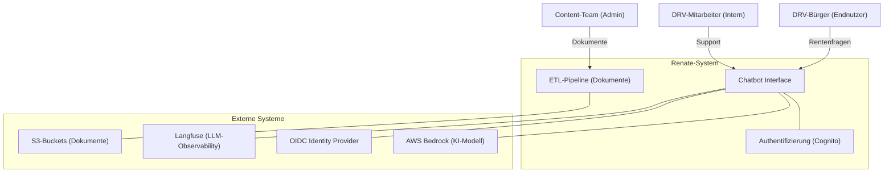

**Externe Schnittstellen:**

| Schnittstelle              | Richtung | Beschreibung                                          |
| -------------------------- | -------- | ----------------------------------------------------- |
| **Endnutzer-Browser**      | ↔        | HTTPS-Kommunikation mit Angular-Frontend              |
| **AWS Bedrock**            | →        | Anfragen an GPT OSS 120B LLM (Cross-Region Inference) |
| **Bedrock Knowledge Base** | →        | Vektorbasierte Dokumentensuche                        |
| **Bedrock Guardrails**     | →        | Content-Safety-Filter für LLM                         |
| **OIDC Identity Provider** | ↔        | Externe Authentifizierung (optional)                  |
| **S3-Buckets**             | ↔        | Dokumenten-Upload und -Speicherung                    |
| **DynamoDB**               | ↔        | Konversationsspeicherung und Feedback                 |
| **Langfuse**               | →        | LLM-Traces, Prompt-Analyse, Feedback-Korrelation      |
| **CloudWatch**             | ←        | Logging und Monitoring                                |
| **AWS WAF**                | →        | API-Schutz (Rate Limiting, Managed Rules)             |

### 3.2 Technischer Kontext

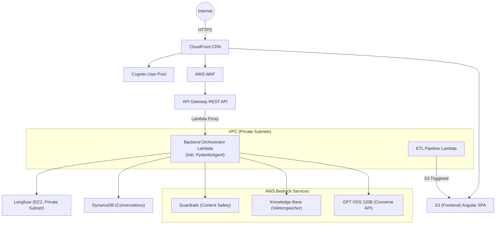

**Technologien:**

- **Frontend**: Angular 20, TypeScript 5.5, AWS Amplify
- **Backend**: Python 3.12, pydantic-ai Framework, Bedrock Converse API
- **Infrastructure**: AWS CDK 2.x (Applikation), OpenTofu ~1.11 (Plattform)
- **Datenbank**: AWS S3 Vectors (Vektordatenbank)
- **Authentifizierung**: AWS Cognito (JWT-Tokens)
- **API**: REST via API Gateway (WAF-geschützt)
- **CDN**: CloudFront + S3
- **Observability**: CloudWatch + X-Ray + Langfuse (LLM-spezifisch)
- **CI/CD**: GitLab mit OIDC, Cocogitto, Buildah

---

## 4. Lösungsstrategie

### 4.1 Architekturstil: Serverless Microservices

**Entscheidung**: Vollständig serverlose Architektur auf Basis von AWS Lambda.

**Begründung**:

- Automatische Skalierung von 0 bis N Nutzern
- Pay-per-Use Kostenmodell
- Keine Serverwartung erforderlich
- Hohe Verfügbarkeit durch AWS-Managed Services

### 4.2 Monorepo-Strategie

**Entscheidung**: Backend, Frontend und Infrastructure in einem Repository.

**Begründung**:

- Atomare Commits über alle Komponenten
- Vereinfachte Dependency-Verwaltung
- Einheitliche CI/CD-Pipeline
- Bessere Code-Wiederverwendung

### 4.3 KI-Strategie: pydantic-ai Agent

**Entscheidung**: pydantic-ai Framework mit typsicheren Tools und Bedrock Converse API.

**Begründung**:

- Typsichere Tool-Parameter mit Pydantic-Validierung
- Direkte Bedrock Converse API Integration
- Einfache Erweiterbarkeit (neue Tools hinzufügen)
- Bessere Testbarkeit durch Dependency Injection
- MVC-Architektur (Controller, Service, Agent)
- **Mehrturn-Support** via `message_history` Parameter

### 4.4 Dokumentenverarbeitung: ETL-Pipeline

**Entscheidung**: Event-getriebene ETL-Pipeline für Dokumententransformation.

**Begründung**:

- Automatische Verarbeitung bei S3-Upload
- Modulare Transform-Ketten (DITA→MD, PDF→MD, Chunking)
- Wiederverwendbare Transform-Komponenten
- Klare Trennung: Ingest → Transform → Output

### 4.5 Frontend-Strategie: Single Page Application

**Entscheidung**: Angular 20 SPA mit DRV Design System.

**Begründung**:

- Native Integration mit DRV-Styleguide
- Reactive Forms und Services für Zustandsverwaltung
- TypeScript für Typsicherheit
- AWS Amplify für vereinfachte Cognito-Integration

### 4.6 Infrastructure as Code

**Entscheidung**: AWS CDK für Applikations-Stack, OpenTofu für Plattform-Infrastruktur.

**Begründung**:

- CDK: Versionskontrolle, wiederholbare Deployments, Type-Safety, Reusable Constructs
- OpenTofu: Strikte Trennung Bootstrap (operator-applied) vs. Live (CI-managed)
- Zwei-Schichten-Modell verhindert Privilege Escalation in CI

### 4.7 Sicherheitsarchitektur

**Schichtenmodell**:

1. **WAF**: Rate Limiting, Managed Rules (OWASP, Bad Inputs, IP-Reputation)
2. **Netzwerkebene**: VPC, Security Groups, Private Subnets
3. **Authentifizierung**: Cognito mit E-Mail-Domain-Validierung
4. **Autorisierung**: API Gateway Cognito Authorizer
5. **Verschlüsselung**: TLS für Transit, S3-Encryption für Data at Rest
6. **IAM**: Least-Privilege-Prinzip für alle Rollen
7. **Content Safety**: Zwei-Schicht-Guardrails (Bedrock + Nova Lite Agent)

### 4.8 Mehrturn-Konversationen

**Entscheidung**: Konversationshistorie in DynamoDB mit automatischer Wiederherstellung im Frontend.

**Begründung**:

- pydantic-ai unterstützt `message_history` Parameter nativ
- DynamoDB bietet kostengünstige, skalierbare Persistenz
- Session-basierte Isolation (PK: `session_id`, SK: `message_id`)
- Frontend lädt Historie bei Seitenaktualisierung automatisch

**Implementierung**:

- **Backend**: `ConversationStore.get_history()` → `history_converter.items_to_messages()` → Agent
- **Frontend**: `SessionService.hadExistingSession()` → `BedrockChatService.loadHistory()` → UI
- **Token-Budget**: Max. 20 Austausch-Paare (~10k Tokens) für Kontextfenster-Kompatibilität

### 4.9 RAG-Enhancements

**Entscheidung**: Konfigurierbares Retrieval-Enhancement-System mit mehreren Strategien.

**Begründung**:

- HyDE verbessert Recall bei vagen Nutzerfragen
- BM25 ergänzt Vektorsuche durch exakte Keyword-Treffer (deutsche Stemmung + Dekomposition)
- Anchor-first priorisiert hochwertige Broschüren nach S/A/B-Tier
- Bedrock Reranker verbessert Precision nach initialer Retrieval
- Alle Features per Env-Var schaltbar → A/B-Testing möglich

### 4.10 Glossar-Integration

**Entscheidung**: 17 kuratierte DRV-Fachbegriffe (`glossary.json`) als System-Prompt-Kontext.

**Begründung**:

- Kein separater LLM-Call nötig (alle Begriffe als `[GLOSSAR-KONTEXT]` im Prompt)
- Agent korrigiert Nutzer-Missverständnisse im normalen Tool-Call-Ablauf
- Offizielle DRV-Terminologie wird konsistent verwendet
- Einfach erweiterbar (JSON-Datei editieren)

---

## 5. Bausteinsicht

### 5.1 Ebene 1: Systemkontext

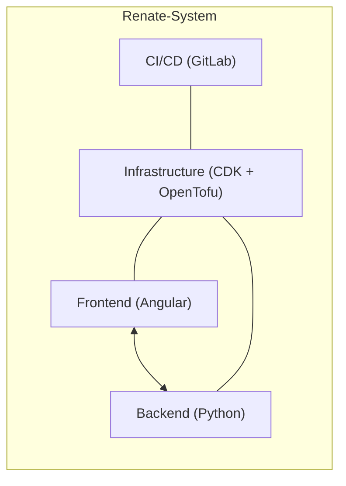

### 5.2 Ebene 2: Frontend (`drv-frontend/`)

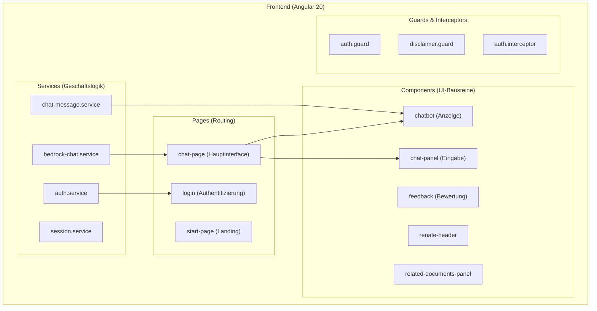

**Verantwortlichkeiten**:

- Darstellung der Chat-Oberfläche im DRV Design System
- Verwaltung von Benutzer-Sessions
- HTTP-Kommunikation mit Backend (API Gateway)
- Authentifizierung über AWS Amplify/Cognito
- Client-seitiges State Management

### 5.3 Ebene 2: Backend (`backend/`)

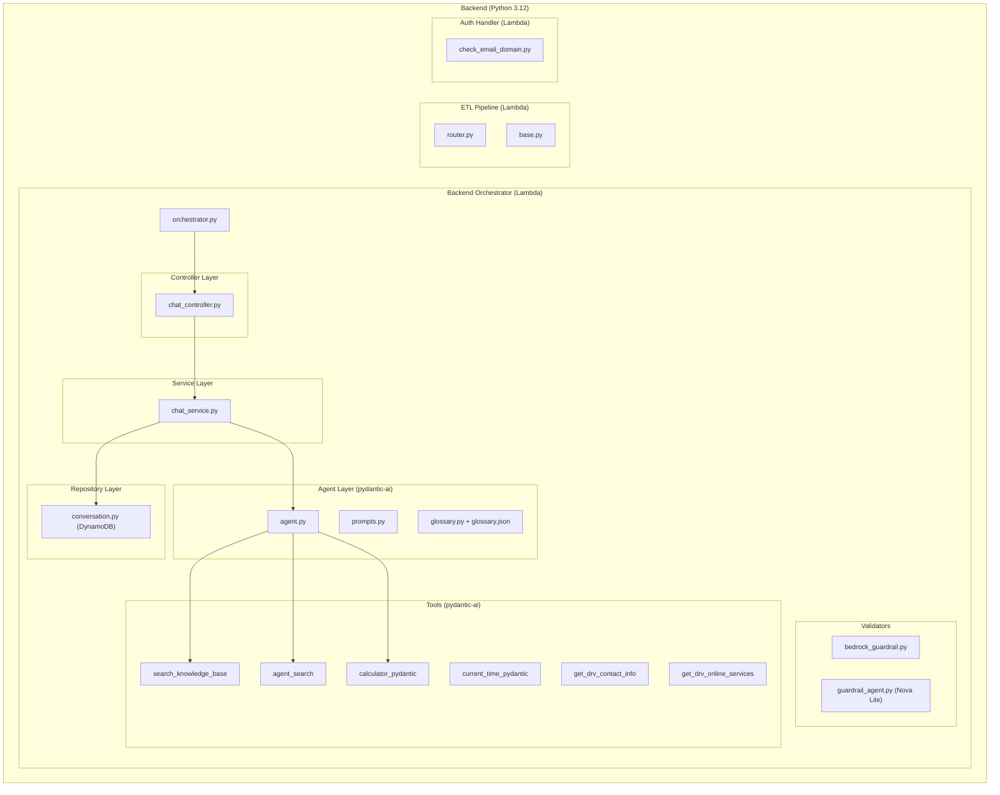

**Verantwortlichkeiten**:

- **Backend Orchestrator**: API-Einstiegspunkt mit MVC-Architektur
  - **Controller**: HTTP Request/Response Handling
  - **Service**: Geschäftslogik, Validierung, Agent-Aufruf
  - **Repository**: Persistenz von Konversationen in DynamoDB
  - **Agent**: pydantic-ai Agent mit 6 typsicheren Tools + Glossar-Kontext
  - **Validators**: Zwei-Schicht-Guardrails (Bedrock + Nova Lite Agent)
- **ETL Pipeline**: Dokumententransformation für Knowledge Base-Ingestion
- **Auth Handler**: Benutzervalidierung bei Registrierung

### 5.4 Ebene 2: Infrastructure (`cdk/` + `terraform/`)

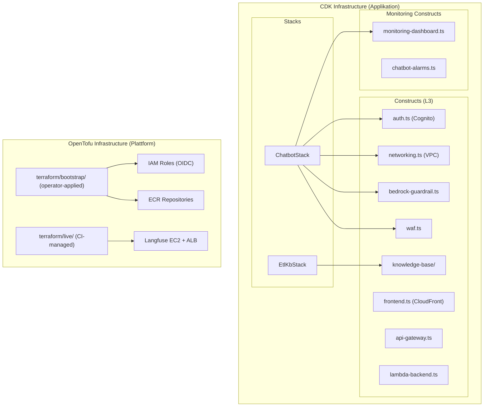

### 5.5 Ebene 3: ETL-Pipeline-Details

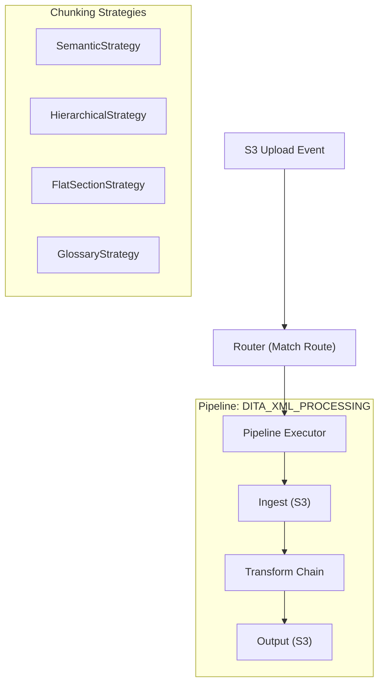

**Chunking-Strategien** (`backend/src/etl/util/chunking/`):

| Strategie              | Anwendungsfall                          |
| ---------------------- | --------------------------------------- |
| `SemanticStrategy`     | Inhaltlich zusammenhängende Abschnitte  |
| `HierarchicalStrategy` | Überschriften-basierte Hierarchie       |
| `FlatSectionStrategy`  | Einfache Abschnitts-Trennung            |
| `GlossaryStrategy`     | Glossar-Einträge (Begriff + Definition) |

---

## 6. Laufzeitsicht

### 6.1 Szenario: Chat-Anfrage (User fragt nach Altersrente)

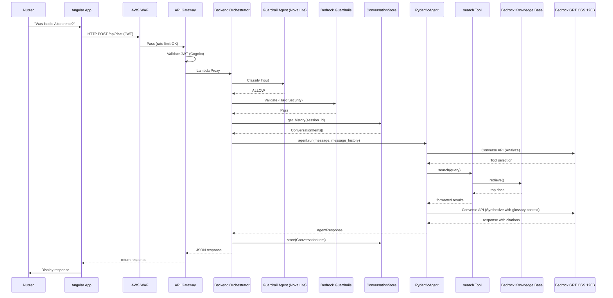

### 6.2 Szenario: Mehrturn-Konversation (Folgefrage)

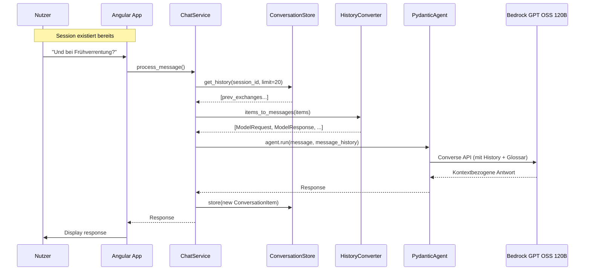

### 6.3 Szenario: Frontend Session-Wiederherstellung

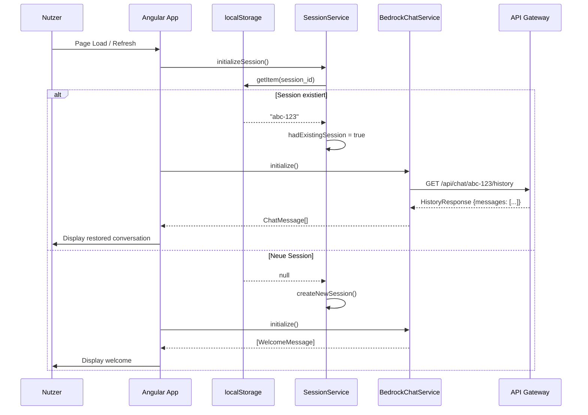

### 6.4 Szenario: Dokumentenverarbeitung (DITA-Upload)

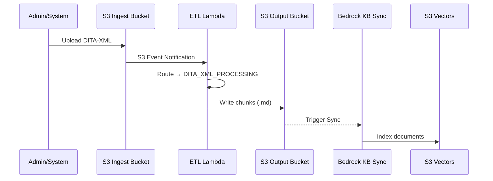

### 6.5 Szenario: CI/CD Deployment (master merge)

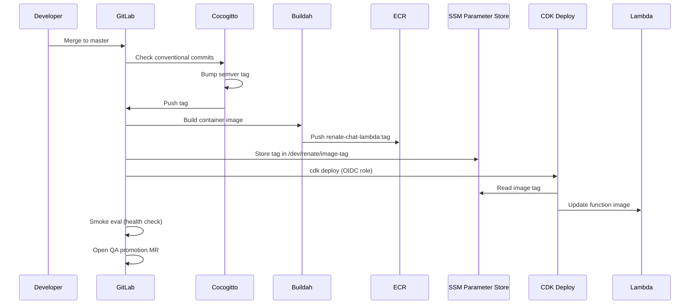

---

## 7. Verteilungssicht

### 7.1 AWS-Infrastruktur (eu-central-1)

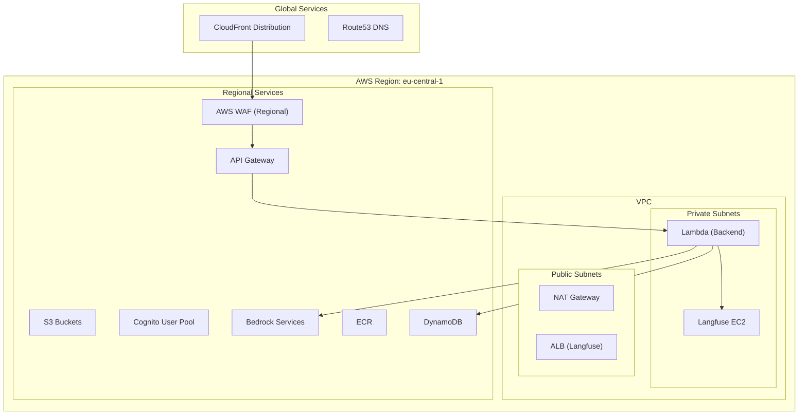

### 7.2 Deployment-Artefakte

| Komponente               | Deployment-Typ     | Artefakt              | Größe (ca.) |
| ------------------------ | ------------------ | --------------------- | ----------- |
| **Frontend**             | S3 + CloudFront    | Angular Build (dist/) | ~5 MB       |
| **Backend Orchestrator** | Lambda Container   | Docker Image (ECR)    | ~500 MB     |
| **ETL Pipeline**         | Lambda Container   | Docker Image          | ~600 MB     |
| **Auth Handler**         | Lambda Zip         | Python Package        | ~5 MB       |
| **Langfuse**             | EC2 Docker Compose | Packer AMI            | ~2 GB       |

### 7.3 Infrastructure Layers

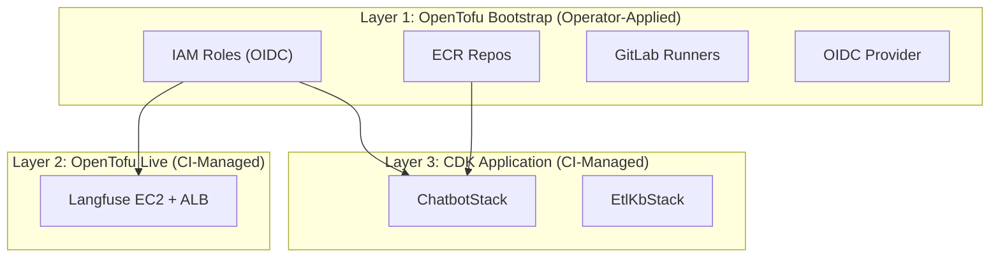

**Deployment-Reihenfolge**:

1. `terraform/bootstrap/` — einmalig, operator-applied (IAM, OIDC, ECR)
2. `terraform/live/` — CI-managed (Langfuse, per-env)
3. CDK Stacks — CI-managed nach Version-Bump

### 7.4 CI/CD-Infrastruktur

- **GitLab**: Self-hosted at gitlab.kilab-platform.de
- **Runners**: Self-hosted im Dev-Account, Autoscale 0–20, Packer AMI-basiert
- **Container Registry**: Private Registry (gitlab.kilab-platform.de:5050)
- **Auth**: OIDC Tokens → `sts assume-role-with-web-identity` (keine Long-lived Credentials)
- **Review Environments**: Branch-basierte isolierte Umgebungen für Feature-Testing ohne Master-Merge

---

## 8. Querschnittliche Konzepte

### 8.1 Sicherheit

#### 8.1.1 AWS WAF

Regional WAF WebACL am API Gateway (Phase 1, eu-central-1):

**Managed Rule Groups**:

- `AWSManagedRulesCommonRuleSet` — OWASP Top 10
- `AWSManagedRulesKnownBadInputsRuleSet` — bekannte Angriffsmuster (Log4j etc.)
- `AWSManagedRulesAmazonIpReputationList` — bösartige IPs

**Rate Limiting**: 500 req/5min (prod), 100 req/5min (dev/qa), begrenzt auf `POST /api/chat`.

**Bot Control**: Optionale Managed Rule Group (Standard: AUS).

**Deployment**: Erst COUNT-Modus, nach Validierung Umstellung auf BLOCK.

**Phase 2 (aufgeschoben)**: CloudFront WAF in us-east-1 für Edge-Schutz.

#### 8.1.2 Authentifizierung und Autorisierung

**Schichtenmodell**:

1. **Cognito User Pool**: Zentrales Identity Management (E-Mail/Passwort + OIDC)
2. **JWT-Tokens**: Access Token (1h), Refresh Token (30d), ID Token
3. **API Gateway Authorizer**: Cognito User Pool Authorizer
4. **Frontend Auth Interceptor**: Automatische JWT-Injection, Token-Refresh

#### 8.1.3 Bedrock Guardrails (Layer 1 — Hard Security)

Konfigurierbare Filter (Standard: HIGH, PROMPT_ATTACK: MEDIUM):

- HATE, INSULTS, SEXUAL, VIOLENCE, MISCONDUCT
- PROMPT_ATTACK auf MEDIUM gesetzt (HIGH verursachte False Positives bei selbstreferenziellen Fragen)

**PII-Erkennung**: IBAN + Kreditkarte (BLOCK), Sozialversicherungsnummer (BLOCK via Regex), E-Mail/Telefon/Name (erlaubt)

**Fail-Behavior**: Immer fail-closed.

#### 8.1.4 Guardrail Agent (Layer 2 — Nova Lite)

**Nuancierte Klassifikation** (`backend/src/backend_orchestrator/validators/guardrail_agent.py`):

Ein leichtgewichtiger LLM-Agent (Nova Lite) klassifiziert Nutzereingaben in 5 Kategorien:

| Kategorie             | Aktion                                                 |
| --------------------- | ------------------------------------------------------ |
| ALLOW                 | Weiterleitung an RAG + Hauptagent                      |
| BLOCK_STANDARD_1      | Standardantwort: Off-Topic / respektlose Kommunikation |
| BLOCK_STANDARD_2      | Verweis ans Servicetelefon (zu spezifisch)             |
| CLARIFY               | Rückfrage an den Nutzer                                |
| ALLOW_WITH_CORRECTION | Weiterleitung mit Korrekturhinweis (falsche Annahmen)  |

**Architektur-Entscheidung**: Bedrock Guardrails sind binär (DENY/ALLOW) und zu ungenau für die DRV-Anforderungen. Der Agent ermöglicht nuancierte Unterscheidung zwischen politischen Fragen, Einzelfallberatung, mehrdeutigen Anfragen und beantwortbaren Fragen mit falschen Annahmen.

**Selbstreferenzielle Fragen**: Explizit als ALLOW klassifiziert ("Wer bist du?", "Bist du eine KI?", "Was sind deine Quellen?", "Wer hat dich programmiert?"). Diese werden NICHT blockiert.

**Fail-Behavior**: Fail-open NUR bei transienten Fehlern (Throttling/Timeout). Fail-closed bei allen anderen Fehlern. Dies stellt sicher, dass bei vorübergehender Nichterreichbarkeit keine legitimen Fragen blockiert werden, während permanente Fehler die Sicherheit nicht kompromittieren.

**Sicherheit**: Das `reason`-Feld vom Klassifikations-Agent wird NIEMALS in den Prompt des Hauptagenten injiziert (Prompt-Injection-Vektor). Nur statische Instruktionen werden verwendet.

**Monitoring**: CloudWatch Alarm bei >20 Violations in 5 Minuten (möglicher Missbrauch).

#### 8.1.5 Verschlüsselung

| Ebene               | Mechanismus           | Details                        |
| ------------------- | --------------------- | ------------------------------ |
| **Data in Transit** | TLS 1.2+              | Alle HTTPS-Verbindungen        |
| **Data at Rest**    | S3 SSE-S3             | S3-Bucket-Encryption           |
| **Data at Rest**    | S3 Vectors Encryption | Node-to-node + At-rest         |
| **Secrets**         | AWS Secrets Manager   | API-Keys, Langfuse-Credentials |

#### 8.1.6 Datenschutz (DSGVO)

- **Keine PII in Logs**: Logger filtert sensible Daten
- **Session-Daten**: In DynamoDB mit TTL
- **Audit-Trail**: CloudWatch Logs für alle API-Aufrufe
- **Datenminimierung**: Nur notwendige Daten werden gespeichert
- **Guardrails**: Automatische PII-Filterung vor LLM-Verarbeitung

### 8.2 Logging und Monitoring

#### 8.2.1 Drei-Säulen-Observability

| Säule                   | Tool       | Zweck                                          |
| ----------------------- | ---------- | ---------------------------------------------- |
| **Operational Metrics** | CloudWatch | Lambda, API GW, DLQ Metriken + Alarme          |
| **Distributed Tracing** | X-Ray      | Infrastruktur-Level Request-Tracing            |
| **LLM Observability**   | Langfuse   | Prompt-Analyse, Token-Usage, Response-Qualität |

#### 8.2.2 Langfuse (LLM-Observability)

**Architektur**: Self-hosted auf EC2 (Private Subnet), ALB-Frontend, Docker Compose (Web + Worker, PostgreSQL, ClickHouse, Redis).

**Integration**:

- OTel-Traces via `BatchSpanProcessor` → OTLP HTTP Endpoint
- Secrets aus AWS Secrets Manager, gelesen bei Lambda Cold Start
- `langfuse_trace_id` in DynamoDB für Feedback-Korrelation

**Authentifizierung**: Authentik OIDC (kein lokaler Login).

**Feedback-Korrelation**: Nutzer-Feedback (Daumen hoch/runter) wird über `langfuse_trace_id` mit LLM-Traces verknüpft → Qualitätsanalyse welche Prompts/Retrievals gute/schlechte Antworten produzieren.

#### 8.2.3 CloudWatch Dashboard

- System Health: API 5XX/4XX, Chat Errors, ETL Errors
- Lambda Performance: Invocations, Duration (P95), Errors & Throttles
- API Gateway: Request Count, Latency (P95)
- ETL Queue: Queue Depth, DLQ Messages
- Bedrock: Token Usage, Invocations, Errors

#### 8.2.4 Alarme

Kritische Alarme (SNS → E-Mail):

- Lambda Error Rate > 5%
- API Gateway 5xx Rate > 1%
- Lambda Duration > 5s (p95)
- Concurrent Executions > 80% Limit
- DLQ Messages > 0

### 8.3 Fehlerbehandlung

- **Frontend**: HTTP Error Interceptor (401 → Login, 5xx → Fehlermeldung)
- **Backend**: Structured exception handling (ValidationError → 400, Throttling → 503, Unexpected → 500)
- **ETL**: Dead Letter Queue für fehlgeschlagene Events, Partial Success bei Multi-Chunk
- **Guardrails**: Layer 1 fail-closed, Layer 2 fail-open nur bei Throttling/Timeout

### 8.4 Konfigurationsverwaltung

**Backend (Lambda Environment Variables via CDK)**:

| Variable                   | Default                   | Zweck                  |
| -------------------------- | ------------------------- | ---------------------- |
| `BEDROCK_MODEL_ID`         | `openai.gpt-oss-120b-1:0` | Haupt-LLM              |
| `SEARCH_MODE`              | `rag`                     | `rag` oder `agent`     |
| `GUARDRAIL_AGENT_MODEL_ID` | (leer = deaktiviert)      | Nova Lite Guardrail    |
| `HYDE_ENABLED`             | `false`                   | HyDE Query Expansion   |
| `BM25_ENABLED`             | `false`                   | Hybrid BM25 Search     |
| `ANCHOR_RETRIEVAL_ENABLED` | `true`                    | Anchor-first Retrieval |
| `LANGFUSE_HOST`            | (leer = deaktiviert)      | Langfuse Endpoint      |
| `LANGFUSE_SECRET_NAME`     | —                         | Secrets Manager Key    |

### 8.5 Testkonzept

#### Test-Pyramide

- **Unit Tests (75%)**: pytest (Backend), Karma/Jasmine (Frontend), Jest (CDK)
- **Integration Tests (20%)**: Backend AWS-Service-Mocks, CDK Assertion Tests
- **E2E (5%)**: Smoke-Checks nach Deploy

#### Spezial-Tests

- `make backend-check`: Ruff + ty + deptry
- shellcheck + bats für CI-Scripts
- Evaluation und Lasttests werden in separaten Repos gepflegt (nicht Teil des Deployment-Stacks)

---

## 9. Architekturentscheidungen

### ADR-001: Serverless Architektur mit AWS Lambda

**Status**: Akzeptiert

**Entscheidung**: AWS Lambda für alle Backend-Services.

**Begründung**: Automatische Skalierung, Pay-per-Use, keine Serverwartung, native AWS-Integration.

**Konsequenzen**: ✓ Reduzierte Kosten, hohe Verfügbarkeit. ✗ Cold Start Latenz, 15min Execution Limit.

---

### ADR-002: Monorepo mit Makefile-Orchestrierung

**Status**: Akzeptiert

**Entscheidung**: Monorepo mit zentralem Makefile.

**Begründung**: Atomare Commits, einheitliche CI/CD, bessere Code-Wiederverwendung.

---

### ADR-003: pydantic-ai Framework für Agent-Implementierung

**Status**: Akzeptiert

**Entscheidung**: pydantic-ai mit Bedrock Converse API.

**Begründung**: Native Bedrock-Integration, typsichere Tools, Dependency Injection, `message_history` Support.

---

### ADR-004: DITA XML als Quellformat

**Status**: Akzeptiert

**Entscheidung**: ETL-Pipeline mit DITA-Parser.

**Begründung**: Kompatibilität mit DRV-CMS, strukturierte Metadaten, Content-Wiederverwendung.

---

### ADR-005: Angular 20 mit DRV Design System

**Status**: Akzeptiert

**Entscheidung**: Angular 20 SPA.

**Begründung**: DRV-Vorgaben, TypeScript-First, Dependency Injection, umfangreiches Ökosystem.

---

### ADR-006: uv als Python Package Manager

**Status**: Akzeptiert

**Entscheidung**: uv für Dependency Management.

**Begründung**: 10-100x schneller als pip/poetry, deterministisches Locking, Workspace-Support.

---

### ADR-007: Event-getriebene ETL-Pipeline

**Status**: Akzeptiert

**Entscheidung**: S3-Event → Lambda → ETL Pipeline.

**Begründung**: Echtzeit-Verarbeitung, skalierbar, lose Kopplung.

---

### ADR-008: S3 Vectors für Knowledge Base

**Status**: Akzeptiert

**Entscheidung**: S3 Vectors mit Bedrock Knowledge Base.

**Begründung**: Native Integration, automatische Skalierung, keine Cluster-Verwaltung, reduzierte Kosten.

---

### ADR-009: Zweistufige Guardrail-Architektur

**Status**: Akzeptiert (erweitert)

**Entscheidung**: Bedrock Guardrails (Layer 1, hard security) + Nova Lite Agent (Layer 2, nuancierte Klassifikation).

**Begründung**: Bedrock ist binär (DENY/ALLOW), zu ungenau für DRV-Anforderungen. Agent ermöglicht 5 Antwortkategorien. PROMPT_ATTACK auf MEDIUM gesetzt (HIGH verursachte False Positives bei "Wer bist du?").

**Fail-Behavior**: Layer 1 immer fail-closed. Layer 2 fail-open nur bei transienten Fehlern.

**Sicherheit**: `reason`-Feld niemals in Hauptagent-Prompt injiziert (Prompt-Injection-Vektor).

---

### ADR-010: AWS WAF für API-Schutz

**Status**: Akzeptiert

**Kontext**: Schutz vor DDoS, Bot-Missbrauch und bekannten Angriffsmustern auf API-Ebene.

**Entscheidung**: Regional WAF WebACL am API Gateway (Phase 1). Managed Rules + IP-basiertes Rate Limiting.

**Begründung**:

- Managed Rules decken OWASP Top 10, Log4j, bösartige IPs ab
- Per-IP Rate Limiting (500/5min prod, 100/5min dev) auf POST /api/chat begrenzt
- COUNT-Modus initial → BLOCK nach Validierung (keine False Positives)
- CloudFront WAF (Phase 2) aufgeschoben — API Gateway WAF deckt kritischen Pfad ab

**Konsequenzen**: ✓ Schutz vor anonymem Missbrauch. ✗ Kein per-User Limiting (nur per-IP). Phase 2 noch offen.

---

### ADR-011: Langfuse für LLM-Observability

**Status**: Akzeptiert

**Kontext**: CloudWatch/X-Ray bieten Infrastruktur-Monitoring, aber keine LLM-spezifische Analyse (Prompt-Qualität, Token-Usage pro Anfrage, Feedback-Korrelation).

**Entscheidung**: Self-hosted Langfuse auf EC2 (Private Subnet, ALB, Docker Compose), OTel-Integration via BatchSpanProcessor.

**Begründung**:

- Self-hosted: Keine Daten verlassen AWS-Account (DSGVO)
- OTel-Standard: Keine proprietäre SDK-Abhängigkeit
- Feedback-Korrelation: `langfuse_trace_id` in DynamoDB verknüpft Nutzerbewertungen mit Traces
- Ergänzt CloudWatch/X-Ray (ersetzt nicht)
- Authentik OIDC: Kein lokaler Login, zentrales Identity Management

**Konsequenzen**: ✓ LLM-Qualitätsanalyse, Feedback-Loop. ✗ EC2-Wartung (mitigiert durch Packer AMI + OpenTofu).

---

### ADR-012: GitLab CI/CD mit OIDC und Cocogitto

**Status**: Akzeptiert

**Kontext**: Vollautomatisierung der Build/Deploy-Pipeline ohne manuelle Schritte oder Long-lived Credentials.

**Entscheidung**: Self-hosted GitLab mit OIDC-Token-Auth, Cocogitto für Semver, Buildah für Container, Change-based Triggering.

**Begründung**:

- OIDC: Keine Secrets in CI-Variablen, kurzlebige Tokens
- Cocogitto: Conventional Commits → automatische Semver-Bumps → konsistente Versionierung
- Buildah: Rootless Container-Builds ohne Docker-Daemon
- Change-based: Jobs laufen nur bei relevanten Pfad-Änderungen → schnellere Pipelines
- GitOps QA-Promotion: Version in `deployments/qa.yaml` gepinnt, auditierbar via MR

**Konsequenzen**: ✓ Vollautomatisch, auditierbar, keine Credentials. ✗ Cocogitto erzwingt Commit-Disziplin.

---

### ADR-013: Agent Search als Alternative zu RAG

**Status**: Akzeptiert

**Kontext**: RAG-basierte Suche hat Limitierungen bei spezifischen Fachfragen (Chunking-Grenzen, fehlender Kontext).

**Entscheidung**: Dedizierter Such-Agent (Nova Lite) als Alternative (`SEARCH_MODE=agent`). Liest S3-basierten Index (Broschüren, Merkblätter, FAQ), listet Sektionen, lädt relevante, verifiziert Relevanz.

**Begründung**:

- Agent kann gezielt Sektionen eines Dokuments laden und Relevanz prüfen
- Section Splitting (~3000 chars) für Token-Effizienz
- Per Env-Var umschaltbar → A/B-Vergleich mit RAG möglich
- Kein Knowledge Base Sync nötig (S3-Index direkt)

**Konsequenzen**: ✓ Bessere Präzision bei Fachfragen. ✗ Höhere Latenz (mehrere LLM-Calls), höhere Kosten pro Anfrage.

---

### ADR-014: OpenTofu Zwei-Schichten-Modell

**Status**: Akzeptiert

**Kontext**: CI-Pipeline benötigt IAM-Rollen, kann aber nicht sicher eigene Trust Policies verwalten (Privilege Escalation).

**Entscheidung**: Strikte Trennung in Bootstrap (operator-applied, nie CI-managed) und Live (CI-managed, per-env).

**Begründung**:

- Bootstrap: Verwaltet OIDC Provider, IAM Roles, ECR — CI kann eigene Berechtigungen nicht eskalieren
- Live: Applikationsinfra (Langfuse etc.) sicher durch CI verwaltbar
- Module (`tofu_ci_roles`, `langfuse`, `oidc`, `ecr`, `ci_deploy_role`) für Wiederverwendung

**Konsequenzen**: ✓ Sicher, auditierbar. ✗ Bootstrap-Änderungen erfordern manuellen Operator-Zugriff.

---

## 10. Qualitätsanforderungen

### 10.1 Qualitätsszenarien

| Szenario       | Stimulus                  | Erwartung                 | Metrik                |
| -------------- | ------------------------- | ------------------------- | --------------------- |
| Performance    | Nutzer stellt Frage       | Antwort in <5s (p95)      | API Gateway Latenz    |
| Verfügbarkeit  | Geschäftszeiten 8-18      | 99,5% Uptime              | CloudWatch Synthetics |
| Sicherheit     | Unautorisierter Zugriff   | HTTP 401, Vorfall geloggt | API GW 4xx Rate       |
| Skalierbarkeit | 1000 gleichzeitige Nutzer | Keine Degradation         | Lambda Concurrency    |
| Wartbarkeit    | Neues Tool hinzufügen     | <2h entwickelt + deployed | Time to Market        |

### 10.2 Qualitätsbaum

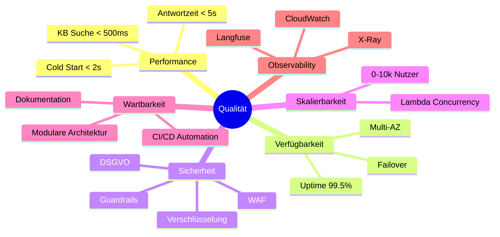

---

## 11. Risiken und technische Schulden

### 11.1 Identifizierte Risiken

#### Risiko 1: Bedrock API Throttling

**Wahrscheinlichkeit**: Mittel | **Auswirkung**: Hoch

**Mitigiert**: Exponential Backoff, WAF Rate Limiting reduziert Überlastung, Quotenerhöhung ausstehend.

#### Risiko 2: Knowledge Base Datenqualität

**Wahrscheinlichkeit**: Mittel | **Auswirkung**: Sehr hoch

**Mitigiert**: Vier-Augen-Prinzip, Versionierung, User-Feedback (jetzt mit Langfuse-Korrelation), Source Citations.

#### Risiko 3: Cold Start Latenz

**Wahrscheinlichkeit**: Hoch | **Auswirkung**: Mittel

**Mitigiert**: Container-Image-Optimierung, Provisioned Concurrency geplant, Frontend Loading-Indikatoren.

#### Risiko 4: DSGVO-Compliance bei Logging

**Wahrscheinlichkeit**: Niedrig | **Auswirkung**: Sehr hoch

**Status**: Mitigiert (Logger-Filter, Langfuse self-hosted = Daten bleiben im AWS-Account).

#### Risiko 5: Vendor Lock-in (AWS Bedrock)

**Wahrscheinlichkeit**: Niedrig | **Auswirkung**: Hoch

**Status**: Akzeptiert (pydantic-ai Provider-Abstraktion als Migrationspfad).

### 11.2 Technische Schulden

#### Schuld 1: Anonyme Session-Isolation (HOCH)

Session-IDs mit Cognito verknüpft (Pseudonym). Ziel: Zufällige UUID, `sessionStorage`, DynamoDB TTL 30 Tage. Aufwand: 1-2 Wochen.

#### Schuld 2: Rate Limiting per User (MITTEL — TEILWEISE BEHOBEN)

WAF bietet per-IP Rate Limiting (500 req/5min prod). Noch ausstehend: Per-User Cognito-basierte Quotas. Aufwand: 1-2 Wochen.

#### Schuld 3: E2E Backend Tests (MITTEL)

Nur Unit/Integration Tests. Ziel: LocalStack-basierte E2E-Szenarien. Aufwand: 2 Wochen.

### 11.3 Verbesserungspotenziale

1. **Caching-Strategie**: Häufige Anfragen cachen (Redis/ElastiCache)
2. **A/B-Testing**: Verschiedene Modelle/Prompts vergleichen (Langfuse ermöglicht Analyse)
3. **CloudFront WAF (Phase 2)**: Edge-Schutz in us-east-1
4. **Per-User Rate Limiting**: Cognito-basierte Quotas zusätzlich zu WAF per-IP

---

## 12. Glossar

### A

**ADR** - Architecture Decision Record: Dokumentation von Architekturentscheidungen

**Agent** - pydantic-ai Agent: KI-Agent mit Tool-Auswahl und LLM-Integration

**Agent Search** - Dedizierter Such-Agent (Nova Lite) als Alternative zu RAG, liest S3-Index und verifiziert Relevanz

**Amplify** - AWS Amplify: Framework für Frontend-Integration mit AWS-Services

### B

**Bedrock** - AWS Bedrock: Managed Service für Foundation Models

**BM25** - Best Matching 25: Keyword-basiertes Ranking-Verfahren, hier mit deutscher Stemmung und Dekomposition für Hybrid-Suche

**Buildah** - Rootless Container-Build-Tool (ohne Docker-Daemon), verwendet in CI/CD

### C

**CDK** - AWS Cloud Development Kit: Infrastructure as Code Framework

**Chunking** - Aufteilung großer Dokumente in kleinere Abschnitte für Vektorspeicherung

**CloudFront** - AWS CloudFront: Content Delivery Network (CDN)

**Cocogitto** - Tool für Conventional-Commit-Validierung und automatische Semver-Versionierung

**Cognito** - AWS Cognito: User Pool für Authentifizierung

**Cold Start** - Verzögerung beim ersten Lambda-Aufruf (Container-Start)

### D

**DITA** - Darwin Information Typing Architecture: XML-Standard für technische Dokumentation

**DRV-Bund** - Deutsche Rentenversicherung Bund

**DSGVO** - Datenschutz-Grundverordnung

### E

**ECR** - Elastic Container Registry: AWS-Dienst für Docker-Image-Speicherung

**Embedding** - Vektorrepräsentation von Text für semantische Suche

**ETL** - Extract, Transform, Load: Datenverarbeitungs-Pipeline

### G

**Glossar-Enrichment** - Integration von 17 kuratierten DRV-Fachbegriffen als `[GLOSSAR-KONTEXT]` im System-Prompt

**Guardrail** - Zweistufiges Content-Safety-System (Bedrock + Nova Lite Agent)

### H

**HyDE** - Hypothetical Document Embeddings: Query-Expansion-Technik, bei der ein hypothetisches Antwort-Dokument generiert und als Suchvektor verwendet wird

**History Converter** - Utility zur Konvertierung von ConversationItems zu pydantic-ai ModelMessage

### J

**JWT** - JSON Web Token: Token-Format für Authentifizierung

### K

**Knowledge Base** - AWS Bedrock Knowledge Base: Managed Vector Database mit Retrieval

### L

**Lambda** - AWS Lambda: Serverless Compute Service

**Langfuse** - Self-hosted LLM-Observability-Plattform für Prompt-Analyse, Token-Tracking und Feedback-Korrelation

**LLM** - Large Language Model: Großes Sprachmodell (hier: openai.gpt-oss-120b-1:0)

### M

**Mehrturn** - Konversation mit mehreren Austauschen, bei der der Agent Kontext vorheriger Nachrichten behält

**ModelMessage** - pydantic-ai Typ für Konversationsnachrichten

**Monorepo** - Repository mit mehreren Projekten (Backend, Frontend, CDK, Terraform)

### O

**OIDC** - OpenID Connect: Authentifizierungsprotokoll, hier für GitLab CI → AWS STS (keine Long-lived Credentials)

**OpenTofu** - Open-Source Fork von Terraform (~1.11), verwendet für Plattform-Infrastruktur (IAM, Langfuse, ECR)

**Online-Services Tool** - pydantic-ai Tool: Liefert Links zu DRV-Online-Diensten

### P

**PII** - Personally Identifiable Information: Personenbezogene Daten

**Pipeline** - ETL-Pipeline oder CI/CD-Pipeline (Kontext-abhängig)

### R

**Renate** - Name des DRV-Chatbot-Assistenten

### S

**S3** - AWS Simple Storage Service: Object Storage

**SSM** - AWS Systems Manager Parameter Store: Key-Value-Konfigurationsspeicher

### T

**Tool** - Erweiterung der Agent-Fähigkeiten (6 Tools: KB Search, Agent Search, Calculator, Time, Contact, Online Services)

### U

**uv** - Moderner Python Package Manager (Rust-basiert)

### V

**VPC** - Virtual Private Cloud: Isoliertes Netzwerk in AWS

### W

**WAF** - Web Application Firewall: AWS-Dienst für HTTP-Schutz (Rate Limiting, Managed Rules, Bot Control)

### X

**X-Ray** - AWS X-Ray: Distributed Tracing Service

---

**Ende der arc42 Architekturdokumentation**
