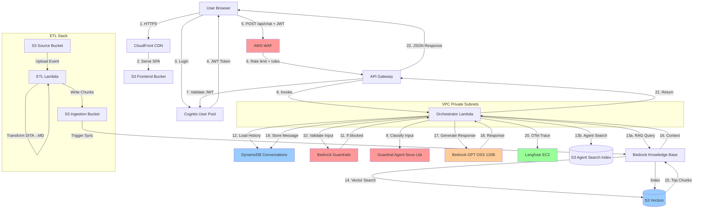
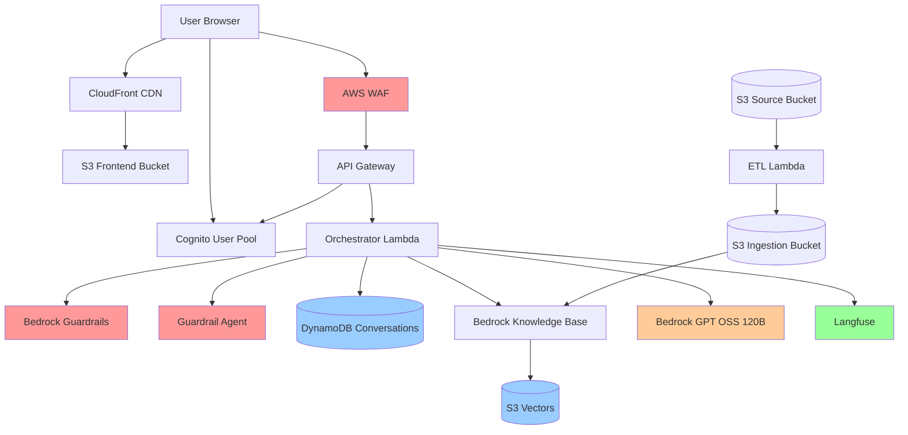
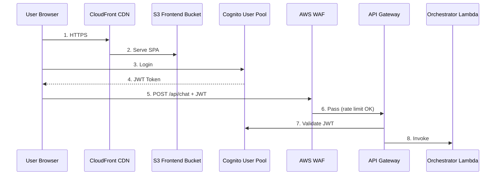
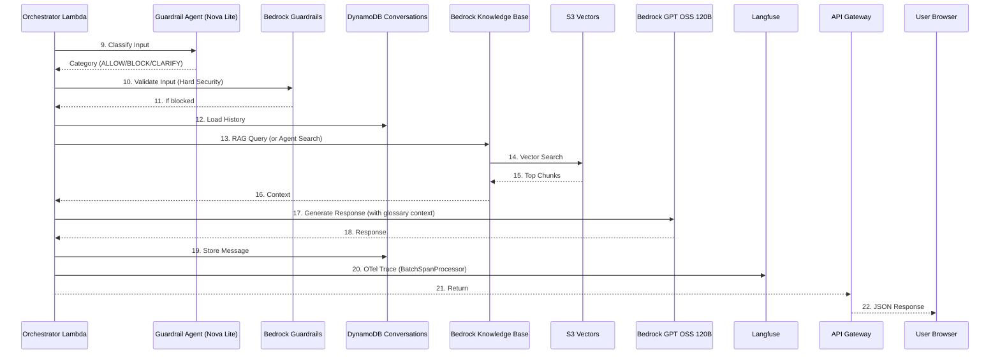
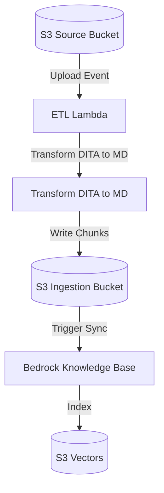
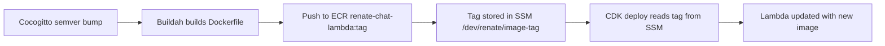

# AWS Architecture Overview - Renate Chatbot

**Project**: DigiBro Monorepo - Renate Chatbot
**Date**: 2026-06-12
**Version**: 2.0

---

## System Overview

Renate is a RAG-based chatbot for Deutsche Rentenversicherung Bund (DRV-Bund) built on AWS serverless architecture with two main CDK stacks, OpenTofu-managed platform infrastructure, and a fully automated CI/CD pipeline.

---

## CDK Stacks

### Stack 1: EtlKnowledgeBaseStack (`renate-etl-kb-dev`)

**Purpose**: Document processing pipeline + Bedrock Knowledge Base

**Components**:

- **S3 Buckets**:
  - Source bucket (raw DITA/XML documents)
  - Ingestion bucket (processed Markdown for Bedrock)
  - Vector store bucket (S3 Vectors for embeddings)
- **Transform Pipeline**:
  - SQS queue for document processing
  - Lambda function (DITA→HTML→Markdown conversion)
  - Dead-letter queue for failures
  - Stale-output cleanup: on both `ObjectCreated` (replace) and `ObjectRemoved` (delete), derived chunk files and their `.metadata.json` sidecars are deleted from the ingestion bucket before new chunks are written, ensuring no orphaned artifacts reach the Knowledge Base
- **Bedrock Knowledge Base**:
  - S3 Vectors for vector storage (NOT OpenSearch Serverless)
  - Data source pointing to ingestion bucket
  - Auto-sync trigger (Lambda on S3 `ObjectCreated` **and** `ObjectRemoved`) — Bedrock's incremental sync removes vectors for deleted objects on next ingestion job
- **BM25 Index**:
  - Rebuilt on S3 `ObjectCreated` **and** `ObjectRemoved` for chunk `.md` files, keeping keyword scores consistent with the current document set
- **Monitoring**:
  - CloudWatch alarms (ETL failures, DLQ depth)
  - SNS topic for alerts
- **Seeding**: Custom resource to deploy initial XML documents

**Key Exports**: Knowledge Base ID via SSM Parameter Store

---

### Stack 2: ChatbotStack (`renate-chatbot-dev`)

**Purpose**: User-facing chatbot application

**Components**:

#### 1. Authentication (Cognito)

- User pool with email domain validation
- OIDC integration support
- Pre-signup Lambda trigger (domain check)
- Token validity: configurable

#### 2. Frontend (CloudFront + S3)

- Angular 20 SPA hosted on S3
- CloudFront distribution with custom domain
- Route53 DNS + ACM certificate
- IPv6 support (optional)

#### 3. Backend (Lambda + API Gateway)

- **Orchestrator Lambda**:
  - Python 3.12 with pydantic-ai
  - Bedrock agent with configurable search (`SEARCH_MODE`: `rag` or `agent`)
  - Tools: KB search, agent search, calculator, contact info, time, online services
  - Glossary integration: 17 curated DRV terms injected into system prompt
  - Environment: VPC-enabled, X-Ray tracing, Langfuse OTel tracing
- **Auth Handler Lambda**: Cognito triggers
- **API Gateway**: REST API with Cognito authorizer, WAF WebACL
- **DynamoDB**: Conversation history table (with `langfuse_trace_id` for feedback correlation)

#### 4. Networking (VPC)

- Private subnets for Lambda
- NAT gateways for Bedrock API access
- VPC endpoints (optional)

#### 5. Security (Bedrock Guardrails + WAF)

- Input validation (pre-RAG) via two-layer guardrail architecture
- Content filtering policies
- Custom blocked messages
- AWS WAF for API Gateway protection (see WAF section)

#### 6. Monitoring

- CloudWatch dashboard (Lambda metrics, API Gateway, DLQ)
- Alarms: Lambda errors, API 5xx, throttling
- SNS alerts to email
- Langfuse LLM observability (see Langfuse section)

---

## Data Flow



### Flow Steps

**Frontend (1-4)**: User loads Angular SPA via CloudFront, authenticates with Cognito

**WAF + Chat Request (5-8)**: WAF applies rate limiting and managed rules, API Gateway validates JWT, invokes Lambda

**Guardrails (9-11)**: Nova Lite agent classifies input (Layer 2), Bedrock Guardrails validate (Layer 1)

**Multi-Turn Context (12)**: Load last 20 message pairs from DynamoDB

**Search (13-16)**: Either RAG query to Knowledge Base (13a) or Agent Search via S3 index (13b), depending on `SEARCH_MODE`

**LLM Generation (17-18)**: Bedrock GPT OSS 120B generates response with context + glossary

**Persistence & Observability (19-22)**: Store conversation in DynamoDB, send OTel trace to Langfuse, return to user

**ETL Pipeline**: Document upload → transform → chunk → sync to Knowledge Base

### Overview



### Frontend, auth, and chat request flow



### Backend processing and RAG flow



### ETL Index flow



---

## Key Technologies

### Backend

- **Language**: Python 3.12+
- **Framework**: pydantic-ai with BedrockConverseModel
- **Package Manager**: uv
- **Testing**: pytest with coverage
- **Linting**: Ruff
- **Type Checking**: ty

### Frontend

- **Framework**: Angular 20
- **Language**: TypeScript 5.5
- **Auth**: AWS Amplify
- **Testing**: Karma/Jasmine

### Infrastructure

- **Application IaC**: AWS CDK 2.x (TypeScript)
- **Platform IaC**: OpenTofu ~1.11 (HCL)
- **CI/CD**: Self-hosted GitLab with OIDC auth
- **Container Builds**: Buildah (rootless)
- **Versioning**: Cocogitto (conventional commits → semver)
- **Testing**: Jest (CDK), shellcheck + bats (CI scripts)
- **Linting**: ESLint (CDK/Frontend), tofu fmt (HCL)

### AWS Services

| Service                 | Purpose                                                        |
| ----------------------- | -------------------------------------------------------------- |
| **Bedrock**             | LLM inference (GPT OSS 120B), Knowledge Base, Guardrails       |
| **Lambda**              | Orchestrator, ETL processing, auth triggers                    |
| **Cognito**             | User authentication                                            |
| **API Gateway**         | REST API for chatbot                                           |
| **WAF**                 | API Gateway protection (rate limiting, managed rules)          |
| **CloudFront**          | CDN for Angular frontend                                       |
| **S3**                  | Frontend hosting, document storage, vector store, search index |
| **DynamoDB**            | Conversation history                                           |
| **S3 Vectors**          | Vector database for embeddings                                 |
| **ECR**                 | Container image registry for Lambda                            |
| **SSM Parameter Store** | Image tags, Knowledge Base ID, config values                   |
| **Secrets Manager**     | Langfuse credentials, API keys                                 |
| **SQS**                 | ETL queue + DLQ                                                |
| **VPC**                 | Network isolation for Lambda                                   |
| **CloudWatch**          | Logs, metrics, alarms, dashboard                               |
| **X-Ray**               | Distributed tracing                                            |
| **SNS**                 | Alert notifications                                            |
| **Route53**             | DNS for custom domain                                          |
| **ACM**                 | SSL/TLS certificates                                           |

---

## Agent Architecture (pydantic-ai)

### Tools (6 total)

1. **search_knowledge_base** - RAG retrieval from Bedrock Knowledge Base (embedding-based). Active when `SEARCH_MODE=rag`.
2. **agent_search** - Dedicated search agent (Nova Lite) reads S3-based index of brochures, Merkblätter, and FAQ documents. Lists sections, fetches relevant ones, verifies relevance. Section splitting keeps sections under ~3000 chars for token efficiency. Active when `SEARCH_MODE=agent`.
3. **calculator_pydantic** - Mathematical calculations
4. **current_time_pydantic** - Current date/time
5. **get_drv_contact_info** - DRV contact details
6. **get_drv_online_services** - Links to online portals/forms

### Glossary Integration

17 curated DRV pension terms defined in `glossary.json`. All terms are injected into the system prompt as `[GLOSSAR-KONTEXT]`. The agent uses official DRV terminology and corrects user misconceptions as part of its normal tool-call logic (no separate LLM call).

### RAG Retrieval Enhancements

All enhancements are configurable via environment variables:

| Enhancement                | Env Var                    | Default | Description                                                                               |
| -------------------------- | -------------------------- | ------- | ----------------------------------------------------------------------------------------- |
| **HyDE**                   | `HYDE_ENABLED`             | `false` | Hypothetical Document Embeddings for query expansion                                      |
| **BM25 Hybrid Search**     | `BM25_ENABLED`             | `false` | Keyword-based scoring with German stemming and decompounding, combined with vector search |
| **Anchor-first Retrieval** | `ANCHOR_RETRIEVAL_ENABLED` | `true`  | Prioritizes brochures by S/A/B tier with configurable weights                             |
| **Bedrock Reranker**       | —                          | enabled | Re-scores retrieval results for better relevance                                          |

### Multi-Turn Conversations

- **Storage**: DynamoDB (PK: session_id, SK: message_id)
- **History Loading**: `ConversationStore.get_history()` loads last 20 pairs
- **Conversion**: `history_converter.items_to_messages()` converts to pydantic-ai format
- **Agent Integration**: `run_agent(message, message_history)` passes context to LLM
- **Frontend**: Auto-restores sessions on page refresh
- **Token Budget**: Max 20 pairs (~10k tokens) for context window compatibility

---

## ETL Pipeline

### Chunking Strategies

| Strategy                 | Use Case                        |
| ------------------------ | ------------------------------- |
| **SemanticStrategy**     | Content-based coherent sections |
| **HierarchicalStrategy** | Heading-based hierarchy         |
| **FlatSectionStrategy**  | Simple section separation       |
| **GlossaryStrategy**     | Term + definition pairs         |

### Transform Chain

1. **Ingest**: Read from S3 source bucket
2. **Convert**: DITA XML → Markdown
3. **Chunk**: Apply chunking strategy
4. **Output**: Write to S3 ingestion bucket
5. **Sync**: Trigger Bedrock KB sync → index to S3 Vectors

---

## Security Architecture

### Layers

1. **WAF**: Rate limiting, managed rule groups (Common, KnownBadInputs, IpReputation)
2. **Network**: VPC, private subnets, NAT gateways
3. **Authentication**: Cognito with email domain validation
4. **Authorization**: API Gateway Cognito Authorizer
5. **Encryption**: TLS in transit, S3-SSE at rest
6. **IAM**: Least-privilege roles for all services
7. **Content Safety**: Two-layer guardrail architecture (Bedrock + Nova Lite agent)
8. **Logging**: PII-filtered CloudWatch logs

### AWS WAF

Regional WAF WebACL attached to API Gateway (Phase 1, eu-central-1):

**Managed Rule Groups**:

- `AWSManagedRulesCommonRuleSet` — OWASP Top 10 protections
- `AWSManagedRulesKnownBadInputsRuleSet` — known bad patterns (Log4j, etc.)
- `AWSManagedRulesAmazonIpReputationList` — malicious IP blocking

**Rate Limiting**:

- 500 requests / 5 minutes (prod)
- 100 requests / 5 minutes (dev/qa)
- Scoped to `POST /api/chat` only

**Bot Control**: Optional managed rule group (default OFF)

**Deployment Strategy**: Initial deployment in COUNT mode for validation, transition to BLOCK after confirming no false positives.

**Phase 2 (deferred)**: CloudFront WAF in us-east-1 for edge protection.

### Bedrock Guardrails

**Layer 1 — Hard Security Filters** (configurable strength: NONE/LOW/MEDIUM/HIGH):

- HATE, INSULTS, SEXUAL, VIOLENCE, MISCONDUCT
- PROMPT_ATTACK (Jailbreak protection) — set to MEDIUM (lowered from HIGH to fix false positives on self-referential questions like "Wer bist du?")

**Fail behavior**: Always fail-closed. If Bedrock Guardrails return an error, the request is blocked.

**PII Detection**:

- Email, phone, name (NONE - allowed)
- IBAN, credit card (BLOCK)
- German social security number (BLOCK via regex)

**Application**: Input validation only (pre-RAG), not on output

### Guardrail Agent (Nova Lite)

**Layer 2 — Nuanced Classification** for domain-specific filtering:

The guardrail agent uses a lightweight LLM (Nova Lite) to classify user input into 5 categories:

| Category              | Action                                         |
| --------------------- | ---------------------------------------------- |
| ALLOW                 | Pass to RAG + main agent                       |
| BLOCK_STANDARD_1      | Return off-topic standard response             |
| BLOCK_STANDARD_2      | Return service-phone redirect                  |
| CLARIFY               | Return follow-up question                      |
| ALLOW_WITH_CORRECTION | Pass to main agent with correction instruction |

**Self-referential questions**: Explicitly allowed ("Wer bist du?", "Was sind deine Quellen?").

**Why two layers**: Bedrock Guardrails are binary (DENY/ALLOW) and too blunt for nuanced DRV requirements. The agent handles political questions, individual case detection, and ambiguous input that Bedrock cannot distinguish.

**Fail behavior**: Fails open ONLY for transient errors (throttling/timeout). Fails closed for all other errors (availability over security only for transient edge cases).

**Security**: The `reason` field from the classification agent is NEVER injected into the main agent's prompt — this is a prompt injection vector. Only static instructions are used.

### GDPR Compliance

- No PII in logs (filtered)
- DynamoDB TTL for auto-deletion (30 days planned)
- Guardrails block PII before LLM processing
- Audit trail in CloudWatch
- Session anonymization (technical debt - see below)

---

## Monitoring & Observability

### CloudWatch Dashboard

**Metrics**:

- System Health: API 5XX/4XX, Chat Errors, ETL Errors
- Lambda: Invocations, Duration (P95), Errors, Throttles
- API Gateway: Request Count, Latency (P95)
- ETL Queue: Queue Depth, DLQ Messages
- Bedrock: Token Usage, Invocations, Errors

### Alarms

**Critical**:

- Lambda Error Rate > 5%
- API Gateway 5xx Rate > 1%
- Lambda Duration > 5s (p95)
- Concurrent Executions > 80% limit
- DLQ Messages > 0

**Alerting**: SNS topic → email notifications

### Tracing

- AWS X-Ray enabled on all Lambdas
- Distributed tracing: API Gateway → Lambda → Bedrock → Knowledge Base

### Langfuse (LLM Observability)

Self-hosted Langfuse instance for detailed LLM trace analysis, complementing CloudWatch/X-Ray:

**Architecture**:

- EC2 instance in private subnet (Packer AMI)
- ALB frontend for access
- Docker Compose: Langfuse web + worker, PostgreSQL, ClickHouse, Redis
- Managed by OpenTofu (`terraform/live/`)
- Authentication: Authentik OIDC (no local login)

**Integration with Lambda**:

- OTel traces sent via `BatchSpanProcessor` → OTLP HTTP endpoint
- Secrets (Langfuse keys) read from AWS Secrets Manager at Lambda cold start
- Configured via `LANGFUSE_HOST` and `LANGFUSE_SECRET_NAME` env vars

**Feedback Correlation**:

- User feedback (thumbs up/down) linked to Langfuse traces
- `langfuse_trace_id` stored in DynamoDB conversation items
- Enables quality analysis: which prompts/retrievals produce good/bad responses

**Complements (does not replace)**:

- CloudWatch: operational metrics, alarms, log aggregation
- X-Ray: infrastructure-level distributed tracing
- Langfuse: LLM-specific observability (prompt analysis, token usage, response quality)

---

## CI/CD Pipeline

### Overview

Self-hosted GitLab at `gitlab.kilab-platform.de` with fully automated deployment pipeline.

**Pipeline Stages**: `validate → tofu-plan → tofu-apply → build → release → deploy`

### Key Design Decisions

- **OIDC token auth**: No long-lived credentials anywhere. All AWS access via `sts assume-role-with-web-identity`.
- **Change-based triggering**: Jobs only run when relevant paths change (e.g. `backend/**/*` → backend-tests).
- **Resource locking**: `resource_group` per environment prevents concurrent deploys (`deploy-dev`, `deploy-qa`, `tofu-dev`, `tofu-qa`).
- **Conventional commits**: Enforced via Cocogitto. Drives automatic semver bumps.

### Container Image Flow



- Buildah: rootless, `chroot` isolation
- Previous image tag saved to SSM `/dev/renate/image-tag-previous` for rollback

### Deployment Flow

```
master merge
  → cocogitto bump (auto semver tag)
  → build-lambda (Buildah → ECR)
  → cdk-deploy:dev (OIDC role, --require-approval never)
  → smoke-eval:dev (health check)
  → open-qa-mr (updates deployments/qa.yaml)

QA promotion MR merged
  → cdk-deploy:qa
  → smoke-eval:qa
```

- **dev**: Auto-deploys on every version bump (master merge with conventional commit)
- **QA**: GitOps-style — version pinned in `deployments/qa.yaml`, promoted via MR
- `make cdk-deploy` remains available for local development but is NOT the production deployment path

### Review Environments

- Branch-based isolated environments for feature testing without master merge
- Triggered by MR creation, torn down on MR close/merge
- Session isolation via `review/<slug>#` prefix on DynamoDB keys

### GitLab Runners

- Self-hosted in dev-account
- Autoscale 0–20 instances
- Packer AMI-based (manager + worker images)

---

## OpenTofu Infrastructure

Two layers with strict separation:

### Bootstrap Layer (`terraform/bootstrap/`)

**Operator-applied only** (never CI-managed). Applied locally with `AdministratorAccess` AWS SSO session.

Manages:

- IAM roles (plan/apply/deploy per env)
- OIDC provider for GitLab CI
- ECR repositories
- GitLab runner infrastructure

**Rationale**: CI cannot safely manage its own trust policies (privilege escalation risk).

### Live Layer (`terraform/live/`)

**CI-managed** via pipeline. Per-env application infrastructure.

Manages:

- Langfuse EC2 instance + ALB
- Supporting resources

**Modules** (`terraform/modules/`):

- `tofu_ci_roles` — plan/apply IAM roles
- `langfuse` — EC2 + Docker Compose + ALB
- `oidc` — OIDC provider config
- `ecr` — container registries
- `ci_deploy_role` — CDK deploy IAM role

### Pipeline Integration

- **MR**: `tofu-plan` runs automatically (read-only plan role)
- **Master**: `tofu-plan` → `tofu-apply` (manual approval gate, apply role)
- Both use OIDC token → `sts assume-role-with-web-identity`

---

## Performance Targets

| Metric                | Target     | Notes                        |
| --------------------- | ---------- | ---------------------------- |
| **API Response Time** | <5s (p95)  | End-to-end chat response     |
| **KB Search**         | <500ms     | Vector search latency        |
| **Cold Start**        | <2s        | Lambda initialization        |
| **Availability**      | 99.5%      | During business hours (8-18) |
| **Concurrent Users**  | 100-10,000 | Auto-scaling range           |

---

## Technical Debt

### 1. Session Anonymization (HIGH PRIORITY)

**Current**: session_id linked to Cognito (pseudonymous)

**Target**:

- Random UUID as session_id (no Cognito link)
- `sessionStorage` instead of `localStorage` (tab-close = session gone)
- DynamoDB TTL: 30 days auto-deletion
- Never expose session_id in URLs

**Effort**: 1-2 weeks

### 2. Rate Limiting per User (MEDIUM PRIORITY — PARTIALLY ADDRESSED)

**Current**: WAF provides per-IP rate limiting (500 req/5min prod, 100 req/5min dev/qa) scoped to `POST /api/chat`. This addresses anonymous abuse but NOT per-user Cognito-based quotas.

**Remaining Target**: Per-user quotas with API Keys + Cognito sub for authenticated user limits.

**Effort**: 1-2 weeks

### 3. E2E Backend Tests (MEDIUM PRIORITY)

**Current**: Only unit/integration tests

**Target**: LocalStack-based E2E scenarios

**Effort**: 2 weeks

---

## Key Environment Variables (Orchestrator Lambda)

| Variable                   | Default                   | Purpose                                      |
| -------------------------- | ------------------------- | -------------------------------------------- |
| `BEDROCK_MODEL_ID`         | `openai.gpt-oss-120b-1:0` | Main LLM (cross-region inference)            |
| `KNOWLEDGE_BASE_ID`        | —                         | Bedrock KB                                   |
| `SEARCH_MODE`              | `rag`                     | `rag` or `agent`                             |
| `GUARDRAIL_ID`             | —                         | Bedrock Guardrail ID                         |
| `GUARDRAIL_VERSION`        | `DRAFT`                   | Guardrail version                            |
| `GUARDRAIL_AGENT_MODEL_ID` | (empty = disabled)        | Nova Lite guardrail agent                    |
| `HYDE_ENABLED`             | `false`                   | HyDE query expansion                         |
| `BM25_ENABLED`             | `false`                   | Hybrid BM25 search                           |
| `ANCHOR_RETRIEVAL_ENABLED` | `true`                    | Anchor-first retrieval                       |
| `LANGFUSE_HOST`            | (empty = disabled)        | Langfuse OTLP endpoint                       |
| `LANGFUSE_SECRET_NAME`     | —                         | Secrets Manager key for Langfuse credentials |
| `OTEL_INCLUDE_CONTENT`     | `false`                   | Include prompt/response content in traces    |
| `AWS_REGION`               | `eu-central-1`            | AWS region                                   |
| `LOG_LEVEL`                | `INFO`                    | Lambda Powertools log level                  |

---

## Deployment

### Prerequisites

```bash
# Install dependencies
make install

# Run tests
make test

# Build all components
make build
```

### Local CDK Deployment (Development Only)

```bash
# Bootstrap (once per account/region)
cdk bootstrap

# Deploy stacks
make cdk-deploy
```

### Production Deployment

Production deployments are fully automated via the CI/CD pipeline (see CI/CD Pipeline section). Manual `make cdk-deploy` is only for local development.

### Deployment Order

1. `EtlKnowledgeBaseStack` (ETL + Knowledge Base)
2. `ChatbotStack` (depends on KB ID from SSM)

---

## Cost Tracking Tags

All resources tagged with:

- **Kostenstelle**: 500050
- **Kostentraeger**: NCL701
- **Sachkonto**: 7978801
- **Projekt**: digibro

---

## References

- [arc42 Architecture Documentation](./arc42-architektur.md)
- [Backend Development Guide](./development-guide-backend.md)
- [Frontend Development Guide](./development-guide-frontend.md)
- [CDK Development Guide](./development-guide-cdk.md)
- [API Contracts](./api-contracts.md)
