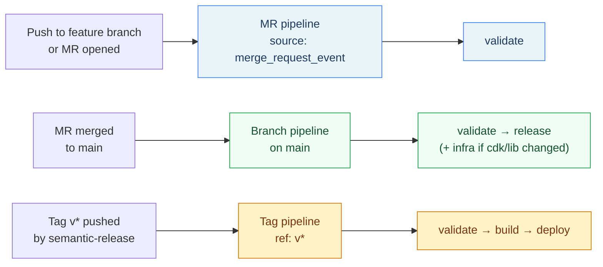
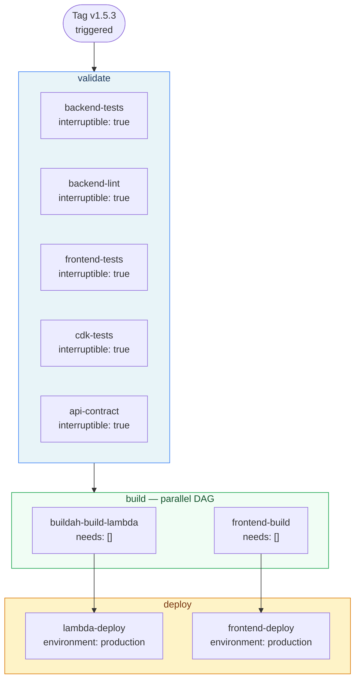
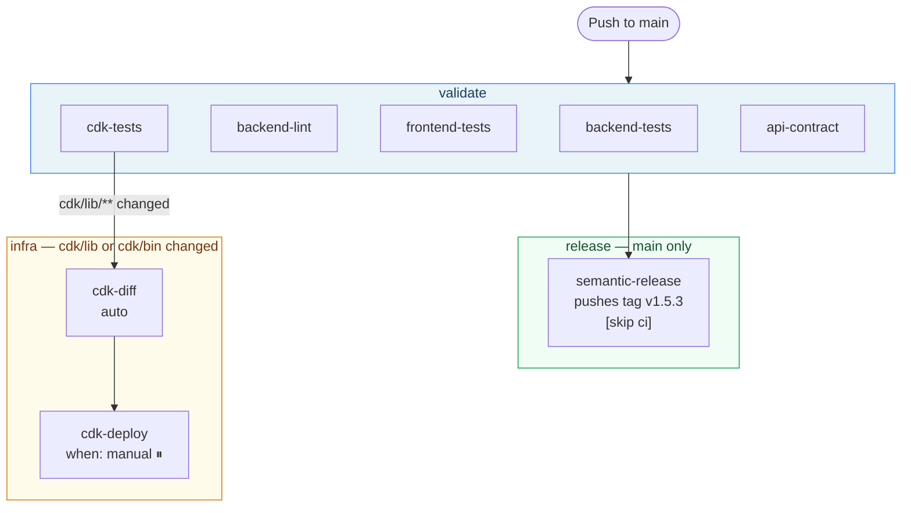

# digibro-monorepo GitLab CI Pipeline Design

> Status: recorded 2026-04-20. Drives TKT-M49 (implementation).
> Companion document: [deployment_model.md](./deployment_model.md)

This document translates the provisioning boundary established in the deployment
model into a concrete GitLab CI pipeline: trigger rules, stage ordering, job
catalogue, DAG wiring, and a YAML skeleton ready for TKT-M49.

---

## Three Pipeline Shapes

A single `.gitlab-ci.yml` produces three distinct pipeline shapes depending on
what triggered it. Each shape activates a different subset of the job graph.



`validate` runs on every pipeline shape. The tag is always cut from a
commit that was already green on `main`, so repeating validate on the tag
pipeline is not redundant — it is the only validation that runs against the
tagged ref itself. GitLab documentation does not recommend skipping validate on
tag pipelines — see [gitlab_ci_patterns.md][research-gitlab].

---

## Stage Declaration

```yaml
stages:
  - validate   # every pipeline — fast feedback gate
  - release    # main branch only — derive semver tag
  - build      # tag pipelines only — produce immutable artefacts
  - deploy     # tag pipelines only — release artefacts to AWS
  - infra      # main branch, cdk/lib or cdk/bin changed only
```

`infra` is last and sits behind a manual gate. Infrastructure carries higher
blast radius than application code. Kief Morris (Infrastructure as Code)
recommends always reviewing a plan before applying; placing `infra` after all
other work and requiring explicit approval enforces that discipline.

---

## Job Catalogue

### validate — every pipeline

All validate jobs share two properties: they run on MR pipelines and on `main`,
and they carry `interruptible: true`. When a developer pushes a follow-up commit
to an open MR, GitLab cancels the stale pipeline automatically — freeing runner
capacity without manual intervention ([`interruptible` reference][research-gitlab]).
Deployments are never `interruptible` because cancelling a partial deployment
leaves infrastructure in an unknown state.

| Job | `interruptible` | Notes |
|-----|----------------|-------|
| `backend-tests` | `true` | `pytest` |
| `backend-lint` | `true` | `ruff` + `mypy` |
| `frontend-tests` | `true` | `npm test` |
| `cdk-tests` | `true` | CDK unit tests — runs on every MR, not only when `cdk/` changes |
| `api-contract` | `true` | Schema compatibility check |

### release — main branch only

| Job | `needs:` | Notes |
|-----|---------|-------|
| `semantic-release` | all validate jobs | Parses conventional commits, bumps `pyproject.toml`, commits with `[skip ci]`, pushes tag `v1.5.3` |

`[skip ci]` in the version-bump commit message prevents the push-to-main event
from re-entering the `release` stage. The tag push produces a separate tag
pipeline covering `validate` → `build` → `deploy`.

### build — tag pipeline only

Both build jobs use `needs: []` to enter DAG mode and run in parallel from the
start of the stage. The Lambda image build and the Angular build are fully
independent; forcing them to run sequentially would waste wall-clock time
([`needs: []` DAG reference][research-gitlab]).

| Job | `needs:` | Notes |
|-----|---------|-------|
| `buildah-build-lambda` | `[]` | Buildah (TKT-M53 pattern); pushes `:v1.5.3` and `:sha-abc` to ECR in digibro account |
| `frontend-build` | `[]` | `npm run build:prod`; artefact `frontend/dist/`, `expire_in: 1h` |

### deploy — tag pipeline only

Both deploy jobs declare `environment: production`. This registers every release
in GitLab's Deployments view, tracking deployment frequency as a DORA metric
and enabling the rollback button in the UI ([`environment:` reference][research-gitlab]).
Deployments are never `interruptible: true` — a mid-flight `aws lambda
update-function-code` must not be cancelled.

| Job | `needs:` | `environment:` | Notes |
|-----|---------|----------------|-------|
| `lambda-deploy` | `buildah-build-lambda` | `production` | `aws lambda update-function-code --image-uri :v1.5.3` |
| `frontend-deploy` | `frontend-build` | `production` | `aws s3 sync` + `create-invalidation` |

### infra — main branch, CDK source changed

`changes:` is scoped to `cdk/lib/**` and `cdk/bin/**` — not `cdk/**`. Changes
to `cdk/test/**` cannot affect the synthesised CloudFormation template so they
must not trigger an infra diff. `compare_to: main` is required; without it,
`changes:` evaluates true for all files on a branch pipeline's first push,
defeating the scoping entirely. `cdk-deploy` uses `when: manual` inside
`rules:`, which sets `allow_failure: false` by default — confirmed in primary
source docs ([`rules: changes`, `compare_to`, and `when: manual`
reference][research-rules]).
The diff output is visible in the job log above the approval button.

| Job | `when:` | `needs:` | Notes |
|-----|---------|---------|-------|
| `cdk-diff` | `on_success` | `cdk-tests` | `npx cdk diff` — proposed changes in job log |
| `cdk-deploy` | `manual` | `cdk-diff` | `npx cdk deploy --all`; pipeline stalls until approved |

---

## Pipeline DAG: Tag Pipeline

The tag pipeline is the critical path for every release. The diagram shows the
full DAG: which jobs run in parallel, which must wait, and how artefacts flow
from build to deploy.



The two deploy jobs reach production independently. A failed `frontend-deploy`
does not block a successful `lambda-deploy`, and vice versa. This reflects the
SRE principle of minimising coupled blast radius: a bad Angular build should not
hold back a Lambda fix. The `lambda-deploy` job also writes the deployed tag to
SSM (`/prod/renate/image-tag`) so the CDK infra pipeline can read it via
`valueForStringParameter` — see [ssm_cross_pipeline_state.md][research-ssm]
and [cdk_lambda_ecr.md][research-cdk].

---

## Pipeline DAG: Main Branch (with infra path)

A push to `main` runs validate and release, and — when `cdk/lib` or `cdk/bin`
files changed — adds the infrastructure path behind a manual gate.



`semantic-release` and `cdk-diff` can run concurrently after validate — they
are independent. The infra path branches off `cdk-tests` specifically because
that is the gate that confirms the CDK source compiles and passes unit tests
before any diff or deploy touches AWS.

---

## Annotated YAML Skeleton

Variables and full script bodies are placeholders for TKT-M49. Every attribute
shown here is a deliberate GitLab CI keyword — nothing is omitted for brevity.

```yaml
workflow:
  auto_cancel:
    on_new_commit: interruptible   # cancels stale MR pipelines automatically

stages:
  - validate
  - release
  - build
  - deploy
  - infra

# ── Shared anchors ────────────────────────────────────────────────────────────
.validate-rules: &validate-rules
  rules:
    - if: $CI_PIPELINE_SOURCE == "merge_request_event"
    - if: $CI_COMMIT_BRANCH == "main"
    - if: $CI_COMMIT_TAG =~ /^v/
  interruptible: true

# ── Validate ──────────────────────────────────────────────────────────────────
backend-tests:
  stage: validate
  <<: *validate-rules
  script: pytest tests/

backend-lint:
  stage: validate
  <<: *validate-rules
  script: ruff check . && mypy .

frontend-tests:
  stage: validate
  <<: *validate-rules
  script: npm test -- --watchAll=false

cdk-tests:
  stage: validate
  <<: *validate-rules
  script: npm --prefix cdk test

api-contract:
  stage: validate
  <<: *validate-rules
  script: ...

# ── Release ───────────────────────────────────────────────────────────────────
semantic-release:
  stage: release
  rules:
    - if: $CI_COMMIT_BRANCH == "main"
  needs:
    - backend-tests
    - backend-lint
    - frontend-tests
    - cdk-tests
    - api-contract
  script: semantic-release publish
  # python-semantic-release appends [skip ci] to the version-bump commit;
  # the resulting tag push triggers a new pipeline rather than looping back.

# ── Build (tag pipeline) ──────────────────────────────────────────────────────
# Build tool: Buildah (quay.io/buildah/stable, TKT-M53 pattern).
# Kaniko was the original design but was archived by Google in 2025. Buildah
# confirmed working in the Docker executor on this platform (TKT-M56 rehearsal).
# Auth: OIDC → aws sts assume-role-with-web-identity → aws ecr get-login-password
#       → buildah login → buildah push (see oidc_deploy_role.md ECR permissions).
buildah-build-lambda:
  stage: build
  rules:
    - if: $CI_COMMIT_TAG =~ /^v/
  needs: []                        # DAG: starts immediately, no stage-order wait
  image: quay.io/buildah/stable
  variables:
    BUILDAH_FORMAT: docker
    BUILDAH_ISOLATION: chroot
    STORAGE_DRIVER: vfs
    REGISTRY_AUTH_FILE: /run/containers/auth.json
  script:
    - >
      STS=$(aws sts assume-role-with-web-identity
        --role-arn "$DEPLOY_ROLE_ARN"
        --role-session-name "gitlab-ci-build-${CI_PIPELINE_ID}"
        --web-identity-token "$GITLAB_OIDC_TOKEN"
        --duration-seconds 3600 --output json)
    - export AWS_ACCESS_KEY_ID=$(echo "$STS" | jq -r '.Credentials.AccessKeyId')
    - export AWS_SECRET_ACCESS_KEY=$(echo "$STS" | jq -r '.Credentials.SecretAccessKey')
    - export AWS_SESSION_TOKEN=$(echo "$STS" | jq -r '.Credentials.SessionToken')
    - aws ecr get-login-password --region us-east-1
        | buildah login --username AWS --password-stdin $ECR_REGISTRY
    - buildah build
        --isolation chroot --storage-driver vfs --format docker
        --ulimit nofile=65535:65536
        -f backend/src/backend_orchestrator/Dockerfile
        -t $ECR_REGISTRY/renate-lambda:$CI_COMMIT_TAG
        -t $ECR_REGISTRY/renate-lambda:sha-$CI_COMMIT_SHORT_SHA
        .
    - buildah push $ECR_REGISTRY/renate-lambda:$CI_COMMIT_TAG
    - buildah push $ECR_REGISTRY/renate-lambda:sha-$CI_COMMIT_SHORT_SHA
    - aws ssm put-parameter
        --name "/${ENV}/renate/image-tag"
        --value "$CI_COMMIT_TAG"
        --type String --overwrite

frontend-build:
  stage: build
  rules:
    - if: $CI_COMMIT_TAG =~ /^v/
  needs: []                        # DAG: runs in parallel with buildah-build-lambda
  script: npm --prefix frontend run build:prod
  artifacts:
    paths: [frontend/dist/]
    expire_in: 1h

# ── Deploy (tag pipeline) ─────────────────────────────────────────────────────
lambda-deploy:
  stage: deploy
  rules:
    - if: $CI_COMMIT_TAG =~ /^v/
  needs: [buildah-build-lambda]
  environment:
    name: production               # registers in GitLab Deployments view
  script:
    - aws lambda update-function-code
        --function-name renate-chat-prod
        --image-uri $ECR_REGISTRY/renate-lambda:$CI_COMMIT_TAG

frontend-deploy:
  stage: deploy
  rules:
    - if: $CI_COMMIT_TAG =~ /^v/
  needs: [frontend-build]
  environment:
    name: production
  script:
    - aws s3 sync frontend/dist/ s3://$FRONTEND_BUCKET/ --delete
    - aws cloudfront create-invalidation
        --distribution-id $CF_DISTRIBUTION_ID --paths "/*"

# ── Infra (CDK, main branch, manual gate) ─────────────────────────────────────
cdk-diff:
  stage: infra
  rules:
    - if: $CI_COMMIT_BRANCH == "main"
      changes:
        paths:
          - cdk/lib/**             # structural source only — not cdk/test/**
          - cdk/bin/**
        compare_to: main           # prevents always-true on new branch first push
  needs: [cdk-tests]
  script: npx --prefix cdk cdk diff

cdk-deploy:
  stage: infra
  rules:
    - if: $CI_COMMIT_BRANCH == "main"
      changes:
        paths:
          - cdk/lib/**
          - cdk/bin/**
        compare_to: main
      when: manual                 # allow_failure: false is the default inside rules
  needs: [cdk-diff]
  environment:
    name: infrastructure/production
  script: npx --prefix cdk cdk deploy --all --require-approval never
```

---

## Design Choices

| Choice | Rationale | Source |
|--------|-----------|--------|
| `validate` runs on all three pipeline shapes | Tag pipelines validate the tagged ref; skipping is an anti-pattern | GitLab CI docs |
| `workflow: auto_cancel: on_new_commit: interruptible` | Cancels stale MR pipelines on follow-up push; saves runner capacity without per-job configuration | GitLab CI docs — workflow |
| `interruptible: true` on all validate and build jobs | Safe to cancel mid-run; a newer commit supersedes them | GitLab CI docs — interruptible |
| Deployments never `interruptible` | A cancelled deploy leaves infrastructure in an unknown state | SRE Book — change discipline |
| `needs: []` on both build jobs | DAG mode — both start immediately in parallel; halves tag pipeline wall-clock time | GitLab CI docs — needs |
| `environment: production` on deploy jobs | Registers every release in GitLab Deployments; enables rollback UI and DORA deployment frequency metric | GitLab CI docs — environments |
| `changes: [cdk/lib/**, cdk/bin/**]` not `cdk/**` | CDK test changes must not trigger an infra diff; only structural source changes warrant plan review | Kief Morris — IaC change discipline |
| `when: manual` inside `rules:` on `cdk-deploy` | Sets `allow_failure: false` by default; pipeline stalls visibly until approved; diff output visible in log above | GitLab CI docs — when: manual in rules |
| `[skip ci]` on semantic-release version-bump commit | Prevents the version-bump push to `main` from re-triggering the release stage | GitLab CI docs — skip pipelines |

---

## References

[gitlab-interruptible]: https://docs.gitlab.com/ee/ci/yaml/index.html#interruptible
[gitlab-needs]: https://docs.gitlab.com/ee/ci/yaml/index.html#needs
[gitlab-environments]: https://docs.gitlab.com/ee/ci/environments/index.html
[gitlab-rules-changes]: https://docs.gitlab.com/ee/ci/yaml/index.html#ruleschanges
[gitlab-when-manual]: https://docs.gitlab.com/ee/ci/jobs/job_control.html#create-a-job-that-must-be-run-manually
[gitlab-skip-ci]: https://docs.gitlab.com/ee/ci/pipelines/index.html#skip-a-pipeline
[gitlab-workflow-autocancel]: https://docs.gitlab.com/ee/ci/yaml/workflow.html#workflowauto_cancelon_new_commit
[buildah]: https://buildah.io
[buildah-decision]: https://gitlab.kilab-platform.de/platform/gitlab-provisioning/-/blob/main/docs/decisions/ci_build_tool.md
[python-semantic-release]: https://python-semantic-release.readthedocs.io/
[kief-morris-iac]: https://infrastructure-as-code.com/
[sre-book]: https://sre.google/sre-book/table-of-contents/
[research-gitlab]: https://gitlab.kilab-platform.de/platform/gitlab-provisioning/-/blob/main/docs/research/gitlab_ci_patterns.md
[research-ssm]: https://gitlab.kilab-platform.de/platform/gitlab-provisioning/-/blob/main/docs/research/ssm_cross_pipeline_state.md
[research-cdk]: https://gitlab.kilab-platform.de/platform/gitlab-provisioning/-/blob/main/docs/research/cdk_lambda_ecr.md
[research-rules]: https://gitlab.kilab-platform.de/platform/gitlab-provisioning/-/blob/main/docs/research/gitlab_rules_changes.md
