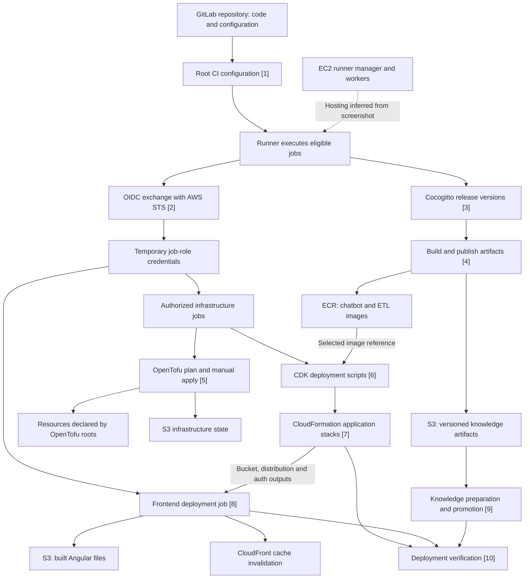
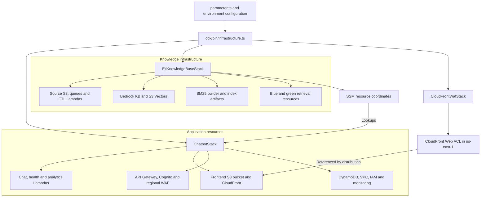
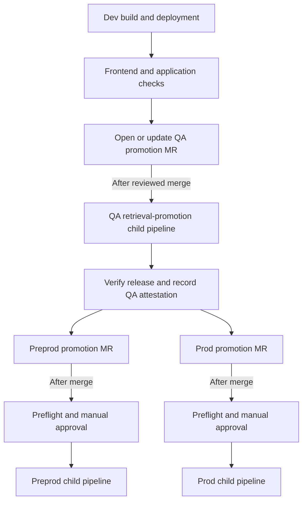

# Deployment architecture scheme

> GitLab coordinates jobs, runners execute them, build jobs publish artifacts, and authorized deployment jobs update AWS infrastructure and release selections.

## Classification and scope

This is a **concept** reference note connecting CI execution, deployment identity, artifacts, infrastructure ownership, and environment promotion.

It records the deployment scheme reviewed from the uploaded material at commit [3db5ec5](https://github.com/Levavoo/Chat-Learning/tree/3db5ec50848d9e818cf82c061ababf232b54dce9/material). It describes what that source snapshot defines, not a live AWS inventory. No deployment commands were executed to create this note.

The original project refers to `.gitlab/ci/...`; this learning repository stores those files under `material/ci/...`. Links below navigate the uploaded material. Use the pinned snapshot above if the material changes later.

## 1. Overall deployment architecture

Read the arrows as responsibility and artifact movement, not a strict job sequence. Actual scheduling comes from `rules`, `needs`, stages, and child-pipeline configuration.

Solid arrows represent relationships supported by the reviewed code. The dotted EC2 connection is inferred from the supplied runner screenshot; runner provisioning/configuration is not available.

### What each part does

- **GitLab** evaluates configuration to create eligible jobs.
- **Runners** execute job scripts in their configured environments.
- **OIDC** establishes job identity; the selected AWS role determines permissions.
- **Build jobs** create artifacts. ECR stores container images; it does not execute the application.
- **OpenTofu and CDK** manage the resources assigned to them.
- **Frontend deployment** uploads built files separately from creating the S3/CloudFront hosting infrastructure.
- **Verification jobs** provide evidence that a selected release works.

### Exact references

All paths in this table are beneath `material/`.

| Ref. | Responsibility | Source |
| --- | --- | --- |
| 1 | Pipeline admission, stages, and included jobs | [Root .gitlab-ci.yml](../material/.gitlab-ci.yml) |
| 2 | Job token exchange for AWS credentials | [scripts/lib/deploy.sh: assume_deploy_role()](../material/ci/scripts/lib/deploy.sh#L31); [retrieval authentication helper](../material/ci/scripts/lib/qa-retrieval-auth.sh#L7) |
| 3 | Version calculation and release variables | [ci/cocogitto.yml](../material/ci/cocogitto.yml) |
| 4 | Chatbot image, ETL image, and data publication | [deploy/lambda.yml](../material/ci/deploy/lambda.yml), [deploy/etl.yml](../material/ci/deploy/etl.yml), [deploy/data-artifacts.yml](../material/ci/deploy/data-artifacts.yml) |
| 5 | OpenTofu plan and apply jobs | [ci/infra/tofu-apply.yml](../material/ci/infra/tofu-apply.yml) |
| 6 | Dev deployment wrapper and CDK invocation | [deploy-dev.sh](../material/ci/scripts/deploy/deploy-dev.sh), [deploy-env.sh](../material/ci/scripts/deploy/deploy-env.sh), [cdk_deploy_stack()](../material/ci/scripts/lib/deploy.sh#L369) |
| 7 | CDK application entry point | [cdk/bin/infrastructure.ts](../material/cdk/bin/infrastructure.ts) |
| 8 | Angular build, upload, and invalidation | [deploy-frontend.sh](../material/ci/scripts/deploy/deploy-frontend.sh) |
| 9 | Retrieval preparation, deployment, and activation | [ci/scripts/deploy directory](../material/ci/scripts/deploy) |
| 10 | Readiness, browser, and application verification | [ci/scripts/verify directory](../material/ci/scripts/verify) |

### Build versus deployment

The job name and script determine behaviour, not the folder name:

- `ci/deploy/lambda.yml` defines `build-lambda`, which builds and pushes the chatbot image.
- [ci/build/lambda.yml](../material/ci/build/lambda.yml) defines the merge-request build test, which builds without pushing.
- The application image recipe is [backend_orchestrator/Dockerfile](../material/backend/src/backend_orchestrator/Dockerfile).
- The ETL image recipe is [etl/Dockerfile](../material/backend/src/etl/Dockerfile).

## 2. What CDK deploys

The entry point creates three stack groups. A stack is a deployment/resource-management boundary, not a server. Resource creation can depend on environment configuration.

The application and ETL environment maps use `eu-central-1`. The CloudFront WAF stack explicitly uses `us-east-1`. Blue/green retrieval resources are associated with the manifest-managed environments: QA, preprod, and prod.

| Definition | Source |
| --- | --- |
| Environment/account/Region/stack-name mappings | [cdk/parameter.ts](../material/cdk/parameter.ts) |
| Chatbot stack composition | [chatbot-stack.ts](../material/cdk/lib/chatbot-stack.ts) |
| Backend functions and selected ECR image | [lambda-backend.ts](../material/cdk/lib/constructs/lambda-backend.ts#L303) |
| Frontend hosting and CloudFront behaviours | [frontend.ts](../material/cdk/lib/constructs/frontend.ts) |
| VPC, subnets, NAT, security group, S3 endpoint | [networking.ts](../material/cdk/lib/constructs/networking.ts) |
| ETL, knowledge resources, slot coordinates, and outputs | [etl-kb-stack.ts](../material/cdk/lib/etl-kb-stack.ts) |
| Bedrock knowledge base and S3 vector resources | [s3-to-s3-vectors-knowledge-base.ts](../material/cdk/lib/constructs/knowledge-base/s3-to-s3-vectors-knowledge-base.ts) |
| Separate CloudFront WAF stack | [cloudfront-waf-stack.ts](../material/cdk/lib/cloudfront-waf-stack.ts) |
| Regional WAF association with API Gateway | [waf.ts](../material/cdk/lib/constructs/waf.ts#L97) |
| Environment classification for retrieval slots | [retrieval-environment.ts](../material/cdk/lib/config/retrieval-environment.ts) |
| Further resource implementations | [cdk/lib/constructs directory](../material/cdk/lib/constructs) |

The code also confirms that CloudFront forwards `/api/*` and `/health` to API Gateway through [addApiBehaviors()](../material/cdk/lib/constructs/frontend.ts#L362). This is a runtime connection configured during infrastructure deployment.

SSM is a coupling point between stacks: the ETL stack publishes resource coordinates, and the chatbot stack reads the relevant values. This allows their deployment concerns to remain separate.

## 3. Environment promotion

The reviewed configuration defines **dev → QA → preprod and prod as separate downstream targets**. It does not require interpreting preprod as an obligatory intermediate step before prod.

A promotion MR records the intended version change; opening an MR does not itself deploy it. Rules, approvals, and the child-pipeline bridge control subsequent execution.

| Route | Source |
| --- | --- |
| Dev deployment and opening the QA MR | [ci/deploy/dev.yml](../material/ci/deploy/dev.yml) |
| QA child-pipeline trigger | [qa/deploy.yml](../material/ci/deploy/qa/deploy.yml) |
| QA transaction and both downstream MRs | [qa/retrieval-promotion.yml](../material/ci/deploy/qa/retrieval-promotion.yml#L264) |
| Prod preflight, approval, and bridge | [prod/deploy.yml](../material/ci/deploy/prod/deploy.yml#L154) |
| Prod child jobs | [prod/retrieval-promotion.yml](../material/ci/deploy/prod/retrieval-promotion.yml) |
| Preprod gates and bridge | [preprod/deploy.yml](../material/ci/deploy/preprod/deploy.yml) |
| Preprod child jobs | [preprod/retrieval-promotion.yml](../material/ci/deploy/preprod/retrieval-promotion.yml) |

### Inside a retrieval promotion

The release combines three selected versions: application, knowledge data, and ETL. They need not all change together.

| Logical step | Behaviour | Implementation |
| --- | --- | --- |
| Prepare | Read the version triple and validate promotion inputs | [prepare-retrieval-promotion.sh](../material/ci/scripts/deploy/prepare-retrieval-promotion.sh) |
| Select path | Decide between reusing retrieval and preparing a full retrieval change | [retrieval-orchestration.mjs: decidePromotionPath()](../material/ci/scripts/lib/node/retrieval-orchestration.mjs#L58) |
| Prepare candidate | For a full change, prepare the inactive slot and check readiness | [deploy-retrieval-candidate.sh](../material/ci/scripts/deploy/deploy-retrieval-candidate.sh) |
| Deploy application | Use explicit image digests and verify deployed image-backed functions | [deploy-retrieval-chatbot.sh](../material/ci/scripts/deploy/deploy-retrieval-chatbot.sh#L38) |
| Deploy frontend | Build, upload, invalidate, and emit deployment evidence | [deploy-frontend.sh](../material/ci/scripts/deploy/deploy-frontend.sh#L131) |
| Activate | Update previous/active manifest selectors and verify convergence | [activate-retrieval.sh](../material/ci/scripts/deploy/activate-retrieval.sh#L147) |
| Verify | Run browser and application checks, with defined recovery paths | Child-pipeline YAML and [scripts/verify](../material/ci/scripts/verify) |

This table is not a claim that all steps run serially. Frontend deployment and retrieval activation have separate dependencies.

An application-only path is conditional: it checks data version, ETL version, tokenizer revision, manifest schema, and retrieval artifact identity. Matching only the application version is not enough to determine the path.

Activation coordinates several operations; it is not one AWS-wide atomic transaction. The selector writes are ordered, checked, and supported by recovery logic.

Downstream deployment also uses [resolve-attested-implementation.sh](../material/ci/scripts/deploy/resolve-attested-implementation.sh#L65) to retrieve the QA-attested CDK and deployment implementation. The declared list of files/directories to retrieve is stored in that script's `ATTESTED_PATHS` array.

## 4. Where references, versions, and identifiers live

Keep the diagram readable by using these lookup locations instead of displaying every bucket name, ARN, or resource ID.

| Information | Location |
| --- | --- |
| Intended app/data/ETL versions | Original project: `deployments/<env>/version.yaml`; keys `version`, `data_artifact_version`, `etl_version` |
| Environment feature flags | Original project: `deployments/<env>/config.yaml`; loaded by [env-config.ts](../material/cdk/lib/utils/env-config.ts) |
| Default account, Region, and stack names | [cdk/parameter.ts](../material/cdk/parameter.ts) |
| Parameter validation and defaults | [parameter-models.ts](../material/cdk/lib/utils/parameter-models.ts) |
| Published application/ETL images | ECR; repository references are defined in the image-build YAML and CDK image constructs linked above |
| Image selection | CDK context values such as `chatbotImageTag` and `etlImageTag`, or applicable SSM image-tag parameters |
| Active knowledge selection | SSM retrieval active-manifest selector; environment-specific coordinates are resolved by [qa-retrieval-common.sh](../material/ci/scripts/lib/qa-retrieval-common.sh) |
| Slot-specific KB IDs and processed buckets | SSM slot parameters declared in [etl-kb-stack.ts](../material/cdk/lib/etl-kb-stack.ts#L195) |
| Frontend bucket, distribution ID, URL, and Cognito IDs | CloudFormation outputs, read by [deploy-frontend.sh](../material/ci/scripts/deploy/deploy-frontend.sh#L74) |
| Candidate manifests, before-state snapshots, outputs, and frontend fingerprints | GitLab job artifacts declared by the corresponding pipeline YAML |
| OpenTofu state bucket/key and locking configuration | `terraform/live/<env>/versions.tf`; [dev example](../material/terraform/live/dev/versions.tf#L11) |
| IaC resource addresses and intended settings | OpenTofu root/module files and CDK stack/construct code |
| Actual deployed physical IDs | CloudFormation resource lists/outputs, applicable SSM parameters, and OpenTofu state; not established merely by reading source |

## 5. Ownership and evidence boundaries

### OpenTofu scope in this snapshot

The supplied [dev root](../material/terraform/live/dev/main.tf) instantiates inbound-email infrastructure and an external review-frontend module. It also records the removal of the former Langfuse module from state without destroying it. The [QA root](../material/terraform/live/qa/main.tf) is a placeholder.

The presence of ECR, OIDC, or IAM definitions under [terraform/modules](../material/terraform/modules) does not prove which external root currently instantiates them. Do not infer that OpenTofu owns every platform resource or all EC2 runners from those module names alone.

### Missing evidence

- Runner manager/worker provisioning and executor configuration are not included. Their relationship to CI is inferred from the screenshot.
- The `deployments/<env>/...` files referenced by scripts are not in the uploaded tree. This note cannot identify the currently selected release or all effective flags.
- External module repositories, live GitLab variable values, environment protection settings, and deployed AWS state were not inspected.
- The app's VPC construct is not evidence of where the EC2 CI runners are hosted.
- Environment mappings include legacy/demo naming. Use the environment/account mapping rather than a stack-name suffix alone to identify the target.

### Other deployment and operational paths

- MR review environments and cleanup: [ci/review/deploy.yml](../material/ci/review/deploy.yml).
- Maintenance, rollback, certificate renewal, and budget overrides: [ci/scripts/ops](../material/ci/scripts/ops).
- Data migrations: [ci/migrations](../material/ci/migrations).
- These are separate paths, not mandatory steps in every release.

## 6. How to read a deployment change

For one change, follow this sequence:

1. Find the job in the root CI includes.
2. Read its `rules`, `needs`, role configuration, and script.
3. Follow the script to the selected environment, versions, and artifacts.
4. Find the resource definition in a CDK stack/construct or OpenTofu root/module.
5. Identify outputs and SSM/state references used by the next step.
6. Check what verifies success and what the failure/recovery path does.

A green job proves only the checks it actually executed. A source diagram is not evidence that a live environment is healthy.

## Related notes and questions

- [[Cloud, IaC, Aws/README|Cloud, IaC, and AWS lessons]]
- [[due|Open learning questions]]
- [[Glossary]]

- [ ] Confirm runner provisioning and executor configuration.
- [ ] Confirm effective environment pins and configuration.
- [ ] Map external infrastructure ownership.
- [ ] Compare this source-based scheme with a permitted deployed-resource inventory.
